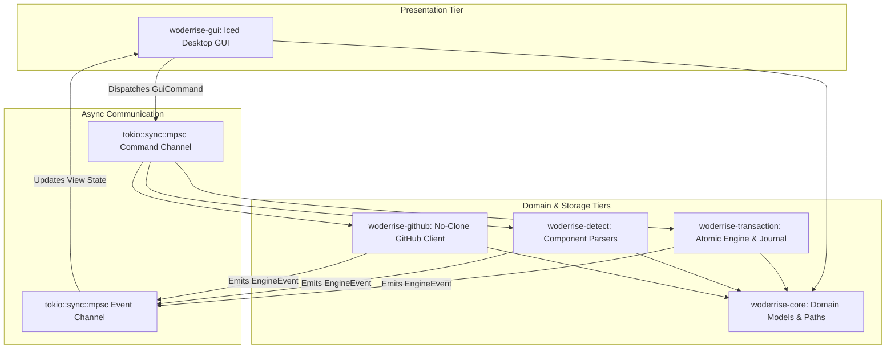

# Woderrise

> **A Lightweight, GitHub-Powered Linux Desktop Configuration Store with a Native Graphical GUI in Rust**

[](https://www.gnu.org/licenses/gpl-3.0)
[](https://www.rust-lang.org)
[](https://wayland.freedesktop.org)
[](https://hyprland.org)

---

## 1. Overview

**Woderrise** is an open-source, graphical desktop store and declarative dotfile manager engineered in Rust for modern Linux Wayland environments—with initial first-class support for the [Hyprland](https://hyprland.org) desktop ecosystem (including Waybar, Hyprlock, Hypridle, Hyprpaper/wallpaper engines, Hyprcursor, and GTK/icon themes).

Linux desktop customization ("ricing") has traditionally been a high-friction, error-prone endeavor: users clone multi-gigabyte GitHub repositories, run unvetted shell scripts with broad privileges, manually copy files into `~/.config`, and risk catastrophic, unrecoverable configuration overwrites. When a community rice breaks their desktop, reverting the changes often requires painstaking manual troubleshooting or full filesystem snapshots.

Woderrise redefines this experience by delivering the polished, discoverable, and safe package discovery UX of modern app centers (such as **Snap Store** and **GNOME Software**) tailored specifically for dotfiles:
- **Discover**: Browse curated community setups, status bars, lock screens, and wallpapers in a responsive card grid with debounced search, star counts, and author badges.
- **Inspect**: Review screenshots in an interactive carousel, read rendered Markdown `README` documentation, browse the remote directory tree without cloning, and preview syntax-highlighted diffs against your current local configurations.
- **Install Declaratively**: Execute safe, one-click installations backed by a 4-phase atomic transaction engine that validates paths, forbids arbitrary script execution, creates automatic backup snapshots, and applies changes via atomic file swaps.
- **Rollback Confidently**: Every transaction is recorded in a persistent journal. If an installed theme does not suit your aesthetic or introduces an issue, click **Rollback** in the history view to instantly restore your previous configurations.

---

## 2. Key Architectural Guarantees

| The Traditional Dotfile Nightmare | The Woderrise Solution |
| :--- | :--- |
| **Monolithic Git Clones**: Cloning 500MB–1GB repositories for a single config file wastes bandwidth and disk space. | **No-Clone GitHub API Pipeline**: Queries GitHub REST & Git Trees APIs (`recursive=1`), streaming only targeted config blobs by content-addressed SHA hashes (>98% bandwidth reduction). |
| **Silent, Irreversible Overwrites**: Setup scripts overwrite `~/.config/` files with zero pre-flight backups. | **Automatic Pre-Install Snapshots**: Creates full local backups in `~/.local/state/woderrise/backups/` before any file is touched. |
| **Arbitrary Shell Script Execution**: `curl ... \| bash` installers execute untrusted code with full user or root permissions. | **Zero Arbitrary Script Execution**: Configurations are treated as pure declarative assets; shell scripts (`install.sh`) are strictly prohibited. |
| **Corrupted Partial Writes**: An interrupted install or power loss leaves half-written, broken configuration files. | **4-Phase Atomic Swaps**: Writes to temporary sibling files (`<file>.woderrise_tmp`), syncs to disk (`fsync`), and atomically swaps via `std::fs::rename`. |
| **All-or-Nothing Monoliths**: Adopting a bar theme forces adopting the author's window manager keybindings and terminal configs. | **Independent Component Lifecycle**: Modular detection permits cherry-picking individual components (e.g. only Waybar or only Hyprlock) without unwanted changes. |
| **Synthetic Demo Data & Fake Stores**: Tools often rely on hardcoded dummy catalogs or mocked mockups. | **Exclusively Real-World Data**: Production builds query live GitHub repositories only; zero fabricated packages exist in production. |

---

## 3. High-Level Architecture & Crate Ecosystem

Woderrise is architected as a modular Rust Cargo workspace consisting of 5 decoupled crates, guaranteeing strict separation of concerns, zero circular dependencies, and 100% headless testability:

```
woderrise/
├── crates/
│   ├── woderrise-core/              # Domain models, path sanitization, error taxonomy (headless)
│   ├── woderrise-github/            # GitHub REST client, Git Trees parser, ETag cache, rate limiter
│   ├── woderrise-detect/            # Dotfile component detectors (Hyprland conf/lua, Waybar, etc.)
│   ├── woderrise-transaction/       # Staging sandbox, backup snapshot engine, atomic swapper, journal
│   └── woderrise-gui/               # Native Iced (v0.14+) desktop GUI presentation layer
└── src/
    └── main.rs                      # Binary entrypoint: runtime bootstrap and signal orchestration
```



### Crate Responsibilities

1. **`woderrise-core`**:
   - Pure domain models (`PackageMetadata`, `ConfigComponent`, `TargetMapping`, `JournalEntry`).
   - Unified error hierarchy (`WoderriseError`) using `thiserror`.
   - Safe path normalization and traversal containment checkers using `camino::Utf8Path`.
2. **`woderrise-github`**:
   - Direct integration with GitHub's REST API and Git Trees API (`recursive=1`).
   - Content-addressed raw blob streaming by blob SHA (`Accept: application/vnd.github.raw`).
   - Rate limit defenses: `If-None-Match` (ETag) conditional caching (returns `HTTP 304 Not Modified` with zero rate limit decrement), header tracking (`x-ratelimit-remaining`), exponential backoff, and optional Personal Access Token (PAT) support.
   - Enforces exclusively live, real-world data.
3. **`woderrise-detect`**:
   - Independent component classification and syntax validation:
     - **Hyprland**: Legacy block/directive syntax (`hyprland.conf`) and modern Lua syntax (`hyprland.lua`).
     - **Waybar**: JSONC configurations (`config.jsonc`) and GTK CSS (`style.css`).
     - **Hyprlock & Hypridle**: Hyprland block directives (`background`, `input-field`, `listener`).
     - **Hyprpaper & Wallpapers**: Wallpaper directives and image assets with path remapping.
     - **Hyprcursor**: Cursor theme structures and `manifest.hl`.
     - **GTK 3/4 & Icons**: `settings.ini` and FreeDesktop `index.theme`.
4. **`woderrise-transaction`**:
   - Sandboxed staging workspace (`$XDG_CACHE_HOME/woderrise/staging/<tx_id>/`).
   - Security auditing: blocks directory traversal (`..`), denies arbitrary script execution, and validates symlink containment.
   - Pre-installation snapshot backup engine (`$XDG_STATE_HOME/woderrise/backups/<tx_id>/`).
   - 4-phase atomic file replacement using temporary sibling files and `std::fs::rename`.
   - Persistent transaction journal (`$XDG_DATA_HOME/woderrise/journal.json`) with advisory file locks (`fs2`).
   - Startup crash recovery engine that automatically restores snapshots if a prior transaction was interrupted.
5. **`woderrise-gui`**:
   - Native desktop GUI built on **`iced` (v0.14+)** using `winit` for native Wayland protocols (`xdg-shell`, `fractional-scale-v1`), subpixel font rendering, and `AccessKit` accessibility.
   - Secondary architecture option documented: `relm4` (v0.11+) + Libadwaita for GNOME HIG compliance.
   - Package discovery experience: card grids, category tabs, debounced search (300ms + cancellation tokens), hero banners, screenshot carousel, two-column split-pane inspect view, Markdown rendering, syntax-highlighted diffs, installation progress, and rollback history.
   - Dynamic system dark/light mode tracking via XDG Desktop Portal (`ashpd`).

---

## 4. End-to-End System Walkthrough

To understand how Woderrise operates from the moment a user launches the application to inspecting, installing, and rolling back a configuration, follow this comprehensive walkthrough:

```
[ 1. Discovery ]          [ 2. Inspection ]           [ 3. Staging & Audit ]       [ 4. Atomic Install ]       [ 5. Rollback ]
 User searches /           User inspects card;         Target blobs downloaded      Pre-install snapshot        User clicks Rollback;
 filters by category.      Woderrise fetches tree      to sandbox; hashes and       backed up; atomic swap      snapshot atomically
 ETag cached query         & renders Markdown          paths verified; scripts      via rename(); compositor    restored; journal
 returns card grid.        README & syntax diff.       rejected.                    reloaded; journal logged.   updated.
```

### Phase 1: Search & Discovery
1. The user opens Woderrise. The application reads `$XDG_DATA_HOME/woderrise/catalog.json` and connects to GitHub API.
2. The user types a query (e.g. `catppuccin`) into the search bar or clicks a category filter pill (`Waybar`).
3. The GUI applies a 300ms debounce timer. If the user continues typing, active search tasks are canceled immediately via `tokio_util::sync::CancellationToken`, preserving API rate limits.
4. The background Tokio worker issues a query to GitHub's Search API (`GET /search/repositories?q=topic:hyprland-dotfiles+catppuccin`) with `If-None-Match: <etag>`.
5. If GitHub returns `HTTP 304 Not Modified`, cached results are returned instantly with zero rate limit penalty. If `HTTP 200`, the fresh JSON results are parsed, stored in the cache, and rendered in the GUI as responsive repository cards displaying star counts, author handles, preview banners, and detected component badges.

### Phase 2: Inspection & Remote Tree Resolution
1. The user clicks **Inspect** on a repository card (e.g. `prasanthrangan/hyprdots`).
2. Woderrise issues a single Git Trees API request: `GET /repos/{owner}/{repo}/git/trees/{default_branch}?recursive=1`.
3. In a single JSON payload (<200 KB), Woderrise receives the complete file hierarchy, including file modes, blob SHAs, and sizes.
4. `woderrise-detect` scans the tree in memory:
   - Identifies `Configs/.config/hypr/hyprland.conf` as a legacy Hyprland configuration.
   - Identifies `Configs/.config/waybar/config.jsonc` and `style.css` as a Waybar theme.
5. In the background, Woderrise fetches `README.md` and screenshot image assets from the repository.
6. The GUI transitions to the **Split-Pane Inspect View**:
   - **Left Pane**: Repository metadata, license, detected component checklist, and action buttons.
   - **Right Pane**: Tab 1 displays the fully rendered Markdown `README.md`; Tab 2 displays the remote file tree browser; Tab 3 displays the **Diff Viewer**.
7. When the user clicks **Preview Diff**, Woderrise downloads the target blob by SHA, reads the user's current local file (e.g. `~/.config/hypr/hyprland.conf`), and computes a syntax-highlighted Myers diff displaying exact additions and removals before any disk changes occur.

### Phase 3: Sandboxed Staging & Security Audit
1. The user selects the components they wish to install (e.g. checking `[x] Waybar Theme` while leaving `[ ] Hyprland Config` unchecked) and clicks **Install Selected**.
2. Woderrise generates a unique transaction ID (e.g. `tx_20261027_141500_waybar_7d8e9f`) and creates an isolated staging sandbox under `$XDG_CACHE_HOME/woderrise/staging/<tx_id>/`.
3. The engine downloads only the required blobs directly from GitHub using content-addressed blob URLs (`GET /repos/{owner}/{repo}/git/blobs/{sha}` with `Accept: application/vnd.github.raw`).
4. **The Security Audit Executes**:
   - **Zero Script Execution**: Verifies no shell scripts (`.sh`), binaries, or executable permissions exist in the staged target set.
   - **Path Traversal Containment**: Validates that every relative destination path stays strictly within the component's designated root (`$XDG_CONFIG_HOME/waybar/`). Any path with `..` or absolute prefixes is rejected.
   - **Symlink Safety**: Rejects any symlinks referencing paths outside the sandbox.
   - **Cryptographic Verification**: Computes SHA-256 hashes of all staged files and records them in `staging/<tx_id>/manifest.json`.

### Phase 4: 4-Phase Atomic Swap & Compositor Reload
1. The user reviews the staging report modal and confirms the installation.
2. **Phase 2 (Backup Snapshot)**: The engine identifies all existing files in `~/.config/waybar/` that will be replaced. It creates an exact pre-installation backup snapshot under `$XDG_STATE_HOME/woderrise/backups/<tx_id>/` and records pre-install SHA-256 hashes.
3. **Phase 3 (Atomic Replacement)**: For each file:
   - Writes the new file into the destination directory as `<filename>.woderrise_tmp`.
   - Calls `fsync()` to ensure the data is physically flushed to storage.
   - Calls `std::fs::rename()` to atomically replace the target file. (On POSIX filesystems, `rename` is atomic, eliminating the possibility of half-written files).
4. **Phase 4 (Commit & Notification)**:
   - Appends an entry marked `Committed` to `$XDG_DATA_HOME/woderrise/journal.json`.
   - Cleans up the ephemeral staging directory.
   - Dispatches desktop reload signals: issues `pkill -SIGUSR2 waybar` or `hyprctl reload`.
5. The GUI displays an installation success banner featuring an immediate `[ Rollback ]` action button.

### Phase 5: 1-Click Rollback & Startup Crash Recovery
1. **User-Initiated Rollback**:
   - If the user navigates to the **History View** and clicks **Rollback This Transaction**:
   - The engine marks the transaction as `RollingBack` in `journal.json`.
   - Atomically restores all files from `$XDG_STATE_HOME/woderrise/backups/<tx_id>/` back into `~/.config/waybar/`.
   - Deletes any newly created files that did not exist before the transaction.
   - Triggers desktop service reload (`pkill -SIGUSR2 waybar`).
   - Updates transaction status to `RolledBack`. The desktop returns to its exact prior state.
2. **Crash Recovery**:
   - If the system loses power or the process is killed mid-write, the next time Woderrise launches, its startup recovery scanner reads `journal.json`.
   - If a transaction is found in an uncommitted `Applying` or `RollingBack` state, Woderrise automatically restores the pre-installation backup snapshot and alerts the user, guaranteeing zero persistent desktop corruption.

---

## 5. Local Storage Footprint (XDG Compliant)

Woderrise maintains an ultra-lightweight local storage footprint conforming strictly to the FreeDesktop XDG specification:

```
$XDG_CONFIG_HOME/woderrise/
└── settings.json                    # (<10 KB) User preferences, optional GitHub PAT token, UI theme

$XDG_DATA_HOME/woderrise/
├── catalog.json                     # (<500 KB) Repository metadata link catalog and cached tree SHAs
└── journal.json                     # (<2 MB) Persistent transaction history and rollback records

$XDG_CACHE_HOME/woderrise/
└── staging/                         # Ephemeral download sandbox (cleaned after install/abort)
    └── <tx_id>/
        ├── manifest.json
        └── staged_files/

$XDG_STATE_HOME/woderrise/
└── backups/                         # Pre-install snapshots enabling 1-click rollback
    └── <tx_id>/
        └── original_files/
```

---

## 6. Security Boundaries

Woderrise is built with defense-in-depth principles:
- **No Arbitrary Script Execution**: Strictly rejects executing `install.sh`, `setup.sh`, bootstrap hooks, or Python scripts. Packages requiring procedural execution to generate configs are flagged as unsupported.
- **Strict Path Canonicalization**: Every target path is checked via `path.starts_with(allowed_component_root)`. Traversal attempts (`../`) are aborted immediately.
- **Symlink Containment**: Git symlinks (`mode 120000`) pointing outside the component root or targeting system files (`/etc`, `~/.ssh`) are strictly prohibited. Safe internal symlinks are converted to regular file copies during staging.
- **Bounded Resource Usage**: File size caps (max 10MB per config file, max 50MB per wallpaper) and network stream timeouts prevent denial-of-service vulnerabilities.
- **Unprivileged Execution**: The GUI and engine run completely unprivileged in the user session. No root or `sudo` permissions are ever requested or required.

---

## 7. Phased Implementation Roadmap

Woderrise is being delivered across 5 structured milestones. **Each milestone defines strict acceptance criteria and requires staging, committing, and pushing changes to `origin/main` upon completion.**

| Milestone | Scope | Deliverables & Acceptance Criteria | Status |
| :--- | :--- | :--- | :--- |
| **Stage 0** | **Architectural Proposal & Documentation** | Git identity setup, main checkout tracking origin/main, author `docs/DESIGN_PROPOSAL.md` (all 12 sections), author comprehensive `README.md`, commit and push to `origin/main`. Zero code scaffolding. | **COMPLETE** |
| **Milestone 1** | **Core Domain & GitHub API Pipeline** | Implement `woderrise-core` (domain models, paths, errors) and `woderrise-github` (Reqwest client, Git Trees recursive parser, raw blob downloader, ETag 304 cache, rate limit monitor, token auth). 100% real-world data policy. Offline WireMock tests. Commit & push to `origin/main`. | Planned |
| **Milestone 2** | **Component Detection & Transaction Engine** | Implement `woderrise-detect` (Hyprland legacy & Lua, Waybar JSONC/CSS, Hyprlock, Hypridle, wallpapers, GTK) and `woderrise-transaction` (sandboxed staging, path security audit, pre-install snapshots, atomic swap via `rename`, persistent `journal.json`, crash recovery). Commit & push to `origin/main`. | Planned |
| **Milestone 3** | **Full Desktop GUI & Snap Store UX** | Implement `woderrise-gui` in pure Rust with Iced (v0.14+). Responsive card grid, debounced search with cancellation tokens, category filters, hero banners, screenshot carousel, two-column inspect view, rendered Markdown README, syntax-highlighted diffs, progress modal, and rollback history view. Portal dark theme. Commit & push to `origin/main`. | Planned |
| **Milestone 4** | **End-to-End Hardening & Release** | Binary entrypoint `src/main.rs`, runtime bootstrap, signal handling, comprehensive end-to-end integration test suite, offline deterministic tests, CI workflows, and release preparation. Commit & push to `origin/main`. | Planned |

---

## 8. Detailed Architectural Documentation

For an exhaustive, production-grade breakdown of all system subsystems, schemas, component heuristics, and transaction state machines, refer to the full architectural design proposal:
- 📖 **[docs/DESIGN_PROPOSAL.md](docs/DESIGN_PROPOSAL.md)** — Complete 12-section architectural design proposal covering goals, workflows, Iced GUI architecture, crate ecosystem, GitHub discovery, real-world data policy, JSON schemas, component detection matrix, 4-phase atomic swap, security boundaries, and phased roadmap.

---

## 9. License

Woderrise is licensed under the **GNU General Public License v3.0 (GPL-3.0)**. See [LICENSE](LICENSE) for details.
