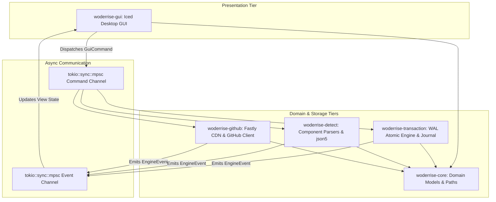

# Woderrise

> **A Lightweight, GitHub-Powered Linux Desktop Configuration Store with a Native Graphical GUI in Rust**

[](Cargo.toml)
[](https://www.rust-lang.org)
[](https://wayland.freedesktop.org)
[](https://hyprland.org)

---

## 1. Overview

**Woderrise** is an open-source, graphical desktop store and declarative dotfile manager engineered in Rust for modern Linux Wayland environments—with initial first-class support for the [Hyprland](https://hyprland.org) desktop ecosystem (including Waybar, Hyprlock, Hypridle, Hyprpaper/wallpaper engines, Hyprcursor, and GTK/icon themes).

Linux desktop customization ("ricing") has traditionally been a high-friction, error-prone endeavor: users clone multi-gigabyte GitHub repositories, run unvetted shell scripts with broad privileges, manually copy files into `~/.config`, and risk catastrophic, unrecoverable configuration overwrites. When a community rice breaks their desktop, reverting the changes often requires painstaking manual troubleshooting or full filesystem snapshots.

Woderrise redefines this experience by delivering the polished, discoverable, and safe package discovery UX of modern app centers (such as **Snap Store** and **GNOME Software**) tailored specifically for dotfiles:
- **Discover**: Browse curated community setups, status bars, lock screens, and wallpapers in a responsive card grid with debounced search, star counts, and author badges.
- **Inspect**: Review screenshots in an interactive carousel, read rendered Markdown `README` documentation, browse the remote directory tree without cloning, and preview syntax-highlighted diffs against your current local configurations.
- **Install Declaratively**: Execute safe, one-click installations backed by a 4-phase atomic transaction engine that validates paths, forbids arbitrary script execution, creates automatic backup snapshots, and applies changes via atomic file swaps.
- **Rollback Confidently**: Every transaction is recorded in a persistent journal. If an installed theme does not suit your aesthetic or introduces an issue, click **Rollback** in the history view to instantly restore your previous configurations.

---

## 2. Key Architectural Guarantees

| The Traditional Dotfile Nightmare | The Woderrise Solution |
| :--- | :--- |
| **Monolithic Git Clones**: Cloning 500MB–1GB repositories for a single config file wastes bandwidth and disk space. | **No-Clone GitHub & Fastly CDN Pipeline**: Queries GitHub REST & Git Trees APIs (`recursive=1`), streaming targeted config files via commit-pinned Fastly CDN raw endpoints (`raw.githubusercontent.com`, consuming 0 REST quota) with content-addressed SHA verification (>98% bandwidth reduction). |
| **Silent, Irreversible Overwrites**: Setup scripts overwrite `~/.config/` files with zero pre-flight backups. | **Automatic Pre-Install Snapshots**: Creates full local backups in `~/.local/state/woderrise/backups/` before any file is touched. Preserves hardware display configs (`monitors.conf`) by default. |
| **Arbitrary Shell Script Execution**: `curl ... \| bash` installers execute untrusted code with full user or root permissions. | **Zero Arbitrary Script Execution & Procedural Auditing**: Configurations are pure declarative assets; scripts (`install.sh`, `sh script.sh`) are prohibited; inline commands (`exec-once`, `exec`, `on-click`) are audited and neutralized by default; compositor reloads are security-gated. |
| **Corrupted Partial Writes**: An interrupted install or power loss leaves half-written, broken configuration files. | **4-Phase Atomic Swaps with WAL & Durability**: Writes Write-Ahead Log (WAL) to `journal.json` as `"Applying"`, stream-copies to sibling temporary files (`<file>.woderrise_tmp`, preventing `EXDEV`), syncs (`fsync`), atomically swaps via `std::fs::rename`, and commits parent directory `fsync`. |
| **All-or-Nothing Monoliths**: Adopting a bar theme forces adopting the author's window manager keybindings and terminal configs. | **Independent Component Lifecycle**: Modular detection permits cherry-picking individual components (e.g. only Waybar or only Hyprlock) without unwanted changes. |
| **Synthetic Demo Data & Fake Stores**: Tools often rely on hardcoded dummy catalogs or mocked mockups. | **Exclusively Real-World Data**: Production builds query live GitHub repositories only; zero fabricated packages exist in production. |

---

## 3. High-Level Architecture & Crate Ecosystem

Woderrise is architected as a modular Rust Cargo workspace consisting of 5 decoupled crates, guaranteeing strict separation of concerns, zero circular dependencies, and 100% headless testability:

```
woderrise/
├── crates/
│   ├── woderrise-core/              # Domain models, path sanitization, error taxonomy (headless)
│   ├── woderrise-github/            # GitHub REST client, Fastly CDN streamer, Git Trees parser, in-memory TTL cache, rate limiter
│   ├── woderrise-detect/            # Dotfile component detectors (Hyprland conf/lua, json5 Waybar, hardware protection)
│   ├── woderrise-transaction/       # Staging sandbox, WAL, backup snapshot engine, atomic swapper, journal, LIFO rollback
│   └── woderrise-gui/               # Native Iced (v0.14+) desktop GUI presentation layer
└── src/
    └── main.rs                      # Binary entrypoint: runtime bootstrap and signal orchestration
```



### Crate Responsibilities

1. **[`woderrise-core`](crates/woderrise-core/README.md)**:
   - Pure domain models (`PackageMetadata`, `ConfigComponent`, `TargetMapping`, `JournalEntry`).
   - Unified error hierarchy (`WoderriseError`) using `thiserror`.
   - Safe path normalization and traversal containment checkers using `camino::Utf8Path`.
2. **[`woderrise-github`](crates/woderrise-github/README.md)**:
   - Direct integration with GitHub's REST API and Git Trees API (`recursive=1`).
   - Bulk dotfile streaming via commit-pinned Fastly CDN (`raw.githubusercontent.com/{owner}/{repo}/{commit_sha}/{path}`), consuming **0 REST API rate limit quota** (with `/git/blobs/{blob_sha}` fallback).
   - In-memory TTL cache (`moka` with 10-minute default TTL) so repeated views/refreshes make ZERO network requests (reflecting that unauthenticated 304s decrement quota by 1).
   - Two-tier search architecture with separate `X-RateLimit-Resource: search` pool monitoring (10 req/min unauthenticated, 30 req/min authenticated) and visual quota gauge.
   - Enforces exclusively live, real-world data.
3. **[`woderrise-detect`](crates/woderrise-detect/README.md)**:
   - Independent component classification, hardware protection, and syntax validation:
     - **Hyprland**: Legacy block/directive syntax (`hyprland.conf`) and modern Lua syntax (`hyprland.lua`), with explicit precedence rules and legacy deactivation handling (`hyprland.conf.disabled_by_woderrise`).
     - **Waybar**: JSONC configurations parsed with `json5` lexer (safely handling `//`, `/* */`, and trailing commas without regex string literal corruption of URLs) and GTK CSS (`style.css`).
     - **Hardware Protection**: Scans for display and hardware files (`monitors.conf`, `workspaces.conf`, `hardware.conf`), preserving local configurations by default with `[Preserve Local Display Config]` badges.
     - **Hyprlock & Hypridle**: Hyprland block directives (`background`, `input-field`, `listener`).
     - **Hyprpaper & Wallpapers**: Wallpaper directives and image assets with path remapping.
     - **Hyprcursor**: Cursor theme structures and `manifest.hl`.
     - **GTK 3/4 & Icons**: `settings.ini` and FreeDesktop `index.theme`.
4. **[`woderrise-transaction`](crates/woderrise-transaction/README.md)**:
   - Sandboxed staging workspace (`$XDG_CACHE_HOME/woderrise/staging/<tx_id>/`).
   - Security auditing: blocks directory traversal, forbids Git tree symlink objects (`mode 120000`, CVE-2021-21300 defense), resolves and preserves GNU Stow / Chezmoi target symlinks (`symlink_metadata`), and evaluates authentic permissions from Git Tree metadata (NTFS/FAT mount safe).
   - Procedural Execution Audit: indexes and neutralizes inline execution directives (`exec-once`, `exec`, `on-click`, `on-timeout`).
   - Pre-installation snapshot backup engine (`$XDG_STATE_HOME/woderrise/backups/<tx_id>/`).
   - Write-Ahead Logging (WAL) protocol writing `active_transaction: "Applying"` to `journal.json` before Phase 3 file swaps.
   - 4-phase atomic file replacement using stream copy (`std::io::copy`, eliminating cross-device `EXDEV` errors), `fsync`, atomic `rename`, and parent directory `fsync` durability commits.
   - Persistent transaction journal updated via atomic sibling writes (`journal.json.tmp` -> `rename`) with advisory file locks (`fs2`).
   - Startup crash recovery engine and linear LIFO rollback with dirty-state verification (`current_sha256 == post_sha256`) and empty directory cleanup.
5. **[`woderrise-gui`](crates/woderrise-gui/README.md)**:
   - Native desktop GUI built on **`iced` (v0.14+)** using `winit` for native Wayland protocols (`xdg-shell`, `fractional-scale-v1`), subpixel font rendering, and `AccessKit` accessibility.
   - Secondary architecture option documented: `relm4` (v0.11+) + Libadwaita for GNOME HIG compliance.
   - Package discovery experience: card grids, category tabs, debounced search (300ms + cancellation tokens), hero banners, screenshot carousel, two-column split-pane inspect view, Markdown rendering, syntax-highlighted diffs, installation progress, and rollback history.
   - Dynamic system dark/light mode tracking via XDG Desktop Portal (`ashpd`).

---

## 4. End-to-End System Walkthrough

To understand how Woderrise operates from the moment a user launches the application to inspecting, installing, and rolling back a configuration, follow this comprehensive walkthrough:

```
[ 1. Discovery ]          [ 2. Inspection ]           [ 3. Staging & Audit ]       [ 4. Atomic Install ]       [ 5. Rollback ]
 Two-tier search:          Inspect card; tree          Fastly CDN streaming (0 q);  Pre-install snapshot;       LIFO rollback;
 Tier 1 local filter;      scanned; hardware           permissions from tree;       WAL commit to journal;      dirty state check;
 Tier 2 remote with        protected; Markdown         scripts & inline commands    atomic rename & fsync;      snapshot restored;
 TTL cache & gauge.        README & diff.              audited & neutralized.       security-gated reload.      journal updated.
```

### Phase 1: Search & Discovery (Two-Tier Architecture)
1. The user opens Woderrise. The application automatically loads `$XDG_DATA_HOME/woderrise/catalog.json` (hydrated with 30 top real-world community configurations) and initializes the `moka` in-memory TTL cache.
2. The user types a query (e.g. `catppuccin`, `ml4`) into the search bar or clicks a category filter pill (`Waybar`, `Hyprlock`).
3. **Tier 1 (Instant In-Memory Filter)**: As the user types, Woderrise instantly filters the in-memory catalog across repository names, topics, and descriptions (0ms latency, zero network calls, zero rate limit consumption).
4. **Tier 2 (Explicit Remote GitHub Search)**: To search remote GitHub beyond the local catalog, pressing <kbd>Enter</kbd> or clicking **"Search GitHub"** explicitly queries GitHub's Search API (`GET /search/repositories?q=...`), preventing accidental rate-limit depletion from rapid keystrokes.
5. **In-Memory TTL Caching**: The engine checks the in-memory cache (10-minute default TTL). Within the TTL window, repeated searches return immediately without network access.
6. The GUI displays an active **Search Quota Gauge** tracking the dedicated `X-RateLimit-Resource: search` pool (10 req/min unauthenticated, 30 req/min authenticated).

### Phase 2: Inspection & Remote Tree Resolution
1. The user clicks **Inspect** on a repository card (e.g. `prasanthrangan/hyprdots`).
2. Woderrise issues a single Git Trees API request: `GET /repos/{owner}/{repo}/git/trees/{default_branch}?recursive=1` (<200 KB JSON payload).
3. `woderrise-detect` scans the tree in memory:
   - Identifies `Configs/.config/hypr/hyprland.conf` as legacy Hyprland configuration.
   - Identifies `Configs/.config/waybar/config.jsonc` as a Waybar theme, validating comments and URLs via `json5`.
   - Identifies `monitors.conf` as a **Hardware-Bound** configuration: automatically unchecks it by default with an informational badge: `[Preserve Local Display Config]`.
   - Identifies any Hyprland Lua syntax (`hyprland.lua`), preparing legacy deactivation if Lua is selected.
4. In the background, Woderrise fetches `README.md` and screenshot image assets via Fastly CDN.
5. The GUI transitions to the **Split-Pane Inspect View**:
   - **Left Pane**: Repository metadata, license, detected component checklist with hardware protection badges, and action buttons.
   - **Right Pane**: Tab 1 renders Markdown `README.md`; Tab 2 displays the remote tree browser; Tab 3 displays the **Diff Viewer**.
6. Clicking **Preview Diff** downloads the remote file via Fastly CDN, reads the local file, and computes a syntax-highlighted Myers diff.

### Phase 3: Sandboxed Staging & Security Audit
1. The user selects desired components (e.g. `[x] Waybar Theme`, leaving hardware `[ ] monitors.conf` preserved) and clicks **Install Selected**.
2. Woderrise creates an isolated staging sandbox under `$XDG_CACHE_HOME/woderrise/staging/<tx_id>/`.
3. **Fastly CDN Bulk Streaming**: The engine streams configuration files using commit-pinned raw URLs: `https://raw.githubusercontent.com/{owner}/{repo}/{commit_sha}/{path}` via Fastly CDN edge caching, consuming **zero GitHub REST API rate limit quota** (retaining `/git/blobs/{blob_sha}` as fallback).
4. **The Security Audit Executes**:
   - **Zero Script Execution & Interpreter Bypass**: Verifies no shell scripts (`.sh`, `.bash`, `.py`) or binaries exist.
   - **Procedural Execution Audit**: Extracts and catalogs inline commands (`exec-once`, `exec`, `on-click`, `on-timeout`); comments them out by default in staging; presents a Security Review dialog.
   - **Symlink Directory Traversal Prevention**: Rejects Git tree symlink objects (`mode 120000`) to prevent CVE-2021-21300 directory traversal.
   - **GNU Stow / Chezmoi Compatibility**: Inspects existing destination files via `symlink_metadata()`. If a symlink is detected, resolves the canonical target to avoid breaking dotfile manager links.
   - **Filesystem Permissions**: Evaluates modes from Git Tree metadata (`100644`), preventing NTFS/FAT `stat()` degradation (`core.filemode=false`).
   - **Cryptographic Verification**: Computes SHA-256 hashes of all staged files and records them in `staging/<tx_id>/manifest.json`.

### Phase 4: 4-Phase Atomic Swap with WAL & Security-Gated Reload
1. The user reviews the staging report and confirms installation.
2. **Phase 2 (Backup Snapshot)**: Identifies existing files in target directories, copies them to `$XDG_STATE_HOME/woderrise/backups/<tx_id>/`, and records pre-installation SHA-256 hashes.
3. **Write-Ahead Logging (WAL)**: Before file swaps begin, atomically writes `active_transaction: { id, status: "Applying", backup_dir, operations }` to `journal.json` using temporary sibling file write (`journal.json.tmp`), calls `fsync()`, and renames via `std::fs::rename()`.
4. **Phase 3 (Atomic Replacement & Durability)**: For each file:
   - Stream-copies data from staging into `<filename>.woderrise_tmp` in the target directory via `std::io::copy()`, eliminating cross-device `EXDEV` errors.
   - Calls `fsync()` on the temporary file descriptor to flush data to storage.
   - Calls `std::fs::rename()` to atomically replace the target file.
   - Calls `fsync()` on the parent directory descriptor (`File::open(parent_dir)?.sync_all()?`) ensuring directory entry durability across sudden power loss.
5. **Phase 4 (Commit & Security-Gated Reload)**:
   - Atomically updates `journal.json`: transitions `active_transaction` to `null` and appends `Committed` to `transactions`.
   - Cleans up ephemeral staging directory.
   - Security-Gated Reload: If procedural commands were reviewed, prompts user for opt-in confirmation before dispatching reload signals (`pkill -SIGUSR2 waybar`, `hyprctl reload`); suppresses automatic reload.
6. The GUI displays an installation success banner featuring an immediate `[ Rollback ]` action button.

### Phase 5: 1-Click Rollback & Startup Crash Recovery
1. **User-Initiated Rollback (LIFO Stack & Dirty State)**:
   - Navigates to **History View** and clicks **Rollback This Transaction**.
   - **LIFO Validation**: Checks that transactions are undone in reverse chronological order.
   - **Dirty State Verification**: Compares `current_sha256 == post_sha256`. If user modified files post-install, displays a **Dirty State Warning** with diff, offering safety backup.
   - Marks transaction as `RollingBack` in `journal.json` via WAL.
   - Atomically restores all files from `$XDG_STATE_HOME/woderrise/backups/<tx_id>/`.
   - Deletes newly created files and prunes empty parent directories.
   - Restores any deactivated legacy configs (`hyprland.conf.disabled_by_woderrise` -> `hyprland.conf`).
   - Dispatches compositor reload signal (`hyprctl reload`).
   - Updates transaction status to `RolledBack`. The desktop returns to its exact prior state.
2. **Startup Crash Recovery (WAL Engine)**:
   - If power was cut or process was killed mid-write, the startup recovery scanner inspects `journal.json`.
   - If an `active_transaction` is found in `"Applying"` or `"RollingBack"` status, Woderrise automatically restores the pre-installation backup snapshot and alerts the user, guaranteeing zero persistent corruption.

---

## 5. Local Storage Footprint (XDG Compliant)

Woderrise maintains an ultra-lightweight local storage footprint conforming strictly to the FreeDesktop XDG specification:

```
$XDG_CONFIG_HOME/woderrise/
└── settings.json                    # (<10 KB) User preferences, optional GitHub PAT token, UI theme

$XDG_DATA_HOME/woderrise/
├── catalog.json                     # (<500 KB) Repository metadata link catalog and cached tree SHAs
└── journal.json                     # (<2 MB) Persistent transaction history and rollback records

$XDG_CACHE_HOME/woderrise/
└── staging/                         # Ephemeral download sandbox (cleaned after install/abort)
    └── <tx_id>/
        ├── manifest.json
        └── staged_files/

$XDG_STATE_HOME/woderrise/
└── backups/                         # Pre-install snapshots enabling 1-click rollback
    └── <tx_id>/
        └── original_files/
```

---

## 6. Security Boundaries

Woderrise is built with defense-in-depth principles:
- **Zero Arbitrary Script Execution & Interpreter Bypass**: Strictly rejects running `install.sh`, `setup.sh`, bootstrap binaries, or Python scripts. Evaluates all procedural script files as active code regardless of permission bits (`0644`). Extracts, indexes, and neutralizes inline execution directives (`exec-once`, `exec`, `on-click`, `on-timeout`) by default in staging, and gates compositor reloads behind explicit user opt-in.
- **Strict Path Canonicalization & Component Root Pinning**: Every target path is checked via `path.starts_with(allowed_component_root)` with roots strictly pinned per component (e.g. `~/.config/hypr/` for Hyprland, `~/.config/waybar/` for Waybar). Any traversal attempts (`..`, null bytes, or attempts to write to generic `autostart/` or `systemd/user/`) are aborted immediately.
- **Symlink Traversal Protection (CVE-2021-21300) & GNU Stow / Chezmoi Preservation**: Forbids Git tree symlink objects (`mode 120000`) in untrusted packages to eliminate directory traversal vulnerabilities. Detects existing user symlinks on the host via `std::fs::symlink_metadata()` to resolve canonical targets and preserve GNU Stow / Chezmoi setups.
- **Filesystem Permission Resilience (NTFS / FAT)**: On NTFS/FAT mounts (`core.filemode=false`), host `stat()` degenerates to `0755`. Woderrise derives file modes and executability strictly from Git Tree metadata (`100644`), preventing false-positive security alarms.
- **Crash Consistency (WAL) & Durability**: Mandates Write-Ahead Logging in `journal.json` before Phase 3 file swaps, uses stream copy (`std::io::copy`) into target sibling temporary files to eliminate cross-device `EXDEV` errors, and commits directory changes via parent directory `fsync`.
- **Bounded Resource Usage**: File size caps (max 10MB per config file, max 50MB per wallpaper) and network stream timeouts prevent denial-of-service vulnerabilities.
- **Unprivileged Execution**: The GUI and engine run completely unprivileged in the user session. No root or `sudo` permissions are ever requested or required.

---

## 7. Implementation Status & Milestones

Woderrise is organized across disciplined milestones. All 5 core workspace crates are implemented, thoroughly tested with a 100% test pass rate, and actively maintained:

| Milestone | Scope | Deliverables & Acceptance Criteria | Status |
| :--- | :--- | :--- | :---: |
| **Milestone 0** | **Architectural Proposal & Taxonomy** | 41-document specification suite, STRIDE threat model, JSON Schemas for catalog, manifest, and journal. | **COMPLETE** |
| **Milestone 1** | **Core Domain & GitHub API Pipeline** | `woderrise-core` & `woderrise-github`: Domain models, XDG path containment, Fastly CDN blob streaming (0 REST quota), ETag 304 caching, and proactive rate limit tracking. | **COMPLETE** |
| **Milestone 2** | **Component Detection & Transaction Engine** | `woderrise-detect` & `woderrise-transaction`: 7-component detection engine, hardware display config preservation, 4-phase atomic swap, WAL journal, and LIFO rollback. | **COMPLETE** |
| **Milestone 3** | **Native Desktop GUI & Snap Store UX** | `woderrise-gui`: Native Iced (v0.14+) desktop app. Discover screen with 30 real-world setups, category filter pills, inspect view, Myers diff viewer, and rollback history. | **COMPLETE** |
| **Milestone 4** | **End-to-End Hardening & Testing** | Binary entrypoint `src/main.rs`, 100% test pass rate across unit, integration, and adversarial suites in all 5 crates, and 0 clippy warnings. | **COMPLETE** |
| **Milestone 5** | **Cross-Screen E2E GUI Hardening** | 10 comprehensive cross-screen integration tests covering all 4 screens, lifecycle safety invariants, and LIFO rollback chains. | **COMPLETE** |
| **Milestone 6** | **Discovery Engine & Curation Feed** | Eager background tree inspection for instant card badges, multi-topic aggregation (100+ setups), keyring-backed GitHub PAT settings dialog, and fuzzy typo-tolerant search. | **COMPLETE** |
| **Milestone 7** | **High-Fidelity Inspection & Installation** | Screen 2 redesign matching production specification: screenshot carousel, interactive thumbnails, metadata matrix, recent files strip, rich component cards, and installation summary CTA. | **ACTIVE / NEXT** |

---

## 8. Quick Start

### Prerequisites
- **Rust 1.88+** (`curl --proto '=https' --tlsv1.2 -sSf https://sh.rustup.rs | sh`)
- Linux desktop running a Wayland compositor (e.g. [Hyprland](https://hyprland.org))

### Build & Run
```bash
# Clone the repository
git clone https://github.com/vijaygovindBiju/Woderrise.git
cd Woderrise

# Launch the native desktop application
cargo run

# Run the complete test suite across all 5 workspace crates
cargo test --workspace

# Run static linter
cargo clippy --workspace --all-targets -- -D warnings
```

---

## 9. Detailed Architectural Documentation

For an exhaustive, production-grade breakdown of all system subsystems, schemas, component heuristics, and transaction state machines, refer to the full architectural design proposal and task backlogs:
- 📖 **[docs/DESIGN_PROPOSAL.md](docs/DESIGN_PROPOSAL.md)** — Complete 12-section architectural design proposal covering workflows, Iced GUI architecture, crate ecosystem, GitHub discovery, component detection matrix, 4-phase atomic swap, and security boundaries.
- 📋 **[docs/TODO.md](docs/TODO.md)** — Actionable engineering task backlog and next iteration roadmap.
- 🗺️ **[docs/ROADMAP.md](docs/ROADMAP.md)** — Project roadmap and long-term delivery milestones.

---

## 10. License

Woderrise is licensed under the **MIT License**. See [`Cargo.toml`](Cargo.toml) for details.
