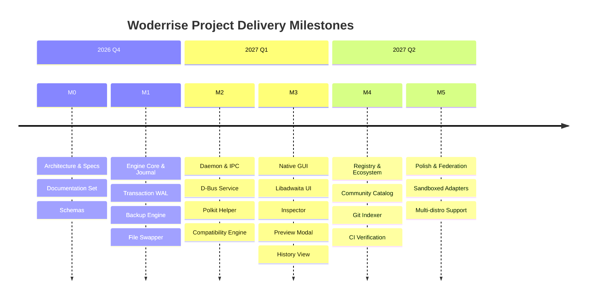

# Woderrise

> **The Universal, Community-Driven Store and Package Manager for the Hyprland Desktop Ecosystem**

---

## 1. Overview

**Woderrise** is an open-source, graphical desktop store and declarative package engine engineered specifically for the [Hyprland](https://hyprland.org) Wayland compositor and modern Linux desktops.

Linux desktop customization ("ricing") has historically suffered from high fragmentation: users must clone unvetted GitHub repositories, manually copy dotfiles into `$HOME/.config`, execute obscure bash scripts, manually resolve missing binary dependencies, and risk catastrophic configuration overwrites. When a rice or theme breaks their setup, recovery is often impossible without manual git rescues or entire filesystem restore points.

Woderrise transforms this workflow into an intuitive, modern application store experience:
1. **Discover**: Browse curated setups, wallpapers, Waybar themes, launchers, widgets, and Hyprland plugins.
2. **Inspect**: Review screenshots, examine exact configuration diffs, verify author signatures, and inspect dependencies before installing.
3. **Install**: Execute safe, declarative, one-click installations backed by an atomic Write-Ahead Log (WAL) transaction engine.
4. **Rollback**: Every change is backed up and journaled. If an installation introduces an issue or doesn't meet expectations, click **Rollback** to restore your previous configuration state safely.

---

## 2. Project Status

| Area | Status | Notes |
| :--- | :--- | :--- |
| **System Architecture & Technical Specs** | ✅ **Documented** | Full architectural blueprints, data models, IPC, and security specifications completed. |
| **Package Manifest & Schema Specs** | ✅ **Documented** | Manifest v1 specification with JSON schemas and examples established. |
| **Installation Engine Core** | 🟡 **Planned (Milestone 1)** | Core transaction engine, SQLite WAL journaling, and rollback implementation pending. |
| **D-Bus Daemon (`woderised`)** | 🟡 **Planned (Milestone 2)** | System/session IPC broker and privilege isolation pending. |
| **Terminal Frontend (`woderrise-gui`)** | ✅ **Available** | Ratatui + Crossterm terminal interface for catalog and package workflows. |
| **Community Registry & Indexer** | 🟡 **Planned (Milestone 4)** | Git-backed, content-addressed package registry pending. |

> [!NOTE]
> **Current Phase: Documentation & Architectural Foundation.**
> No application source code has been committed yet. This repository currently hosts the complete technical specification to enable reliable, incremental implementation.

---

## 3. The Problem Solved

| The Traditional Dotfile Nightmare | The Woderrise Solution |
| :--- | :--- |
| **Silent Overwrites**: Scripts copy files directly into `~/.config/`, clobbering existing customizations without warning. | **Atomic Backups & Ownership**: Automatic content-addressed backups prior to writes; strict file ownership prevents silent overwrites. |
| **Arbitrary Shell Execution**: `curl ... \| bash` installers run with unvetted permissions, risking security and stability. | **Declarative Manifests**: Packages declare artifacts, target paths, and merge rules declaratively; scripts are restricted and isolated. |
| **Irreversible Failures**: Mid-script failure leaves the desktop in an unbootable or partially configured state. | **Crash-Consistent Rollback**: Write-Ahead Journaling (WAL) tracks all operations; failed installs roll back automatically. |
| **Monolithic All-or-Nothing Rices**: Full desktop setups require adopting an entire configuration suite wholesale. | **Modular Composition**: Unified package model supports everything from a single wallpaper or Waybar theme to full desktop setups. |
| **Plugin ABI Breakages**: Hyprland C++ plugin updates crash Hyprland if binary headers mismatch. | **ABI Compatibility Checks**: Built-in compatibility engine validates Hyprland version and commit hash before loading plugins. |

---

## 4. Key Architectural Guarantees

- **Declarative Operations**: File placements, symlinks, Hyprland configuration injections, and service triggers are declared in structured YAML manifests validated against strict schemas.
- **Inspectability First**: Users can inspect exact file diffs, system packages, required permissions, and author provenance before touching the disk.
- **Persistent Transaction Journal**: Every install, update, and removal is recorded with millisecond timestamps, file checksums, and backup identifiers.
- **Optimistic Concurrency Protection**: Rollback will never silently overwrite modifications the user made after an installation took place; conflicts are flagged with diff resolution.
- **Privilege Minimization**: The daemon and GUI execute completely unprivileged in the user session. Privileged actions (e.g. system package installation via `pacman`) delegate strictly to `polkit` with granular prompts.
- **Offline & Cache Resilient**: Downloaded artifacts and manifests are cached locally by cryptographic hash; uninstallation and rollback succeed even if the upstream repository goes offline.

---

## 5. Supported Package Categories

Woderrise categorizes desktop components into 28 distinct taxonomies (see [CATALOG_TAXONOMY.md](docs/CATALOG_TAXONOMY.md)):
1. **Bars and Panels** (Waybar, AGS, Quickshell, Ironbar)
2. **Bar Themes and Modules**
3. **Wallpapers and Engines** (Hyprpaper, Swww, MPVpaper)
4. **GTK & Qt Themes**
5. **Icons, Cursors & Fonts**
6. **Terminal Themes & Applications** (Kitty, Foot, Alacritty)
7. **Application Launchers** (Rofi-Wayland, Wofi, Anyrun)
8. **Docks and Desktop Widgets**
9. **Notification Daemons** (Dunst, Mako, Swaync)
10. **OSDs and Control Centers** (SwayOSD, Avizo)
11. **Lock Screens & Idle Daemons** (Hyprlock, Hypridle, Swaylock)
12. **Hyprland Plugins** (`hyprpm`-managed and custom C++ plugins)
13. **Animations, Layouts & Window Rules**
14. **Keybindings & Configuration Presets**
15. **Workspace Automation & Scripts**
16. **Clipboard Managers** (Cliphist, Wl-clipboard)
17. **Screenshot & Screen Recording** (Grim, Slurp, Hyprshot, Wf-recorder)
18. **Audio Controls & Effects** (PipeWire, WirePlumber, Cava)
19. **Brightness & Night Light** (Brightnessctl, Gammastep, Hyprsunset)
20. **Display & Monitor Layouts** (Kanshi, Wdisplays)
21. **Authentication & Portals** (Polkit-gnome, XDG-desktop-portal-hyprland)
22. **File Managers & Terminal Integrations** (Yazi, Thunar, Ranger)
23. **Power Menus & Battery Daemons** (Wlogout)
24. **Input Methods & Keyboard Layouts** (Fcitx5)
25. **Linux Desktop Applications**
26. **Component Bundles** (Curated multi-package sets)
27. **Complete Desktop Configurations** (Full Rices)
28. **Creator Collections**

---

## 6. Initial Platform Scope

- **Operating System**: Linux (Arch Linux rolling distribution as primary target; portable across standard Linux distributions).
- **Compositor**: [Hyprland](https://hyprland.org) (Wayland protocol).
- **Display Server**: Pure Wayland (XWayland optional for legacy apps).
- **System Service Manager**: systemd user session (`systemd --user`).
- **Target Architecture**: x86_64, aarch64.

---

## 7. How It Works (High-Level Pipeline)

```mermaid
flowchart TD
    UI[Graphical Store UI / CLI] -->|Request Install| Broker[D-Bus IPC Broker]
    Broker -->|Validate & Plan| Planner[Installation Planner]
    Planner -->|Query Engine| Resolver[Dependency & Compatibility Engine]
    Planner -->|Fetch Artifacts| Cache[Content-Addressed Cache]
    Planner -->|Preview Diff & Approvals| UI
    UI -->|Confirm Install| Engine[Transaction Engine]
    Engine -->|Snapshot Existing Files| Backup[Backup Manager]
    Engine -->|Record WAL Journal| DB[(SQLite Journal)]
    Engine -->|Atomic File Operations| FS[User Filesystem (~/.config)]
    Engine -->|Reload Compositor / IPC| Hyprland[Hyprland / Waybar / Services]
    Engine -->|Commit Transaction| DB
```

---

## 8. Documentation Index

The complete architectural foundation is divided into modular, cross-referenced specifications:

### Product & Requirements
- [Product Vision](docs/PRODUCT_VISION.md) — Long-term goals, user personas, core principles, boundaries, and success metrics.
- [Product Requirements](docs/PRODUCT_REQUIREMENTS.md) — Comprehensive functional (`REQ-F-*`) and non-functional (`REQ-NF-*`) specifications.
- [User Flows](docs/USER_FLOWS.md) — End-to-end user workflows with Mermaid flowcharts for installation, rollback, and conflict recovery.
- [Use Cases](docs/USE_CASES.md) — Actors, preconditions, step-by-step flows, error handling, and postconditions.
- [Acceptance Criteria](docs/ACCEPTANCE_CRITERIA.md) — Measurable, testable criteria for MVP verification.

### Research & Analysis
- [Competitor & Ecosystem Analysis](docs/COMPETITOR_ANALYSIS.md) — Deep-dive audit of 0xTsoa, Dotfiles Market, Barforge, ML4W, Hyprdots, Chezmoi, and Nix.

### Catalog & Package Ecosystem
- [Catalog Taxonomy](docs/CATALOG_TAXONOMY.md) — 28 component categories, representative projects, and installation constraints.
- [Package Model](docs/PACKAGE_MODEL.md) — Identity, types, lifecycle, immutability, composition, and inheritance.
- [Package Manifest Specification](docs/PACKAGE_MANIFEST_SPEC.md) — Manifest v1 YAML schema, field definitions, and validated examples.
- [Registry & Repositories](docs/REGISTRY_AND_REPOSITORIES.md) — Git-backed registry protocol, indexing, content addressing, and offline mirrors.
- [Package Publishing](docs/PACKAGE_PUBLISHING.md) — Contribution pipelines, automated linting, security scanning, and deprecation.
- [Dependency Resolution](docs/DEPENDENCY_RESOLUTION.md) — SAT-based solver semantics, shared dependencies, and clean uninstallation rules.

### Installation Engine & Rollback
- [Installation Engine](docs/INSTALLATION_ENGINE.md) — 15-stage atomic pipeline, state machine, timeouts, and execution guarantees.
- [Transaction Journal](docs/TRANSACTION_JOURNAL.md) — SQLite WAL transaction schema, crash consistency, and recovery mechanics.
- [Rollback and Recovery](docs/ROLLBACK_AND_RECOVERY.md) — Inverse execution, conflict detection, user edit safeguards, and disaster recovery.
- [Backup and Cache](docs/BACKUP_AND_CACHE.md) — Content-addressed artifact caching, rolling backups, and disk quota enforcement.
- [File Ownership & Conflicts](docs/FILE_OWNERSHIP_AND_CONFLICTS.md) — Ownership database, atomic swaps, 3-way file merging, and symlink security.
- [Uninstall and Update](docs/UNINSTALL_AND_UPDATE.md) — Upgrade migration rules, orphan cleanup, and downgrade safeguards.

### Architecture & Technical Design
- [System Architecture](docs/ARCHITECTURE.md) — Subsystem decomposition, security boundaries, and communication topology.
- [Technology Stack](docs/TECH_STACK.md) — Technical evaluations, framework justifications, and alternatives.
- [Data Model & Database Schema](docs/DATA_MODEL.md) — Relational schemas, indexing strategies, and migration policies.
- [IPC & Privilege Broker](docs/IPC_AND_PRIVILEGES.md) — D-Bus protocols, Polkit integration, and sandboxed execution.
- [Compatibility Engine](docs/COMPATIBILITY.md) — Hyprland ABI tracking, Wayland protocol versions, and distribution adapters.
- [Error Handling Guide](docs/ERROR_HANDLING.md) — Error codes, structured diagnostics, retry policies, and user recovery prompts.
- [Observability & Diagnostics](docs/OBSERVABILITY.md) — Structured tracing, transaction telemetry, and privacy-preserving debug exports.

### Security, Trust & Privacy
- [Threat Model](docs/THREAT_MODEL.md) — STRIDE threat analysis, attack surface maps, and defensive mitigations.
- [Security Model](docs/SECURITY_MODEL.md) — Cryptographic signing, path traversal protections, and least-privilege architecture.
- [Script Execution Policy](docs/SCRIPT_EXECUTION_POLICY.md) — Sandboxed script execution rules, Bubblewrap isolation, and limitations.
- [Privacy Policy & Telemetry](docs/PRIVACY.md) — Zero-telemetry defaults, local data retention, and export/erasure rights.

### User Interface & Experience
- [UX Specification](docs/UX_SPECIFICATION.md) — Screen wireframes, stateful view transitions, and interaction designs.
- [Design System](docs/DESIGN_SYSTEM.md) — Libadwaita / Wayland visual hierarchy, typography, widgets, and accessibility standards.
- [Installation Preview Specification](docs/INSTALLATION_PREVIEW.md) — Pre-installation inspection dialogues, file diff viewers, and permission consent.

### Engineering & Project Management
- [Testing Strategy](docs/TESTING_STRATEGY.md) — Unit, integration, headless Wayland tests, and fault-injection scenarios.
- [Development Setup](docs/DEVELOPMENT_SETUP.md) — Local toolchain setup, isolated test environments, and development guidelines.
- [Contributing Guidelines](docs/CONTRIBUTING.md) — Code style, pull request lifecycle, and package review criteria.
- [Project Roadmap](docs/ROADMAP.md) — Milestones M1 through M6, release timelines, and scope boundaries.
- [Actionable Implementation Backlog](docs/TODO.md) — Granular engineering tasks organized by milestone and subsystem.
- [Architecture Decision Records (ADR)](docs/ARCHITECTURE_DECISION_RECORDS.md) — Documented architectural choices, trade-offs, and revisit triggers.
- [Known Limitations](docs/KNOWN_LIMITATIONS.md) — Technical constraints, edge cases, and explicit non-guarantees.
- [Project Glossary](docs/GLOSSARY.md) — Formal definitions of all ecosystem and domain terminology.

---

## 9. Roadmap Summary



---

## 10. License

Woderrise is released under the **GNU General Public License v3.0 (GPL-3.0)**. Manifest schemas and registry metadata are published under the **Creative Commons Zero v1.0 Universal (CC0-1.0)** public domain dedication.
