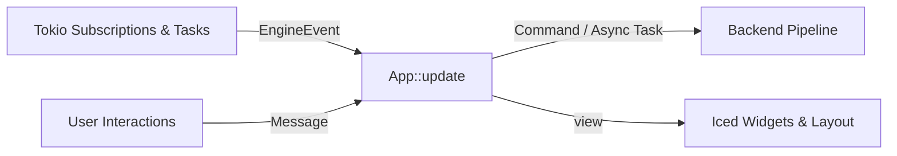

# `woderrise-gui`

> Native Wayland desktop application built on Iced (v0.14+) for discovering, inspecting, staging, installing, and rolling back Linux desktop rices.

[](https://www.rust-lang.org)
[](https://wayland.freedesktop.org)
[](../../Cargo.toml)

---

## Overview

`woderrise-gui` is the native graphical user interface for Woderrise. Engineered entirely in Rust using the modern **Iced (v0.14+)** reactive GUI framework, it delivers the fast, polished, discoverable experience of modern application centers (such as the Snap Store or GNOME Software) tailored specifically for the modern Wayland desktop ecosystem.

### Core Screens

```
┌────────────────────────────────────────────────────────────────────────┐
│  WODERRISE          [🔍 Search dotfiles...]      [Quota: 28/30]  [⚙️]  │
├─────────────┬──────────────────────────────────────────────────────────┤
│  DISCOVER   │  Top Curated Wayland Setups                              │
│  INSPECT    │  ┌───────────────┐ ┌───────────────┐ ┌───────────────┐   │
│  HISTORY    │  │ Hyprdots      │ │ Catppuccin    │ │ End-4 Dots    │   │
│  SETTINGS   │  │ ⭐ 4.2k        │ │ ⭐ 3.1k        │ │ ⭐ 1.8k        │   │
│             │  │ [Hypr] [Bar]  │ │ [Waybar]      │ │ [Hypr] [Lock] │   │
│             │  └───────────────┘ └───────────────┘ └───────────────┘   │
└─────────────┴──────────────────────────────────────────────────────────┘
```

1. **Screen 1 — Discover (`screens::search`)**:
   - Responsive card grid dynamically scaling across window widths (3-4 columns on desktop displays).
   - Debounced search input (300ms) with instant Tier 1 in-memory catalog filtering and explicit Tier 2 remote GitHub queries on <kbd>Enter</kbd>.
   - Category filter pills (`All`, `Hyprland`, `Waybar`, `Hyprlock`, `Hypridle`, `Wallpapers`, `GTK`).
   - Dedicated search quota gauge (`X-RateLimit-Resource: search`) warning before limits are exhausted.
2. **Screen 2 — Repository Inspection & Installation (`screens::inspect`)**:
   - 5 organized detail tabs: **Overview**, **Detected Components**, **File Tree**, **README**, and **Diff / Install Preview**.
   - Granular component checklists with automatic **[Preserve Local Display Config]** safeguards protecting `monitors.conf`.
   - Syntax-highlighted Myers diff viewer comparing remote configs against existing local files.
   - Pre-flight installation planning summary displaying conflict statuses, target paths, and exact file write counts.
   - Strict transactional installation workflow with explicit user confirmation.
3. **Screen 3 — History & Rollback (`screens::history`)**:
   - Summary statistics derived from genuine persisted records (Total Operations, Successful, Failed, Rollback-Eligible).
   - Searchable, filterable transaction list with operation timestamps, repository name, pinned commit SHA, and changed file paths.
   - Guarded 1-click LIFO rollback with dirty-state safety checks (`current_sha256 == post_sha256`) and safety diffs.
4. **Screen 4 — Settings & Authentication (`screens::settings`)**:
   - GitHub authentication status, token management with secure storage (Secret Service with restricted file fallback).
   - Live quota monitors for both Core REST and Search pools with live reset countdown timers.
   - Dynamic Dark / Light theme switcher with automatic FreeDesktop portal (`ashpd`) system preference detection.
   - Safe cache management and diagnostic tools.

---

## Architecture & Communication Flow

`woderrise-gui` adheres to the Model-View-Update (MVU / Elm) architecture native to Iced:



- **Asynchronous Channels**: The GUI communicates with backend engines (`woderrise-github`, `woderrise-detect`, `woderrise-transaction`) through non-blocking `tokio::sync::mpsc` channels and event subscriptions.
- **Zero UI Freezing**: All network calls, Git tree resolutions, and file staging run asynchronously off the main rendering thread.

---

## Running the Application

```bash
# Launch the desktop application
cargo run --package woderrise-gui
```

### Running Tests

```bash
cargo test --package woderrise-gui
```
