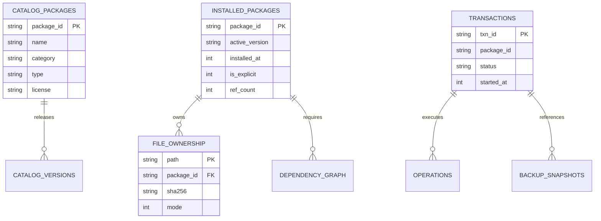

# Data Model and Database Schemas

> **Document ID:** SPEC-ARCH-DAT-021  
> **Status:** Approved Architectural Blueprint  
> **Version:** 1.0.0  
> **Last Updated:** 2026-10-24  

---

## 1. Overview & Multi-Database Architecture

To separate concerns, prevent lock contention, and enable distinct backup and caching lifecycles, Woderrise partitions its persistent data across three localized SQLite databases:

1. **`registry.db` (`~/.local/share/woderrise/registry.db`):** Ephemeral local cache of the remote catalog index, equipped with SQLite FTS5 for instant search. Can be deleted and regenerated from Git at any time.
2. **`ownership.db` (`~/.local/share/woderrise/ownership.db`):** Authoritative state of currently installed packages, claimed filesystem paths, and dependency reference counters.
3. **`journal.db` (`~/.local/share/woderrise/journal.db`):** Permanent, append-only Write-Ahead Log (WAL) recording every transaction, operation outcome, and backup snapshot.



---

## 2. Database 1: `registry.db` (Catalog & Search Index)

```sql
-- Core Package Metadata
CREATE TABLE IF NOT EXISTS catalog_packages (
    package_id TEXT PRIMARY KEY,
    name TEXT NOT NULL,
    category TEXT NOT NULL,
    type TEXT NOT NULL,
    license TEXT NOT NULL,
    author_name TEXT,
    description TEXT,
    thumbnail_url TEXT,
    repository_url TEXT,
    stars_count INTEGER DEFAULT 0,
    updated_at INTEGER NOT NULL
);

-- Full-Text Search Virtual Table (FTS5)
CREATE VIRTUAL TABLE IF NOT EXISTS catalog_search_fts USING fts5(
    package_id,
    name,
    category,
    description,
    author_name,
    tags,
    content='catalog_packages',
    content_rowid='rowid'
);

-- Version Releases
CREATE TABLE IF NOT EXISTS catalog_versions (
    package_id TEXT NOT NULL REFERENCES catalog_packages(package_id) ON DELETE CASCADE,
    version TEXT NOT NULL,
    release_date INTEGER NOT NULL,
    manifest_yaml TEXT NOT NULL,
    manifest_sha256 TEXT NOT NULL,
    is_yanked INTEGER NOT NULL DEFAULT 0,
    PRIMARY KEY (package_id, version)
);
```

---

## 3. Database 2: `ownership.db` (Active System State)

```sql
-- Installed Packages Registry
CREATE TABLE IF NOT EXISTS installed_packages (
    package_id TEXT PRIMARY KEY,
    active_version TEXT NOT NULL,
    package_type TEXT NOT NULL,
    installed_at INTEGER NOT NULL,
    updated_at INTEGER NOT NULL,
    is_explicit INTEGER NOT NULL DEFAULT 1,       -- 1 = user requested; 0 = auto-installed dependency
    ref_count INTEGER NOT NULL DEFAULT 1,          -- Number of packages depending on this package
    pin_version TEXT,                              -- Pin constraint (if locked by user)
    install_txn_id TEXT NOT NULL                   -- Transaction that installed this version
);

-- File Ownership & Path Claims
CREATE TABLE IF NOT EXISTS file_ownership (
    path TEXT PRIMARY KEY,                         -- Absolute normalized path (e.g. /home/user/.config/waybar/config.jsonc)
    package_id TEXT NOT NULL REFERENCES installed_packages(package_id) ON DELETE CASCADE,
    installed_version TEXT NOT NULL,
    installed_sha256 TEXT NOT NULL,
    file_mode INTEGER NOT NULL DEFAULT 420,        -- Octal 0644
    is_symlink INTEGER NOT NULL DEFAULT 0,
    backup_id TEXT,                                -- Associated backup if original user file was replaced
    claimed_at INTEGER NOT NULL
);

-- Active Dependency Reference Graph
CREATE TABLE IF NOT EXISTS dependency_graph (
    parent_id TEXT NOT NULL REFERENCES installed_packages(package_id) ON DELETE CASCADE,
    child_id TEXT NOT NULL,
    dep_type TEXT NOT NULL CHECK (dep_type IN ('STORE_PACKAGE', 'SYSTEM_NATIVE', 'COMPOSITOR_PLUGIN')),
    version_constraint TEXT NOT NULL,
    PRIMARY KEY (parent_id, child_id)
);
```

---

## 4. Database 3: `journal.db` (Transactions & Backups)

```sql
-- Transaction Write-Ahead Log
CREATE TABLE IF NOT EXISTS transactions (
    txn_id TEXT PRIMARY KEY,                       -- e.g. 'TXN-20261024-0012'
    parent_txn_id TEXT REFERENCES transactions(txn_id),
    package_id TEXT NOT NULL,
    version TEXT NOT NULL,
    txn_type TEXT NOT NULL CHECK (txn_type IN ('INSTALL', 'UPDATE', 'UNINSTALL', 'ROLLBACK', 'RECOVERY')),
    status TEXT NOT NULL CHECK (status IN ('PLANNED', 'PREPARED', 'EXECUTING', 'COMMITTED', 'FAILED', 'ABORTED_RECOVERED', 'ROLLED_BACK')),
    started_at INTEGER NOT NULL,
    completed_at INTEGER,
    initiator TEXT NOT NULL DEFAULT 'user_gui',
    error_message TEXT,
    metadata_json TEXT
);

-- Ordered Operation Sequence
CREATE TABLE IF NOT EXISTS operations (
    op_id TEXT PRIMARY KEY,
    txn_id TEXT NOT NULL REFERENCES transactions(txn_id) ON DELETE CASCADE,
    sequence_num INTEGER NOT NULL,
    op_type TEXT NOT NULL CHECK (op_type IN (
        'CREATE_FILE', 'MODIFY_FILE', 'DELETE_FILE',
        'INJECT_CONFIG', 'EJECT_CONFIG',
        'SERVICE_TRIGGER', 'INSTALL_SYSTEM_DEP'
    )),
    target_path TEXT NOT NULL,
    pre_sha256 TEXT,
    post_sha256 TEXT,
    backup_id TEXT REFERENCES backup_snapshots(backup_id),
    status TEXT NOT NULL CHECK (status IN ('PLANNED', 'EXECUTING', 'COMPLETED', 'FAILED', 'REVERSED')),
    details_json TEXT
);

-- Durable Backup Snapshots
CREATE TABLE IF NOT EXISTS backup_snapshots (
    backup_id TEXT PRIMARY KEY,
    txn_id TEXT NOT NULL REFERENCES transactions(txn_id),
    original_path TEXT NOT NULL,
    storage_path TEXT NOT NULL,
    sha256 TEXT NOT NULL,
    file_mode INTEGER NOT NULL,
    created_at INTEGER NOT NULL
);
```

---

## 5. Schema Migration & Versioning Strategy

All databases track their schema version using SQLite's native `PRAGMA user_version`.

### Migration Invariants:
1. **Incremental Numbering:** Schema versions increment monotonically (`user_version = 1`, `2`, `3`).
2. **Non-Destructive Migrations:** Migrations must never drop tables containing historical transactions or backup pointers without backing up the database file first.
3. **Automated Migration Hook:** On startup, the engine queries `PRAGMA user_version` and executes pending migration scripts inside an exclusive transaction before serving IPC requests.
4. **Crash Safety:** If a migration fails mid-way, the transaction rolls back cleanly, preserving the prior database version.
