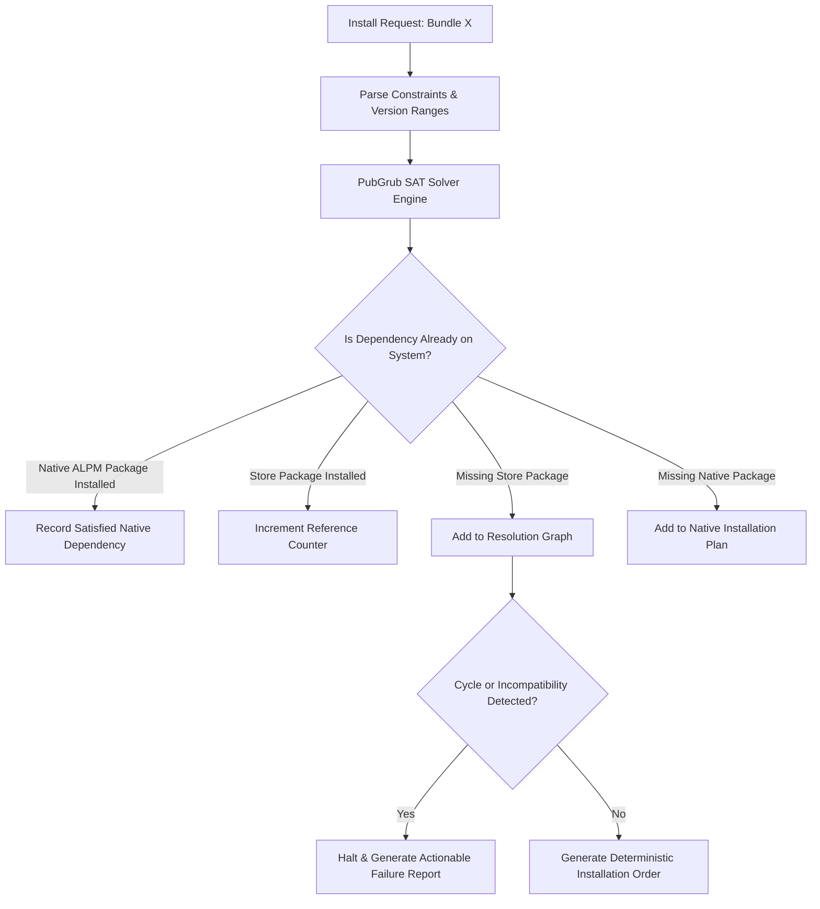

# Dependency Resolution & Graph Solver

> **Document ID:** SPEC-ECO-DEP-012  
> **Status:** Approved Architectural Blueprint  
> **Version:** 1.0.0  
> **Last Updated:** 2026-10-24  

---

## 1. Overview & Solver Architecture

Dependency resolution in a desktop customization ecosystem is inherently complex: packages rely not only on other store packages (e.g. a Waybar theme requiring a specific icon set), but also on **native system binaries** (e.g. `waybar`, `rofi-wayland`, `swww`) and **compositor ABI levels** (Hyprland C++ plugin headers).

To guarantee deterministic, conflict-free installations, Woderrise integrates a **SAT-based dependency solver** inspired by [PubGrub](https://github.com/dart-lang/pubgrub) and [libsolv](https://github.com/openSUSE/libsolv).



---

## 2. Dependency Taxonomy & Reference Tracking

Woderrise distinguishes four distinct dependency origins. The engine tracks these differences in the local SQLite database to prevent catastrophic or accidental dependency purges:

| Dependency Type | Managed By | Tracked Attributes | Removal Policy |
| :--- | :--- | :--- | :--- |
| **Native System Binary (Pre-Existing)** | Host Package Manager (`pacman`) | Detected via ALPM query prior to install. | **NEVER UNINSTALL**. The user installed this independently. |
| **Native System Binary (Store-Installed)** | Polkit Helper (`pacman -S`) | Installed by Woderrise to satisfy store package. | Marked as `orphaned_candidate` when parent package is uninstalled; user prompted before removal. |
| **Store Package (Explicit)** | Woderrise Engine | Directly requested and installed by the user. | Retained until user explicitly uninstalls it. |
| **Store Package (Implicit / Shared)** | Woderrise Engine | Installed automatically to satisfy another package. | **Reference Counted (`ref_count`)**. Only removed when `ref_count == 0` and user confirms. |

> [!IMPORTANT]
> **The Golden Rule of Dependency Cleanup:**
> Never assume uninstalling a package means that its dependencies can safely be removed! If Package A and Package B both depend on `com.catppuccin.gtk-theme` (`ref_count = 2`), uninstalling Package A decrements the counter to `1`. The GTK theme remains fully active and untouched.

---

## 3. Version Constraints & SemVer Resolution

Dependencies express version constraints using standard semantic version syntax:
- Caret (`^1.2.0`): Permits updates that do not modify the leftmost non-zero digit (`>=1.2.0 <2.0.0`).
- Tilde (`~1.2.0`): Permits patch updates (`>=1.2.0 <1.3.0`).
- Exact (`=0.41.2`): Mandates strict equality (critical for Hyprland C++ plugins).
- Comparison Ranges (`>=0.9.20 <1.0.0`): Explicit bounded ranges.

### 3.1 Cycle Detection & Resolution
Dependency cycles (e.g. `Package A -> Package B -> Package A`) are detected during graph construction via Tarjan's strongly connected components algorithm. Circular dependencies are rejected during manifest linting and blocked by the engine with an explicit cycle trace.

---

## 4. Conflict Resolution & Mutex Locks

Packages declare mutual exclusivity using the `conflicts` stanza:
```yaml
conflicts:
  - id: "com.rival.bar"
    reason: "Competes for primary status bar ownership"
```

In addition to declared package conflicts, Woderrise enforces **Path-Level Mutex Locks**:
- Two packages cannot simultaneously claim exclusive ownership (`strategy: replace`) over the exact same target path (e.g. `~/.config/waybar/config.jsonc`).
- If an installation plan detects that Package B claims a path currently owned by installed Package A:
  1. The solver halts.
  2. It generates a **Compound Transition Plan**:
     - Step 1: Backup active configuration of Package A.
     - Step 2: Uninstall Package A.
     - Step 3: Install Package B.
  3. The plan is presented to the user for explicit confirmation before execution.

---

## 5. Failure Behavior & Actionable Error Reporting

When the solver cannot find a valid solution, it never emits a cryptic error like `UnsatisfiableConstraintsError: 0x8004`. Instead, it outputs a human-readable explanation modeled on PubGrub error reports:

```text
Error: Could not install 'Catppuccin Full Desktop Suite' (v2.1.0)

Reason: Incompatible Hyprland Plugin Dependency
- 'Catppuccin Full Desktop Suite' (v2.1.0) depends on 'hyprsplit' (^0.41.0)
- 'hyprsplit' (v0.41.2) requires Hyprland ABI hash '3b9a7102'
- Your running Hyprland version is v0.40.0 (commit 'd92a1104')

Suggested Actions:
1. Update Hyprland to >= v0.41.2 via your system package manager (`sudo pacman -Syu hyprland`).
2. Or install an older compatible version of the suite:
   'woderrise install com.catppuccin.suite --version 1.8.0'
```
