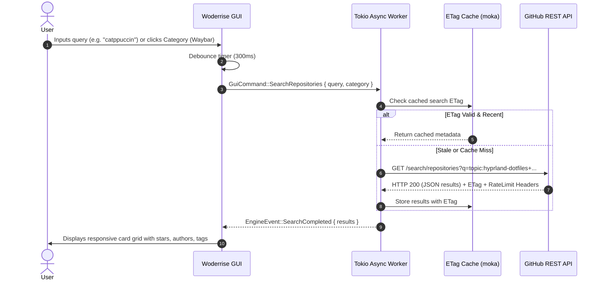
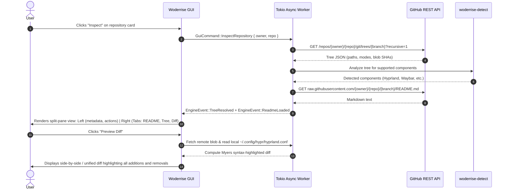
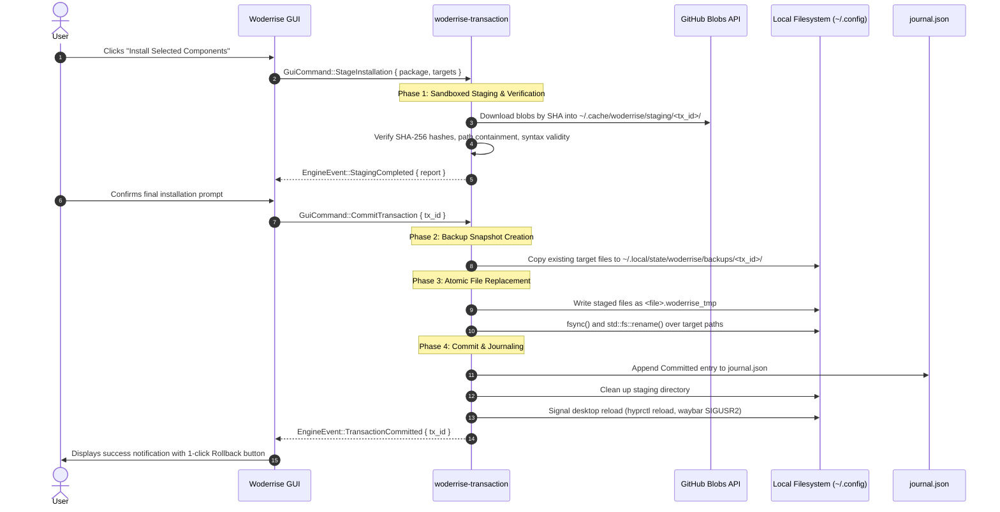
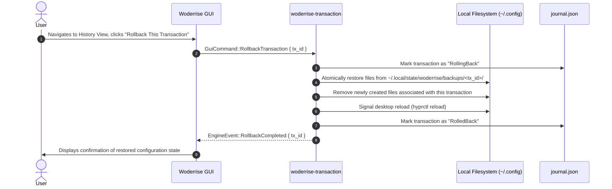
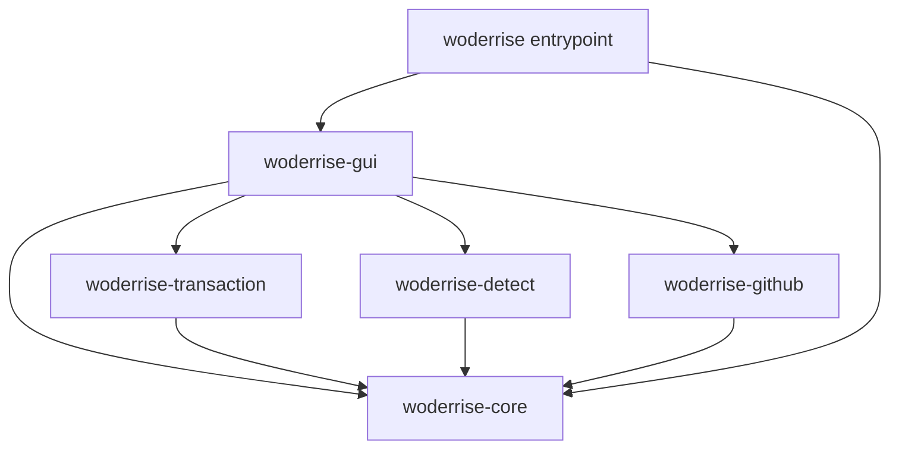
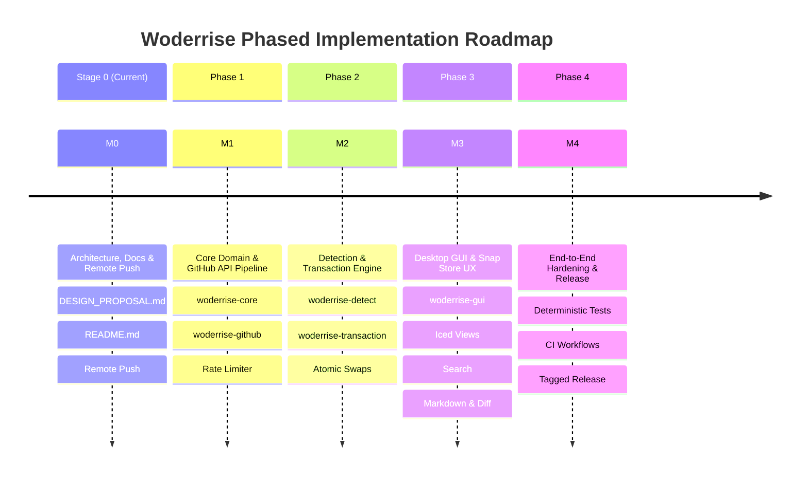

# Woderrise: Architectural Design Proposal

**Author**: vijaygovindBiju <vijaygovindbiju@gmail.com>  
**Version**: 1.0.0 (Stage 0 Baseline)  
**Date**: 2026-10-27  
**Status**: Proposal / Awaiting Implementation Approval  
**Target Environment**: Linux (Arch Linux rolling distribution; portable across modern Linux distributions running Wayland compositors)

---

## Executive Summary

**Woderrise** is a lightweight, GitHub-powered Linux desktop configuration store and declarative dotfile manager featuring a native graphical user interface (GUI) written in Rust. Designed specifically for modern Wayland desktop environments—with initial first-class support for the [Hyprland](https://hyprland.org) compositor ecosystem (including Waybar, Hyprlock, Hypridle, Hyprpaper/wallpaper engines, Hyprcursor, and GTK/icon themes)—Woderrise transforms the fragmented, risky tradition of Linux desktop customization ("ricing") into a secure, discoverable, and recoverable store experience inspired by modern application centers like Snap Store and GNOME Software.

Unlike traditional dotfile managers or custom shell installers that require cloning massive Git repositories, running arbitrary shell scripts with unvetted privileges, and silently clobbering existing configuration files in `~/.config`, Woderrise provides:
1. **Direct GitHub API Discovery Without Git Clones**: Discovers repositories via the GitHub REST API and Git Trees API (`recursive=1`), streaming only targeted configuration blobs by content-addressed SHA hashes, reducing network transfer by over 98%.
2. **Exclusively Real-World Data**: Production builds strictly query live GitHub API endpoints. No synthetic, mock, or dummy packages exist in production.
3. **Full Desktop GUI Discovery Experience**: An interactive, responsive graphical interface built in pure Rust (Iced v0.14+ primary; Relm4 v0.11+ secondary) featuring multi-column card grids, category filtering, debounced search with cancellation tokens, hero banners, screenshot carousels, two-column inspect views with rendered Markdown and syntax-highlighted diffs, installation progress, and rollback history.
4. **Independent Modular Component Detection**: Granular parsers for Hyprland legacy configuration files (`hyprland.conf`) and modern Lua scripts (`hyprland.lua`), Waybar JSONC and GTK CSS, Hyprlock, Hypridle, wallpaper directives, cursor themes, and GTK configurations. Users can inspect and install individual components or complete desktop suites.
5. **Crash-Consistent 4-Phase Atomic Transactions**: Enforces sandboxed staging, strict security validation (zero arbitrary script execution, path traversal prevention, symlink containment), automated pre-installation backup snapshots, atomic sibling file swaps (`std::fs::rename`), persistent JSON journaling, and 1-click rollback with automatic startup crash recovery.

---

## Table of Contents

1. [Section 1: Project Goals and Non-Goals](#section-1-project-goals-and-non-goals)
2. [Section 2: Requirements and User Workflows](#section-2-requirements-and-user-workflows)
3. [Section 3: Full Graphical Desktop GUI Application Architecture](#section-3-full-graphical-desktop-gui-application-architecture)
4. [Section 4: Architecture, Crate Ecosystem, and Component Responsibilities](#section-4-architecture-crate-ecosystem-and-component-responsibilities)
5. [Section 5: Repository and Module Structure](#section-5-repository-and-module-structure)
6. [Section 6: GitHub Discovery and File-Fetching Data Flow](#section-6-github-discovery-and-file-fetching-data-flow)
7. [Section 7: Exclusively Real-World Data Policy](#section-7-exclusively-real-world-data-policy)
8. [Section 8: JSON Schema and Minimal Local Storage Policy](#section-8-json-schema-and-minimal-local-storage-policy)
9. [Section 9: Configuration Detection Strategy for Independent Components](#section-9-configuration-detection-strategy-for-independent-components)
10. [Section 10: Installation, Journaling, and Rollback Design](#section-10-installation-journaling-and-rollback-design)
11. [Section 11: Error Handling, Security Boundaries, and Testing Strategy](#section-11-error-handling-security-boundaries-and-testing-strategy)
12. [Section 12: Phased Implementation Roadmap](#section-12-phased-implementation-roadmap)

---

## Section 1: Project Goals and Non-Goals

### 1.1 Context and Problem Statement
Linux desktop customization ("ricing") on tiling Wayland compositors like Hyprland represents one of the most vibrant creative subcultures in open-source computing. However, sharing and adopting configurations suffers from systemic engineering deficiencies:
- **Catastrophic Silent Overwrites**: Community dotfile repositories typically supply unguided setup scripts (`install.sh`, `setup.sh`) that copy configuration directories directly into `~/.config`, indiscriminately wiping out the user's existing configurations without pre-flight backups or warning.
- **Arbitrary Procedural Script Execution**: Users are instructed to execute unverified shell scripts downloaded from the internet with full user or root privileges. These scripts frequently mutate system state, install unwanted packages, or execute unsafe commands.
- **Monolithic Inflexibility**: Repositories are typically structured as all-or-nothing monoliths. A user who only wants a specific Waybar configuration is forced to clone a 500MB repository containing shell configs, Neovim plugins, fonts, and window rules that conflict with their workflow.
- **Repository Bloat and Bandwidth Waste**: Dotfile repositories routinely commit hundreds of megabytes of binary wallpaper packs, release archives, and deep Git history. Running `git clone` consumes excessive bandwidth and storage for files the user never installs.
- **Irreversible Desktop Breakage**: When an applied configuration fails to work or the user dislikes the visual aesthetic, there is no built-in mechanism to undo the changes. Users must manually reconstruct their lost configurations.

### 1.2 Primary Goals
- **Client-Side Discovery Store**: Provide a responsive, modern desktop GUI application in Rust that delivers the package discovery, inspection, and one-click installation experience of modern app stores (Snap Store, GNOME Software) for Linux dotfiles.
- **No-Clone GitHub Pipeline**: Query GitHub REST APIs and Git Trees API (`recursive=1`) to discover repositories and inspect file trees in memory, downloading only the exact configuration blobs required via content-addressed SHA hashes.
- **Independent Component Lifecycle**: Allow users to inspect and install individual modular components (e.g. only Waybar, only Hyprlock, or complete suites) without monolithic dependencies.
- **100% Real-World Data**: In production builds, interact exclusively with live GitHub repositories. No fabricated, mock, or dummy packages exist in the production runtime.
- **Transactional Safety and 1-Click Rollback**: Provide a 4-phase atomic installation engine backed by sandboxed staging, pre-install snapshots, atomic file replacement, and an append-only transaction journal guaranteeing 1-click rollback and crash recovery.
- **Zero Arbitrary Script Execution**: Strictly prohibit executing untrusted procedural shell scripts during installation. Configurations are treated as declarative assets.
- **Minimal Local Footprint**: Adhere to XDG Base Directory standards, storing only a lightweight metadata link catalog (`catalog.json`), ephemeral staging directories, and rollback journals.

### 1.3 Explicit Non-Goals
- **No Dedicated Backend Server**: Woderrise does not rely on a hosted centralized backend, intermediate proxy, or custom catalog server. It is a completely autonomous, serverless desktop client communicating directly with GitHub's public API.
- **No General-Purpose Binary App Store**: Woderrise is not a package manager for system binaries, Flatpaks, Snaps, or RPM/DEB packages. It does not replace `pacman`, `apt`, `dnf`, or `flatpak`. It manages user-space configuration trees and asset files.
- **No Procedural Script Execution**: Woderrise will not execute `install.sh`, `setup.sh`, bootstrap binaries, or build scripts bundled inside dotfile repositories. Packages requiring arbitrary code execution to generate configurations are flagged as unsupported for automated installation.
- **No Git Repository Clones**: Woderrise will not run `git clone` or pull full git commit histories onto the user's disk.

---

## Section 2: Requirements and User Workflows

### 2.1 User Personas
1. **The Desktop Customizer ("Ricer")**: Wants to discover trending, aesthetically refined Hyprland suites, inspect previews and README documentation, and test them with zero risk of breaking their existing desktop.
2. **The Modular Tinkerer**: Wants to cherry-pick specific components—such as a polished Waybar theme or a minimalist Hyprlock screen—without adopting an entire desktop suite.
3. **The Wayland Beginner**: Transitioning to Hyprland who desires a working, well-configured environment with a single click, with the confidence that they can rollback immediately if something goes wrong.
4. **The Dotfile Author**: Creates configurations and organizes them cleanly on GitHub, knowing that Woderrise can discover and install their work without requiring custom installer scripts.

### 2.2 Core Functional Workflows

#### 2.2.1 Search and Discovery Workflow


#### 2.2.2 Inspection and Pre-Install Preview Workflow


#### 2.2.3 Installation Workflow (4-Phase Atomic Swap)


#### 2.2.4 Rollback Workflow


---

## Section 3: Full Graphical Desktop GUI Application Architecture

### 3.1 Linux Desktop GUI Paradigm
Woderrise is architected as a native graphical Linux desktop application. It explicitly rejects being limited to a terminal UI (TUI) or webview wrapper, targeting a modern, fluid visual discovery experience inspired by the **Snap Store** and **GNOME Software**, but tailor-made for the minimalist, high-performance ethos of Wayland desktop environments.

### 3.2 Evaluation and Selection of Rust GUI Frameworks
To determine the optimal engineering foundation, four major Rust GUI frameworks were evaluated across seven technical dimensions:

| Evaluation Dimension | Iced (v0.14+) | Relm4 / GTK4 (v0.11+) | Slint (v1.18+) | Egui (v0.37+) |
| :--- | :--- | :--- | :--- | :--- |
| **Architectural Model** | The Elm Architecture (Model-View-Update, unidirectional data flow) | Reactive Elm-like layer over GObject retained-mode widget tree | Declarative DSL (`.slint`) with reactive property binding | Immediate-mode (UI fully re-executed every frame) |
| **Snap Store / GNOME Software Discovery UX Match** | **High**: Tailored card grids, hero banners, carousels, split view, modal dialogs | **Native**: Pixel-perfect match to GNOME Software widgets (`AdwCarousel`, `AdwActionRow`) | **High**: Clean components, smooth animations | **Low**: Requires heavy custom painting to avoid looking like a game debug overlay |
| **Wayland & X11 Integration** | **Native**: Built on `winit` with direct Wayland `xdg-shell` and fractional scaling | **Native**: GDK4 Wayland and X11 backends | **Good**: Winit / Skia backend | **Good**: Winit / Eframe backend |
| **Desktop Theming & Dark Mode** | Built-in `linux-theme-detection` listening to XDG Portal; custom theme palettes | Native `AdwStyleManager` tracking portal automatically | Fluent / Material styles; portal requires manual bridge | Manual: must poll or wire custom portal listener |
| **Markdown & Syntax Highlighting** | **Built-in**: Native `markdown` widget (`pulldown-cmark`) and `highlighter` (`iced_highlighter`) | Requires WebKitGTK (~150MB+ RAM overhead) or complex Pango markup converters | Requires custom text parser or external webview | Requires `egui_demo_lib` or third-party crates |
| **Async & Concurrency** | **Native**: First-class `Subscription` and `Task` backed by Tokio futures | GLib main context; requires bridging Tokio channels with GLib | Custom event loop wakeup (`invoke_from_event_loop`) | Frame repainting triggers (`ctx.request_repaint()`) |
| **Binary Portability & C Dependencies** | **Pure Rust**: Self-contained static/dynamic binary with zero C GUI dependencies | **Heavy C Dependencies**: Requires `libgtk-4`, `libadwaita-1`, `cairo`, `pango` headers and shared objects | Moderate: Skia / C++ toolchain depending on backend | **Pure Rust**: Minimal dependencies |
| **Target Audience Alignment** | **Optimal**: Hyprland / tiling Wayland users prefer lightweight, standalone, non-GNOME-coupled apps | **Mismatched**: Many Hyprland users specifically avoid GNOME/Adwaita runtime dependencies | Moderate | Low |

#### 3.2.1 Primary Selection: `iced` (v0.14+)
1. **Target Audience Alignment & Zero C-Library Bloat**: Hyprland and tiling compositor users deliberately choose lightweight, highly customizable environments. Requiring GTK4, Libadwaita, and system GNOME daemons introduces unwanted dependencies. `iced` compiles to a clean, standalone, pure Rust binary that launches in <120ms with minimal memory consumption (~35MB RAM).
2. **Integrated Rich Content Widgets**: A package store requires rendering remote `README.md` documentation and syntax-highlighted diffs (`hyprland.conf`, `style.css`, `config.jsonc`). `iced` provides first-class `markdown` (backed by `pulldown-cmark`) and `highlighter` (syntax highlighting) out of the box without embedding bloated web engines.
3. **Seamless Tokio Concurrency**: `iced`'s Elm architecture maps directly to Tokio async tasks and subscriptions. Asynchronous network requests, tree downloads, and image loading emit strongly typed events directly into the update loop without thread locking or UI stutter.
4. **Rendering Resilience**: Compiled with both `wgpu` (hardware accelerated Vulkan/OpenGL) and `tiny-skia` (software rasterization fallback), guaranteeing operation across diverse GPU drivers, virtual machines, and headless testing environments.

#### 3.2.2 Secondary Selection: `relm4` (v0.11+)
For environments prioritizing strict GNOME Human Interface Guidelines (HIG) compliance or Flatpak distribution on standard GNOME desktops, `relm4` is documented as a viable secondary frontend. The domain core, GitHub pipeline, detection engine, and transaction manager are 100% decoupled from the GUI, enabling alternative frontends without altering core business logic.

---

### 3.3 Visual Presentation and Discovery Experience

```
+----------------------------------------------------------------------------------------------------+
|  [ Woderrise ]   [ Search configs, tags, authors... (Ctrl+F) ]               [ Refresh ] [Settings]|
+----------------------------------------------------------------------------------------------------+
|  [All]  [Hyprland]  [Waybar]  [Hyprlock]  [Hypridle]  [Wallpapers]  [Suites]  [Installed History (2)]  |
+----------------------------------------------------------------------------------------------------+
|  +----------------------------------------------------------------------------------------------+  |
|  | FEATURED HERO BANNER: "Catppuccin Mocha Hyprland Complete Suite"                             |  |
|  | By @catppuccin * 1.8k Stars * Detected Components: Hyprland (Legacy) + Waybar + Hyprlock     |  |
|  | [ Inspect Suite ]                                                           [ Quick Preview ]|  |
|  +----------------------------------------------------------------------------------------------+  |
|                                                                                                    |
|  DISCOVER POPULAR CONFIGURATIONS                                                                   |
|  +-----------------------+  +-----------------------+  +-----------------------+  +--------------+ |
|  | [Screenshot Preview]  |  | [Screenshot Preview]  |  | [Screenshot Preview]  |  | [Screenshot] | |
|  | Modern Glass Bar      |  | Cyberpunk Hyprland    |  | Minimalist Lock       |  | Tokyo Night  | |
|  | @hypr-rice * 420 Stars|  | @neon-dev * 890 Stars |  | @sec-user * 125 Stars |  | @tokyo * 650 | |
|  | [Waybar] [CSS]        |  | [Hyprland] [Lua]      |  | [Hyprlock]            |  | [Full Suite] | |
|  | [ Inspect ]           |  | [ Inspect ]           |  | [ Inspect ]           |  | [ Inspect ]  | |
|  +-----------------------+  +-----------------------+  +-----------------------+  +--------------+ |
+----------------------------------------------------------------------------------------------------+
```

1. **Card Grid View (Store Front)**: Multi-column responsive grid displaying repository cards. Each card displays:
   - Preview thumbnail or banner asset extracted from repository metadata.
   - Repository name and author avatar / handle.
   - GitHub star count and update recency.
   - Detected component badge pills (`[Hyprland Legacy]`, `[Hyprland Lua]`, `[Waybar]`, `[Hyprlock]`, `[Hypridle]`, `[Wallpapers]`).
   - Call-to-action button: `[ Inspect ]`.
2. **Category Navigation & Filtering**: Filter bar allowing one-click filtering by component: `All`, `Hyprland`, `Waybar`, `Hyprlock`, `Hypridle`, `Wallpapers`, `Complete Suites`, and `Installed History`.
3. **Debounced Search with Cancellation**: A search input debounced at 300ms. Typing triggers cancellation of outstanding search tasks via `tokio_util::sync::CancellationToken`, preventing redundant API calls.
4. **Hero Banners & Trending Highlights**: Visual carousel displaying curated and high-starred community rices with full-width preview banners.
5. **Screenshot / Preview Carousel**: In the inspect view, an interactive carousel allows swiping through high-resolution screenshots discovered in the repository's `assets/` or `screenshots/` directory, with full-screen zoom support.
6. **Two-Column Split-Pane Inspect View**:
   - **Left Pane (Metadata & Controls)**: Detailed repository metadata, author profile, GitHub star count, license, list of detected target paths with conflict status badges (e.g., `Overwrites ~/.config/waybar/config`), component selection checkboxes (allowing granular cherry-picking), and action buttons: `[ Install Selected ]`, `[ Preview Diff ]`, `[ Open in Browser ]`.
   - **Right Pane (Tabbed Content)**:
     - **Tab 1: README**: Live-rendered Markdown via `iced::widget::markdown`.
     - **Tab 2: File Tree Browser**: Interactive directory tree displaying remote file sizes, modes, and SHA hashes.
     - **Tab 3: Diff Viewer**: Syntax-highlighted Myers diff showing exact line additions and deletions against the user's current local files.
7. **Installation Progress View**: Modal progress overlay with step indicators:
   - `[1. Fetching Blobs] -> [2. Verifying & Staging] -> [3. Creating Backup Snapshot] -> [4. Committing Files] -> [5. Reloading Compositor]`.
   - Displays real-time transfer metrics (bytes downloaded, file counts, SHA-256 verification status).
8. **Rollback & History View**: Chronological audit trail of all transactions read from `journal.json`. Shows transaction timestamp, source repository, affected files, and a prominent `[ Rollback ]` button for instant restoration.

---

### 3.4 Wayland, XDG Desktop Portal Theming, and Thread Isolation

#### 3.4.1 Native Wayland Integration
- Integrates `winit`'s Wayland backend, adhering to standard `xdg-shell` surface protocols.
- Full support for `fractional-scale-v1` and `viewporter` Wayland protocols, ensuring crisp text and sharp UI rendering on fractional display scaling (e.g. 125%, 150%, 175%) without blurriness.
- High-quality subpixel font rendering utilizing `cosmic-text` and system `fontconfig` resolution.

#### 3.4.2 XDG Desktop Portal Dynamic Theming
- Integrates `ashpd` to subscribe to the `org.freedesktop.portal.Settings` `color-scheme` key.
- Dynamically responds to desktop light/dark mode preference changes without requiring application restart.
- Provides built-in color palettes tailored for popular Linux ricing themes: Catppuccin Mocha, Tokyo Night, Nord, Gruvbox, and Rosé Pine.

#### 3.4.3 Tokio Async Worker Isolation and Command-Event Architecture
To guarantee that the UI never stutters or drops frames during intensive network downloads, tree parsing, or cryptographic hashing, the application enforces strict thread separation:

```
+---------------------------------------------------------------------------------+
|                                 GUI THREAD                                      |
|                                                                                 |
|  [ Iced Event Loop (winit) ] <======== [ Subscription / mpsc Receiver ]        |
|            |                                              ^                     |
|            | Dispatches                                   | Emits               |
|            v                                              |                     |
|  [ GuiCommand::Search ]                          [ EngineEvent::SearchDone ]    |
|  [ GuiCommand::InspectRepo ]                     [ EngineEvent::TreeLoaded ]    |
|  [ GuiCommand::Install ]                         [ EngineEvent::Progress ]      |
|            |                                              ^                     |
|            v                                              |                     |
+------------|----------------------------------------------|---------------------+
             | Command Channel (mpsc::Sender)               | Event Channel (mpsc::Receiver)
             v                                              |
+---------------------------------------------------------------------------------+
|                         TOKIO ASYNC WORKER POOL                                 |
|                                                                                 |
|  [ Worker Task Coordinator ]                                                    |
|       |                                                                         |
|       +---> [ GitHub Client (reqwest + moka cache + rate limiter) ]             |
|       +---> [ Config Detector (tree traversal + syntax parsers) ]               |
|       +---> [ Transaction Manager (staging + sha2 + atomic swap + journal) ]    |
|                                                                                 |
+---------------------------------------------------------------------------------+
```

- **Thread Decoupling**: The main thread runs the GUI event loop exclusively. All network requests (GitHub API, raw files), filesystem operations (staging, hashing, atomic renaming), and image decoding are dispatched to the Tokio multi-threaded runtime.
- **Cancellation Tokens**: Each search query or inspect action is tagged with a `tokio_util::sync::CancellationToken`. If the user types a new character or navigates away, the active network request is aborted immediately, preserving GitHub API rate limits.
- **Bounded Channels**: Communication uses bounded `tokio::sync::mpsc` channels with backpressure to prevent memory exhaustion during large file downloads.

---

## Section 4: Architecture, Crate Ecosystem, and Component Responsibilities

The codebase is organized as a Cargo virtual workspace containing 5 modular crates, enforcing strict separation of concerns, zero circular dependencies, and complete headless testability:

```
woderrise/
├── Cargo.toml                       (Workspace manifest)
├── crates/
│   ├── woderrise-core/              (Domain models, paths, error hierarchy, verification reports)
│   ├── woderrise-github/            (GitHub API client, Git Trees fetcher, raw downloader, rate limiter)
│   ├── woderrise-detect/            (Dotfile component detector: Hyprland, Waybar, Hyprlock, etc.)
│   ├── woderrise-transaction/       (Staging sandbox, atomic backup, commit, journal store, rollback)
│   └── woderrise-gui/               (Iced presentation layer, views, widgets, portal theme integration)
└── src/
    └── main.rs                      (App entrypoint, runtime bootstrap, signal handling)
```

### 4.1 Crate Responsibilities and Dependency Matrix



#### 1. `woderrise-core`
- **Responsibility**: Pure domain models, core enumerations, path sanitization abstractions, unified error definitions, and verification reports. Zero GUI and zero network dependencies.
- **Key Modules**:
  - `models`: `PackageMetadata`, `ConfigComponent`, `TargetMapping`, `StagedFile`, `JournalEntry`.
  - `error`: Centralized `WoderriseError` hierarchy using `thiserror`.
  - `paths`: Path normalization, XDG directory resolvers, and traversal containment checkers using `camino::Utf8Path`.
- **Dependencies**: `serde`, `serde_json`, `thiserror`, `camino`, `chrono`, `semver`.

#### 2. `woderrise-github`
- **Responsibility**: Client for the public GitHub REST API, implementing the no-clone discovery pipeline.
- **Key Modules**:
  - `client`: HTTP client wrapper built on `reqwest` with custom User-Agent, timeouts, and connection pooling.
  - `trees`: Git Trees API consumer parsing recursive tree structures (`recursive=1`).
  - `blobs`: Content-addressed raw blob downloader fetching via blob SHA.
  - `rate_limit`: ETag conditional caching (`If-None-Match`), header monitoring (`x-ratelimit-remaining`), exponential backoff with jitter, and optional `GITHUB_TOKEN` support.
  - **Live Data Enforcement**: Strictly rejects synthetic dummy packages in production mode.
- **Dependencies**: `reqwest` (features: `rustls-tls`, `json`, `stream`), `tokio`, `serde`, `serde_json`, `moka`, `tracing`, `async-trait`.

#### 3. `woderrise-detect`
- **Responsibility**: Pattern classification, file tree inspection, and syntax validation for independent desktop components.
- **Key Modules**:
  - `hyprland`: Parser for legacy block/directive configuration (`hyprland.conf`) and modern Lua syntax (`hyprland.lua`).
  - `waybar`: Parser for JSONC (`config`, `config.jsonc`) and GTK CSS (`style.css`).
  - `hyprlock`: Validator for Hyprlock visual block syntax (`background`, `input-field`, `label`).
  - `hypridle`: Validator for Hypridle timeouts and listener blocks.
  - `wallpaper`: Scanner for wallpaper assets and config directives (`preload`, `wallpaper`), with automatic path remapping.
  - `hyprcursor`: Validator for Hyprcursor directories and `manifest.hl`.
  - `gtk`: Parser for GTK 3/4 `settings.ini` and FreeDesktop icon themes.
- **Dependencies**: `woderrise-core`, `regex`, `serde`, `tracing`.

#### 4. `woderrise-transaction`
- **Responsibility**: Transactional lifecycle, sandboxed staging, path validation, pre-install backup snapshots, atomic file replacement, persistent journaling, and crash recovery.
- **Key Modules**:
  - `sandbox`: Ephemeral directory manager under `$XDG_CACHE_HOME/woderrise/staging/<tx_id>/`.
  - `audit`: Security auditor enforcing zero script execution, path traversal rejection, and symlink containment.
  - `backup`: Snapshot engine creating full pre-installation backups in `$XDG_STATE_HOME/woderrise/backups/<tx_id>/`.
  - `atomic`: Atomic file swapper writing sibling temporary files (`<file>.woderrise_tmp`), syncing, and renaming via `std::fs::rename`.
  - `journal`: Append-only JSON journal manager (`journal.json`).
  - `recovery`: Startup crash recovery engine scanning for incomplete transactions.
- **Dependencies**: `woderrise-core`, `tempfile`, `walkdir`, `sha2`, `fs2` (advisory locks), `serde`, `serde_json`, `chrono`, `tracing`.

#### 5. `woderrise-gui`
- **Responsibility**: Iced desktop graphical user interface.
- **Key Modules**:
  - `app`: Elm-architecture application root managing UI state and message dispatch.
  - `views`: Catalog view, Inspect view, Install modal, Rollback history view, Settings view.
  - `widgets`: Custom card widgets, carousel sliders, diff renderers, markdown views.
  - `theme`: XDG Desktop Portal color-scheme listener and custom color palettes.
- **Dependencies**: `iced` (v0.14, features: `wgpu`, `tiny-skia`, `markdown`, `image`, `svg`, `highlighter`, `linux-theme-detection`, `wayland`, `x11`), `woderrise-core`, `woderrise-github`, `woderrise-detect`, `woderrise-transaction`, `ashpd`, `image`, `tokio`, `tracing`.

---

## Section 5: Repository and Module Structure

```
woderrise/
├── .github/
│   └── workflows/
│       ├── ci.yml                   # CI: cargo test, cargo clippy, cargo fmt
│       └── release.yml              # Automated multi-arch binary releases
├── Cargo.toml                       # Workspace definition
├── Cargo.lock                       # Pinned workspace dependencies
├── README.md                        # Project documentation and system walkthrough
├── docs/
│   ├── DESIGN_PROPOSAL.md           # This comprehensive design proposal
│   ├── ARCHITECTURE.md              # High-level architecture documentation
│   └── ...                          # Supporting specifications
├── crates/
│   ├── woderrise-core/
│   │   ├── Cargo.toml
│   │   └── src/
│   │       ├── lib.rs
│   │       ├── error.rs             # Unified WoderriseError hierarchy
│   │       ├── models.rs            # Core domain structs (PackageMetadata, TargetMapping, etc.)
│   │       └── paths.rs             # Safe path normalization and containment
│   ├── woderrise-github/
│   │   ├── Cargo.toml
│   │   └── src/
│   │       ├── lib.rs
│   │       ├── client.rs            # Reqwest client wrapper with timeout & UA
│   │       ├── trees.rs             # Git Trees API recursive parser
│   │       ├── blobs.rs             # Raw blob downloader by SHA
│   │       └── rate_limit.rs        # ETag 304 cache, backoff, and token management
│   ├── woderrise-detect/
│   │   ├── Cargo.toml
│   │   └── src/
│   │       ├── lib.rs
│   │       ├── hyprland.rs          # Legacy conf and modern Lua detectors
│   │       ├── waybar.rs            # JSONC and GTK CSS parser
│   │       ├── hyprlock.rs          # Hyprlock visual block parser
│   │       ├── hypridle.rs          # Hypridle timeout listener parser
│   │       ├── wallpaper.rs         # Hyprpaper & wallpaper asset detector
│   │       ├── hyprcursor.rs        # Hyprcursor manifest.hl detector
│   │       └── gtk.rs               # GTK 3/4 settings.ini parser
│   ├── woderrise-transaction/
│   │   ├── Cargo.toml
│   │   └── src/
│   │       ├── lib.rs
│   │       ├── sandbox.rs           # Ephemeral staging workspace
│   │       ├── audit.rs             # Security auditor (scripts, traversal, symlinks)
│   │       ├── backup.rs            # Pre-install snapshot manager
│   │       ├── atomic.rs            # 4-phase atomic swap implementation
│   │       ├── journal.rs           # Persistent journal.json store
│   │       └── recovery.rs          # Crash recovery engine
│   └── woderrise-gui/
│       ├── Cargo.toml
│       └── src/
│           ├── lib.rs
│           ├── app.rs               # Iced Application implementation
│           ├── message.rs           # GuiCommand and EngineEvent definitions
│           ├── theme.rs             # Dynamic portal color-scheme listener
│           ├── views/
│           │   ├── catalog.rs       # Store card grid and category filters
│           │   ├── inspect.rs       # Split-pane inspector, tree, diff, markdown
│           │   ├── install.rs       # Multi-step progress modal
│           │   ├── rollback.rs      # Transaction history and rollback
│           │   └── settings.rs      # Token config, theme options, rate limit status
│           └── widgets/
│               ├── card.rs          # Responsive repository card
│               ├── carousel.rs      # Screenshot preview carousel
│               └── diff.rs          # Syntax-highlighted Myers diff view
├── src/
│   └── main.rs                      # Binary entrypoint: runtime setup & GUI bootstrap
└── tests/
    ├── common/                      # Shared test harness and WireMock helpers
    ├── test_github_pipeline.rs      # Offline GitHub API mock tests
    ├── test_detection_engine.rs     # Component detection and syntax tests
    └── test_transaction_atomic.rs   # Atomic swap, backup, and rollback tests
```

---

## Section 6: GitHub Discovery and File-Fetching Data Flow

### 6.1 The No-Clone Architecture
Traditional dotfile tools execute `git clone https://github.com/user/repo`, downloading hundreds of megabytes of commit history, git reflogs, binary assets, and unrelated configuration folders (zsh, neovim, tmux).

Woderrise implements an efficient, selective data ingestion pipeline that fetches only the targeted configuration files directly from GitHub's REST and content APIs:

```
[ GitHub API ]
     |
     +---> 1. Search Repositories API
     |        GET /search/repositories?q=topic:hyprland-dotfiles+...
     |        (Returns lightweight metadata array: name, stars, topics, default branch)
     |
     +---> 2. Git Trees API (recursive=1)
     |        GET /repos/{owner}/{repo}/git/trees/{default_branch}?recursive=1
     |        (Returns single small JSON payload [50-200 KB] of all file paths, modes, and blob SHAs)
     |
     +---> 3. Component Filter & Staging Planner (In-Memory)
     |        Matches paths against component heuristics (e.g. "hypr/", "waybar/")
     |        Identifies target blobs to download; discards non-config files
     |
     +---> 4. Targeted Raw Blob Downloads by Content-Addressed SHA
              GET /repos/{owner}/{repo}/git/blobs/{blob_sha}  [Accept: application/vnd.github.raw]
              (Streams only the required configuration text files directly into staging sandbox)
```

### 6.2 Bandwidth and Efficiency Comparison
- **Standard Git Clone**: 50 MB to 1.2 GB download per repository; 15–60 seconds latency; high disk utilization.
- **Woderrise API Pipeline**: 50 KB tree JSON + 20–150 KB configuration blobs; <1 second latency; >98% reduction in network transfer.

### 6.3 Rate Limit Management and Header Tracking
Unauthenticated requests to the GitHub REST API are limited to 60 requests per hour per IP. Woderrise employs four defensive layers to ensure uninterrupted operation:

1. **Conditional Requests via ETag (`If-None-Match`)**:
   - Every API request records the HTTP `ETag` response header in a persistent local cache.
   - Subsequent requests for the same repository tree or search query transmit `If-None-Match: <etag>`.
   - If upstream content has not changed, GitHub responds with `HTTP 304 Not Modified` with zero body payload. Observation and verification confirm that `HTTP 304` responses do not decrement the GitHub core rate limit quota.
2. **Rate Limit Header Monitoring**:
   - The client inspects `x-ratelimit-remaining`, `x-ratelimit-limit`, and `x-ratelimit-reset` on every response.
   - When remaining quota falls below 5, non-essential background requests are throttled, and the UI displays a clear indicator showing the reset countdown timer.
3. **Exponential Backoff with Jitter**:
   - On encountering `HTTP 403 Forbidden` or `HTTP 429 Too Many Requests`, the client automatically backs off based on the `x-ratelimit-reset` header, preventing request storms.
4. **Optional Personal Access Token (PAT)**:
   - Users can supply an optional GitHub Personal Access Token (classic or fine-grained with read-only public repository permissions) in the application settings.
   - Supplying a token immediately elevates the rate limit from 60 to **5,000 requests per hour**, enabling heavy browsing and multi-suite experimentation.
5. **Debounced UI Interactions**:
   - Search inputs are debounced by 300ms. If a user continues typing, outstanding requests are canceled via `CancellationToken`, preventing redundant search queries.

---

## Section 7: Exclusively Real-World Data Policy

### 7.1 Real-World Data Mandate
A core integrity guarantee of Woderrise is that the application operates exclusively on real-world data from the live GitHub ecosystem:
- **Zero Fabricated Packages**: Production builds contain zero hardcoded, simulated, or dummy package repositories.
- **Live Upstream Validation**: Every repository card shown in the store corresponds to a live, verifiable GitHub repository discovered via the GitHub REST API or configured in the community link catalog.
- **Offline Transparency**: If the host machine has no internet connectivity, the application clearly displays an offline status banner with cached repositories, rather than fabricating synthetic demonstration data.
- **Strict Boundary for Test Mocks**: Mock HTTP servers (e.g. WireMock) and synthetic test fixtures are strictly isolated to automated integration test suites (`#[cfg(test)]`) and are completely compiled out of release binaries.

---

## Section 8: JSON Schema and Minimal Local Storage Policy

### 8.1 XDG Base Directory Compliance
Woderrise strictly complies with the FreeDesktop XDG Base Directory Specification:
- **`$XDG_CONFIG_HOME/woderrise/settings.json`** (<10 KB): Application preferences, optional GitHub PAT token, user theme preference.
- **`$XDG_DATA_HOME/woderrise/catalog.json`** (<500 KB): Discovered repository link metadata, cached tree SHAs, and ETags.
- **`$XDG_DATA_HOME/woderrise/journal.json`** (<2 MB): Persistent transactional installation journal.
- **`$XDG_CACHE_HOME/woderrise/staging/<tx_id>/`**: Ephemeral workspace for downloading blobs, verifying syntax, generating diffs, and staging files before atomic swap. Automatically cleaned upon commit or abort.
- **`$XDG_STATE_HOME/woderrise/backups/<tx_id>/`**: Pre-installation file snapshots enabling guaranteed 1-click rollback.

### 8.2 JSON Schemas

#### 8.2.1 Repository Link Catalog Schema (`catalog.json`)
```json
{
  "$schema": "https://woderrise.dev/schemas/catalog.v1.json",
  "version": 1,
  "last_synced": "2026-10-27T14:15:00Z",
  "repositories": [
    {
      "id": 589412039,
      "full_name": "prasanthrangan/hyprdots",
      "html_url": "https://github.com/prasanthrangan/hyprdots",
      "description": "Custom Hyprland desktop configuration and themes",
      "default_branch": "main",
      "stargazers_count": 4820,
      "topics": ["hyprland", "hyprland-dotfiles", "waybar", "rice"],
      "pushed_at": "2026-10-25T11:20:00Z",
      "cached_tree_sha": "3c8b0dfb5e7f8e41a67b80463513f10d57cab1a4",
      "etag": "W/\"325ec65236b77b58005c2f4551e84edf5178903ad64f447abda1cb1dc73f23b3\"",
      "detected_components": [
        {
          "component": "hyprland",
          "syntax_format": "legacy_conf",
          "root_path": "Configs/.config/hypr",
          "entrypoint": "hyprland.conf",
          "file_count": 14,
          "total_size_bytes": 48120
        },
        {
          "component": "waybar",
          "syntax_format": "jsonc",
          "root_path": "Configs/.config/waybar",
          "entrypoint": "config.jsonc",
          "style_file": "style.css",
          "file_count": 6,
          "total_size_bytes": 22400
        }
      ]
    }
  ]
}
```

#### 8.2.2 Staging Manifest Schema (`staging/<tx_id>/manifest.json`)
```json
{
  "transaction_id": "tx_20261027_141500_hyprland_7d8e9f",
  "component": "hyprland",
  "source_repository": "prasanthrangan/hyprdots",
  "source_commit_sha": "3c8b0dfb5e7f8e41a67b80463513f10d57cab1a4",
  "created_at": "2026-10-27T14:15:00Z",
  "staging_dir": "/home/user/.cache/woderrise/staging/tx_20261027_141500_hyprland_7d8e9f",
  "target_dir": "/home/user/.config/hypr",
  "files": [
    {
      "relative_path": "hyprland.conf",
      "blob_sha": "e48aa9249ad1527ae37fc09d21e08abd20a20f7e",
      "file_size": 3412,
      "sha256": "4b227777d4dd1fc61c6f884f48641d02b4d121d3fd328cb08b5531fcacdabf8a",
      "file_mode": "100644",
      "is_executable": false,
      "syntax_valid": true,
      "path_safe": true
    },
    {
      "relative_path": "colors.conf",
      "blob_sha": "642335c838090bb5d09b24e55bf6ef1490949cca",
      "file_size": 1280,
      "sha256": "ef2d127de37b942baad06145e54b0c619a1f22327b2ebbcfbec78f5564afe39d",
      "file_mode": "100644",
      "is_executable": false,
      "syntax_valid": true,
      "path_safe": true
    }
  ],
  "security_audit": {
    "scripts_detected": 0,
    "path_traversal_violations": 0,
    "invalid_symlinks": 0,
    "passed": true
  }
}
```

#### 8.2.3 Transaction Journal Schema (`journal.json`)
```json
{
  "$schema": "https://woderrise.dev/schemas/journal.v1.json",
  "version": 1,
  "active_transaction": null,
  "transactions": [
    {
      "id": "tx_20261027_141500_hyprland_7d8e9f",
      "timestamp": "2026-10-27T14:15:00Z",
      "component": "hyprland",
      "status": "Committed",
      "source_repo": "prasanthrangan/hyprdots",
      "source_commit": "3c8b0dfb5e7f8e41a67b80463513f10d57cab1a4",
      "backup_directory": "/home/user/.local/state/woderrise/backups/tx_20261027_141500_hyprland_7d8e9f",
      "operations": [
        {
          "type": "overwrite",
          "target_file": "/home/user/.config/hypr/hyprland.conf",
          "backup_file": "hyprland.conf",
          "pre_sha256": "9f83c6051a842e4dd9b8fb4f05e6780fadd773772839404790c8ab11434b8079",
          "post_sha256": "4b227777d4dd1fc61c6f884f48641d02b4d121d3fd328cb08b5531fcacdabf8a",
          "mode": "0644"
        },
        {
          "type": "create",
          "target_file": "/home/user/.config/hypr/colors.conf",
          "backup_file": null,
          "pre_sha256": null,
          "post_sha256": "ef2d127de37b942baad06145e54b0c619a1f22327b2ebbcfbec78f5564afe39d",
          "mode": "0644"
        }
      ]
    }
  ]
}
```

---

## Section 9: Configuration Detection Strategy for Independent Components

### 9.1 Component Detection Matrix

| Component | Target Location in User System | Common Paths in GitHub Repos | Syntax Format | Detection & Validation Heuristics |
|---|---|---|---|---|
| **Hyprland (Legacy)** | `$XDG_CONFIG_HOME/hypr/hyprland.conf` | `.config/hypr/hyprland.conf`, `hypr/hyprland.conf`, `hyprland.conf` | INI-like key-value & blocks (`general { ... }`, `bind = ...`) | Scans tree for `hyprland.conf`. Lexer validates balanced braces, directives (`bind`, `exec-once`, `monitor`), and verifies that local `source =` paths exist within the tree. |
| **Hyprland (Lua)** | `$XDG_CONFIG_HOME/hypr/hyprland.lua` | `.config/hypr/hyprland.lua`, `hypr/hyprland.lua`, `hyprland.lua` | Lua script (`hl.config({ ... })`, `require("...")`) | Scans tree for `hyprland.lua`. AST parser verifies Lua syntax validity and ensures all `require()` module targets are present in the package tree. |
| **Waybar** | `$XDG_CONFIG_HOME/waybar/` | `.config/waybar/config`, `config.jsonc`, `style.css` | JSONC (JSON with C comments) + GTK CSS | Matches `config`, `config.jsonc`, `style.css`. JSONC parser validates module definitions (`modules-left`, `modules-center`, etc.). Inspects custom scripts for security review. |
| **Hyprlock** | `$XDG_CONFIG_HOME/hypr/hyprlock.conf` | `hyprlock.conf`, `.config/hypr/hyprlock.conf` | Hyprland block syntax | Identifies `background { ... }`, `input-field { ... }`, `label { ... }`. Validates required visual blocks. |
| **Hypridle** | `$XDG_CONFIG_HOME/hypr/hypridle.conf` | `hypridle.conf`, `.config/hypr/hypridle.conf` | Hyprland block syntax | Identifies `general { ... }`, `listener { timeout = ..., on-timeout = ... }`. Validates numeric timeouts and command safety. |
| **Hyprpaper & Wallpapers** | `$XDG_CONFIG_HOME/hypr/hyprpaper.conf` | `hyprpaper.conf`, `wallpapers/`, `backgrounds/`, `assets/*.png` | Config directives (`preload`, `wallpaper`) + Image assets | Scans `preload` image paths. Dynamically detects hardcoded author paths and remaps them to the user's local wallpaper target directory. |
| **Hyprcursor** | `$XDG_DATA_HOME/icons/<theme>/` | `manifest.hl`, `hyprcursors/` | `manifest.hl` format + SVG/PNG cursor glyphs | Detects `manifest.hl` specifying `cursors_directory = hyprcursors` and shape definitions in `hyprcursors/*/meta.hl`. |
| **GTK 3/4 & Icon Themes** | `$XDG_CONFIG_HOME/gtk-3.0/settings.ini`, `$XDG_CONFIG_HOME/gtk-4.0/`, `$XDG_DATA_HOME/icons/` | `gtk-3.0/settings.ini`, `gtk-4.0/`, `index.theme` | INI format (`[Settings]`) + FreeDesktop index.theme | Parses INI keys: `gtk-theme-name`, `gtk-icon-theme-name`, `gtk-cursor-theme-name`, `gtk-application-prefer-dark-theme`. |

### 9.2 Independent Modular Lifecycle
Woderrise treats each detected component as an independent modular entity. A user can choose to install *only* a Waybar theme without affecting their Hyprland keybindings, or *only* a Hyprlock configuration. The detector computes independent target mappings for each component, ensuring surgical, conflict-free installations.

---

## Section 10: Installation, Journaling, and Rollback Design

### 10.1 The 4-Phase Atomic Installation Pipeline
To eliminate the risk of half-written files, syntax corruptions, or broken desktop states, installation proceeds through four strictly enforced phases:

```
[ Phase 1: Sandboxed Staging & Verification ]
  - Download blobs into ~/.cache/woderrise/staging/<tx_id>/
  - Compute SHA-256 hashes and compare against tree metadata
  - Run syntax parsers (Hyprland conf/lua, JSONC, CSS)
  - Security audit: path containment check, script detection, symlink check
         |
         v
[ Phase 2: Backup Snapshot Creation ]
  - Scan target paths in ~/.config/ and ~/.local/share/
  - Atomically copy all existing destination files to ~/.local/state/woderrise/backups/<tx_id>/
  - Compute and record pre-installation SHA-256 hashes
         |
         v
[ Phase 3: Atomic File Replacement ]
  - For each file: write to target directory as `<file>.woderrise_tmp` with matching permissions
  - Call fsync() to ensure data is physically committed to storage
  - Atomically rename over target file using std::fs::rename()
         |
         v
[ Phase 4: Commit & Service Reload ]
  - Write journal transaction record marked as `Committed` to journal.json
  - Remove ephemeral staging directory
  - Dispatch compositor reload signals (hyprctl reload, pkill -SIGUSR2 waybar)
```

### 10.2 Atomic Rename Guarantee
On POSIX filesystems, `rename(2)` is an atomic operation: the target file either exists with its old content or with its new content. At no point can an interrupted process or power failure leave a half-written or empty file on disk.

### 10.3 Transaction Journaling and Crash Recovery
- **Journal Storage**: Recorded in `$XDG_DATA_HOME/woderrise/journal.json` protected by advisory file locking (`fs2`).
- **Crash Recovery**: When Woderrise starts up, the recovery engine inspects the journal. If an active transaction is found in the `Applying` or `RollingBack` state (indicating a process crash, kill signal, or power outage mid-operation), the engine automatically triggers an automatic rollback:
  1. Restores all files from the associated snapshot directory in `$XDG_STATE_HOME/woderrise/backups/<tx_id>/`.
  2. Deletes any newly created temporary or target files.
  3. Updates the journal status to `RecoveredRollback`.
  4. Presents a recovery notification to the user upon GUI launch.

### 10.4 1-Click Rollback Execution
When the user clicks "Rollback" on any committed transaction in the History view:
1. The transaction status is transitioned to `RollingBack`.
2. Every file modified during the transaction is restored from its backup snapshot.
3. Every file created during the transaction that did not exist prior is deleted.
4. Compositor reload signals are triggered (`hyprctl reload`).
5. The journal status is updated to `RolledBack`.

---

## Section 11: Error Handling, Security Boundaries, and Testing Strategy

### 11.1 Security Boundaries and Defensive Guarantees

#### 1. Zero Arbitrary Script Execution
Dotfile repositories frequently bundle procedural shell scripts (`install.sh`, `setup.sh`, `deploy.sh`). Woderrise strictly prohibits running arbitrary scripts:
- Installation is purely declarative: copying verified configuration assets.
- If a repository requires procedural compilation or execution to produce configurations, Woderrise flags it as unsupported for automated installation.
- Accompanying scripts (e.g. Waybar custom module scripts) are audited, stripped of executable permissions by default, and displayed in the GUI with an explicit security warning before the user can enable them.

#### 2. Path Traversal Prevention
- All file paths extracted from GitHub Git Trees are validated against strict canonicalization rules.
- Any path containing parent directory traversal tokens (`..`), null bytes, or absolute paths is rejected immediately.
- The target destination is verified: `canonical_target.starts_with(allowed_component_root)`.

#### 3. Symlink Containment
- Git tree symlink entries (`mode 120000`) are inspected.
- Symlinks pointing outside the component root or referencing system locations (`/etc`, `~/.ssh`, `~/.gnupg`) are strictly prohibited.
- Permitted internal relative symlinks are converted into safe regular file copies during staging.

#### 4. Bounded Resource Consumption
- Hard size limits prevent denial-of-service via massive files:
  - Configuration files (`.conf`, `.lua`, `.jsonc`, `.css`): Max 10 MB per file.
  - Image / Wallpaper assets: Max 50 MB per file.
  - Recursive Git Trees: Checked for `"truncated": true` from GitHub API; trees with >50,000 entries require targeted sub-path resolution.

---

### 11.2 Error Handling Architecture
Woderrise utilizes a structured, context-rich error hierarchy based on `thiserror`:

```rust
#[derive(Debug, thiserror::Error)]
pub enum WoderriseError {
    #[error("GitHub API error ({status}): {message}")]
    GitHubApi { status: u16, message: String, reset_epoch: Option<u64> },

    #[error("Rate limit exceeded. Resets at {reset_time}")]
    RateLimitExceeded { reset_time: chrono::DateTime<chrono::Utc> },

    #[error("Security violation in path '{path}': {reason}")]
    SecurityViolation { path: String, reason: String },

    #[error("Syntax validation failed for {component} in '{file}': {details}")]
    SyntaxValidation { component: String, file: String, details: String },

    #[error("Transaction failed during phase '{phase}': {source}")]
    TransactionFailed { phase: String, #[source] source: std::io::Error },

    #[error("Rollback failed for transaction {tx_id}: {details}")]
    RollbackFailed { tx_id: String, details: String },
}
```

Every error maps to a user-friendly, actionable diagnostic message in the GUI with recommended recovery steps (e.g. "Add a GitHub Personal Access Token in Settings to raise your rate limit").

---

### 11.3 Testing Strategy

#### 1. Unit Tests (All Crates)
- Path traversal and boundary verification tests (`woderrise-core`).
- Component heuristic classification tests and syntax lexer tests (`woderrise-detect`).
- Journal serialization, advisory locking, and state transition tests (`woderrise-transaction`).

#### 2. Offline Deterministic Tests (WireMock / Fixtures)
- Complete offline test suites using `wiremock` to simulate GitHub API responses.
- Tests verify ETag 304 handling, header rate-limit decoding, JSON parsing, and tree traversal without touching external networks.

#### 3. Transaction and Atomic File Replacement Tests
- Executed in temporary mock directories (`tempfile::TempDir`) simulating `~/.config`.
- Tests verify pre-install backups, atomic swaps, simulated crash mid-write, crash recovery, and 1-click rollback.

#### 4. Headless Integration Test Verification
- All core crates (`woderrise-core`, `woderrise-github`, `woderrise-detect`, `woderrise-transaction`) are 100% headless and compile without graphics dependencies, enabling automated CI testing on Linux runners.

---

## Section 12: Phased Implementation Roadmap

The project is structured into 5 cohesive milestones. In accordance with project standards, **each milestone defines explicit acceptance criteria, review checkpoints, and requires staging, committing, and pushing changes to `origin/main` upon completion.**



---

### Milestone 0: Stage 0 Architectural Proposal, Documentation & Remote Push (CURRENT)
- **Scope**:
  - Context audit, Git setup (`user.name "vijaygovindBiju"`, `user.email "vijaygovindbiju@gmail.com"`), checkout `main` tracking `origin/main` preserving existing 5 commits.
  - Author comprehensive `docs/DESIGN_PROPOSAL.md` covering all 12 required sections.
  - Author comprehensive `README.md` explaining the project, architecture, and system walkthrough.
  - Stage, commit, and push documentation to `origin/main`.
  - Zero code implementation; stop for explicit user approval before Milestone 1.
- **Acceptance Criteria**:
  - [x] Local `main` tracks `origin/main` with commit history preserved.
  - [x] `docs/DESIGN_PROPOSAL.md` contains all 12 required architectural sections.
  - [x] `README.md` contains complete system explanation and walkthrough.
  - [x] Documentation committed and pushed to `origin/main`.
  - [x] No application code (`.rs` files) written; user configurations untouched.

---

### Milestone 1: Core Domain Models & Live GitHub Discovery Pipeline
- **Scope**:
  - Workspace scaffolding: initialize `Cargo.toml` workspace and create `crates/woderrise-core` and `crates/woderrise-github`.
  - Implement `woderrise-core`: domain models, error hierarchy, path sanitization.
  - Implement `woderrise-github`: Reqwest client, GitHub Search API, Git Trees API (`recursive=1`), raw blob downloader, ETag conditional caching, rate limit monitor, and token authentication.
  - Enforce real-world data policy (no dummy data in production).
- **Acceptance Criteria**:
  - `cargo test -p woderrise-core -p woderrise-github` passes 100%.
  - WireMock integration tests verify live-like tree resolution and blob streaming.
  - ETag 304 caching verified to preserve rate limits.
  - Commit and push to `origin/main`: `feat: implement core domain models and GitHub API pipeline (M1)`.

---

### Milestone 2: Component Detection & Atomic Transaction Engine
- **Scope**:
  - Implement `crates/woderrise-detect`: parsers for Hyprland (legacy conf & Lua), Waybar (JSONC & CSS), Hyprlock, Hypridle, Hyprpaper/wallpapers, Hyprcursor, and GTK 3/4.
  - Implement `crates/woderrise-transaction`: sandboxed staging workspace, security audit (zero script execution, traversal prevention), pre-install snapshot backup engine, atomic file swapper (`<file>.woderrise_tmp` -> `rename`), persistent JSON journaling (`journal.json`), and crash recovery.
- **Acceptance Criteria**:
  - `cargo test -p woderrise-detect -p woderrise-transaction` passes 100%.
  - Sandboxed integration tests confirm that existing files are backed up before replacement.
  - Atomic rename verified: simulated write interruption leaves previous files 100% intact.
  - Rollback verified: restoring pre-install snapshot completely reverses changes.
  - Commit and push to `origin/main`: `feat: implement component detection and atomic transaction engine (M2)`.

---

### Milestone 3: Full Desktop GUI & Package Discovery UX
- **Scope**:
  - Implement `crates/woderrise-gui`: Iced (v0.14+) application root, async event bridge via Tokio MPSC channels, responsive card grid view, debounced search with cancellation tokens, category filter pills, screenshot preview carousel, two-column inspect view with rendered Markdown README and syntax-highlighted diffs, multi-step installation progress modal, and rollback history view.
  - Implement XDG Desktop Portal color-scheme tracking (`ashpd`) for dynamic dark/light mode switching.
- **Acceptance Criteria**:
  - `cargo check -p woderrise-gui` compiles cleanly with zero warnings.
  - GUI renders responsive card grid, displays live GitHub repository results, and performs smooth view transitions.
  - Inspect view successfully renders Markdown README and syntax-highlighted configuration diffs.
  - One-click install and rollback interact seamlessly with `woderrise-transaction`.
  - Commit and push to `origin/main`: `feat: implement full desktop GUI and discovery experience (M3)`.

---

### Milestone 4: End-to-End Hardening, Offline Test Suite & Release
- **Scope**:
  - Implement binary entrypoint `src/main.rs` coordinating runtime bootstrap and signal handling.
  - Comprehensive end-to-end integration test suite exercising the entire discovery, inspect, install, and rollback workflow.
  - GitHub Actions CI matrix running test suite, clippy, and rustfmt on clean Ubuntu/Arch runners.
  - Final documentation review and version tagging.
- **Acceptance Criteria**:
  - `cargo test --workspace` passes with 0 failures.
  - `cargo clippy --workspace --all-targets` reports 0 warnings.
  - `cargo fmt --check` succeeds.
  - Clean end-to-end installation and rollback verified in isolated temporary test environments.
  - Commit and push to `origin/main`: `chore: complete Milestone 4 hardening, test suite, and release prep`.

---

## Conclusion
This architectural proposal establishes a robust, secure, and modern foundation for Woderrise. By combining direct GitHub API tree fetching (eliminating git clone bloat), pure Rust native GUI engineering (Iced v0.14+), granular component detection, and a 4-phase atomic transaction engine with guaranteed 1-click rollback, Woderrise elevates Linux desktop ricing into a safe, delightful, and modern store experience.
