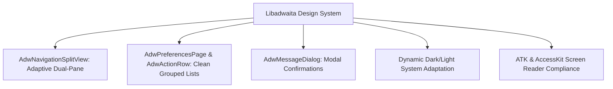

# Design System and Visual Standards

> **Document ID:** SPEC-UI-DS-031  
> **Status:** Approved Architectural Blueprint  
> **Version:** 1.0.0  
> **Last Updated:** 2026-10-24  

---

## 1. Architectural Alignment: Libadwaita & Wayland Native

To avoid aesthetic fragmentation and ensure seamless integration with the modern Hyprland Wayland desktop, Woderrise strictly adopts the **GNOME / Libadwaita HIG (Human Interface Guidelines)**:

- **Toolkit:** GTK4 + Libadwaita 1.5+ (`libadwaita-rs`).
- **Wayland Protocols:** Native Wayland subsurface rendering, fractional scaling (`wp-fractional-scale-v1`), and smooth client-side decorations.
- **System Theme Integration:** Automatically synchronizes with system dark/light mode preference via `org.freedesktop.appearance.color-scheme`.

---

## 2. Layout Structure & Responsive Behavior

The main application window utilizes an adaptive **Dual-Pane Navigation Split** (`AdwNavigationSplitView`):

1. **Sidebar Pane (Collapsible):**
   - Minimum width: 240px; Default width: 280px.
   - Hosts main navigation: Home, Categories (28 taxonomies), Installed, History, Settings.
   - Automatically collapses into a slide-over drawer on narrow displays (< 800px width) or tiled mobile/handheld form factors.
2. **Content Canvas (Fluid):**
   - Minimum width: 560px.
   - Adapts from a 1-column layout on compact displays to a 4-column responsive grid on wide 4K / ultrawide displays.

---

## 3. Typography & Visual Hierarchy

Woderrise utilizes the standard system typography stack (typically Cantarell, Inter, or system default):

| Role | Style | Size | Weight | Usage |
| :--- | :--- | :--- | :--- | :--- |
| **Display Title** | Sans-Serif | 24 pt | Bold (700) | Package details hero title |
| **Section Header** | Sans-Serif | 18 pt | Semi-Bold (600) | Category titles, history timeline dates |
| **Body Primary** | Sans-Serif | 11 pt | Regular (400) | Package descriptions, changelog text |
| **Body Secondary**| Sans-Serif | 10 pt | Regular (400) | Author subtitles, license tags, timestamps |
| **Code / Diff** | Monospace | 10 pt | Regular (400) | File paths, configuration diffs, SHA-256 hashes |

---

## 4. Reusable UI Components

### 4.1 Package Card (`WoderrisePackageCard`)
- Rounded card with subtle border and hover drop-shadow.
- 16:9 thumbnail image preview at top with fallback category icon.
- Badges overlay: 🟢 Compatible | 📦 Bundle | 🔒 Signed.
- Bottom action footer: Title, Author, Star Rating, and Quick-Install icon.

### 4.2 Grouped Settings Row (`AdwActionRow`)
- Clean horizontal list row with title, description subtitle, and trailing control (toggle switch, button, or navigation arrow).
- Used extensively in Settings, Package Dependencies, and Transaction History.

### 4.3 Side-by-Side Diff Widget (`WoderriseDiffViewer`)
- Dual-pane scrollable monospace viewer with synchronized vertical scrolling.
- Gutter displaying line numbers for both pre-install and post-install states.
- Syntax highlighting powered by `tree-sitter` for JSON, CSS, INI, Bash, and YAML.

---

## 5. Accessibility (a11y) Standards

1. **Keyboard Operability:**
   - Standard Tab navigation across all interactive widgets.
   - `Escape` closes modals, inspectors, and search overlays.
   - `Ctrl+F` focuses the global search bar from any view.
2. **Color Contrast:**
   - All text and iconography meets **WCAG 2.1 AA** contrast ratio standards (minimum 4.5:1 against card backgrounds).
   - Diff views do not rely solely on color: added lines include `+` symbols; removed lines include `-` symbols.
3. **Screen Reader Semantic Tree:**
   - Every image includes meaningful alternative text (`caption`).
   - Action buttons expose descriptive accessibility labels (e.g. `aria-label="Install Waybar Theme Catppuccin"` rather than just `"Install"`).
