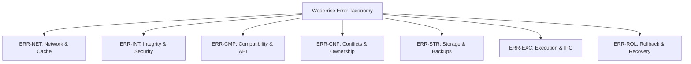

# Error Handling and Diagnostic Specification

> **Document ID:** SPEC-ARCH-ERR-024  
> **Status:** Approved Architectural Blueprint  
> **Version:** 1.0.0  
> **Last Updated:** 2026-10-24  

---

## 1. Error Handling Philosophy: Actionable Diagnostics Over Cryptic Codes

When desktop software fails, traditional Linux tools frequently output unhelpful messages like `exit code 1` or `Segmentation fault (core dumped)`. 

Woderrise mandates that **every system failure must produce an Actionable Diagnostic Record**. An error message is unacceptable unless it clearly answers four questions:
1. **What failed?** (The exact subsystem and operation that encountered an issue).
2. **Why did it fail?** (The root cause in clear, technical English).
3. **What state is the system in right now?** (e.g. *"Zero changes were made"*, or *"Files restored to previous backup"*).
4. **What can the user do next?** (Actionable recovery buttons: "Roll Back", "Retry", "Resolve Conflict", or "Export Debug Report").

---

## 2. Standardized Error Code Taxonomy



| Error Code | Category | Root Cause | Default User Recovery Option |
| :--- | :--- | :--- | :--- |
| `ERR-NET-001` | Network | Remote artifact download timed out (> 60s) | [Retry Download] / [Check Offline Mode] |
| `ERR-NET-002` | Network | Registry mirror returned HTTP 404/500 | [Switch to Alternate Mirror] |
| `ERR-INT-001` | Integrity | Artifact SHA-256 hash mismatch | Cache purged automatically; [Retry Fresh Download] |
| `ERR-INT-002` | Security | Manifest violates path traversal constraints (`../`) | Installation blocked immediately; report package. |
| `ERR-CMP-001` | Compatibility| Running Hyprland version older than required | [Update Hyprland via Pacman] / [View Compatible Versions] |
| `ERR-CMP-002` | Compatibility| C++ Plugin ABI header commit hash mismatch | [Compile Locally via hyprpm] / [Disable Plugin] |
| `ERR-CNF-001` | Conflict | Target file owned by another installed package | [Replace Existing Package] / [Cancel] |
| `ERR-CNF-002` | Concurrency | Another transaction is currently executing | Transaction queued; [Wait for In-Progress Install] |
| `ERR-STR-001` | Storage | Insufficient disk space on `$HOME` filesystem | Required bytes displayed; [Clear Download Cache] |
| `ERR-STR-002` | Storage | Failed to create pre-modification backup snapshot | Halts before writes; [Check Permissions on ~/.local] |
| `ERR-EXC-001` | Execution | Service reload failed (e.g. Waybar syntax error)| Automated compensation rollback; [Inspect Config Diff] |
| `ERR-ROL-001` | Rollback | User modified files after install (concurrency check)| [Keep My Edits] / [Overwrite with Backup] |

---

## 3. Structured Diagnostic Record Schema

When an error occurs, the engine serializes a structured JSON diagnostic payload into the transaction record and logs it via `tracing`:

```json
{
  "error_code": "ERR-CMP-002",
  "title": "Hyprland Plugin ABI Mismatch",
  "summary": "Plugin 'hyprsplit' is not compatible with your running Hyprland version.",
  "timestamp": 1792842100450,
  "txn_id": "TXN-20261024-0014",
  "subsystem": "CompatibilityEngine",
  "technical_details": {
    "running_hyprland_version": "0.41.2",
    "running_commit_hash": "3b9a71028dfbc611c01e92d84784a92c0199e81b9578ec09d841b9",
    "plugin_required_commit_hash": "a4f89b91c78e9011b988f00129a0081bb201199a",
    "hyprland_headers_present": false
  },
  "filesystem_state": "UNTOUCHED",
  "recovery_actions": [
    {
      "label": "Install Hyprland Headers to Enable Local Compilation",
      "action_type": "INSTALL_SYSTEM_PKG",
      "package_name": "hyprland-headers"
    },
    {
      "label": "Dismiss",
      "action_type": "DISMISS"
    }
  ]
}
```

---

## 4. Automatic Compensation Rollback

If any error occurs during **Stage 10 (Atomic File Writes)** or **Stage 12 (Service Activation)**:
1. The execution engine catches the error.
2. It transitions the transaction state to `FAILED`.
3. It immediately invokes the **Compensation Rollback Engine**:
   - Reverses all completed file operations using the in-memory transaction plan and pre-install backup snapshots.
   - Deletes any temporary staging files (`*.woderrise.tmp.*`).
   - Reloads previous configuration state.
4. Updates transaction status in the journal to `ABORTED_RECOVERED`.
5. Emits a D-Bus signal alerting the UI that the system has returned safely to its prior state.
