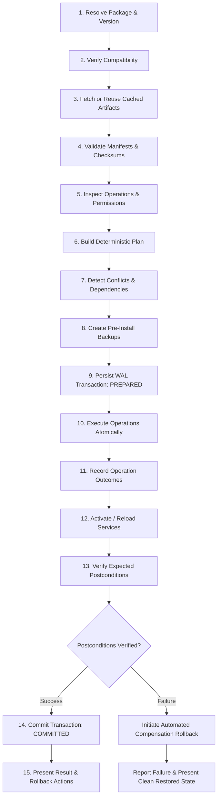

# Installation Engine Specification

> **Document ID:** SPEC-ENG-INST-013  
> **Status:** Approved Architectural Blueprint  
> **Version:** 1.0.0  
> **Last Updated:** 2026-10-24  

---

## 1. Architectural Philosophy & Execution Guarantees

The **Installation Engine** is the core operational heart of Woderrise. It treats desktop customization not as an ad-hoc shell script, but as a **mission-critical distributed transaction pipeline**.

Every state alteration—from placing a single PNG wallpaper to deploying a full 50-component desktop setup—must adhere strictly to **ACID-inspired desktop principles**:
- **Atomic:** Either all files, configuration blocks, and services deploy successfully, or the entire transaction is rolled back cleanly. No partial or half-broken desktops.
- **Consistent:** The local package database, file ownership registry, and filesystem state remain 100% synchronized.
- **Isolated:** Only a single mutating transaction can execute at any time, guaranteed by a local process-level mutex lock (`~/.local/state/woderrise/installer.lock`).
- **Durable:** Transaction progress is logged to an append-only Write-Ahead Log (WAL) SQLite journal before disk mutations occur. In the event of a sudden power outage or kernel panic, recovery resumes automatically upon reboot.

---

## 2. The 15-Stage Installation Pipeline

### Detailed Pipeline Stage Breakdown

#### Stage 1: Resolve Package & Version
- Resolves the requested package identifier and version constraint against local indexes and remote registry shards.
- Evaluates lockfiles if part of a reproducible bundle.

#### Stage 2: Verify Compatibility
- Checks host compositor version via `hyprctl version`.
- Verifies C++ plugin ABI header hashes if the package type is `plugin`.
- Verifies display server (`wayland_only` checks `$WAYLAND_DISPLAY`).
- Verifies CPU architecture (`uname -m`).

#### Stage 3: Fetch or Reuse Cached Artifacts
- Queries `~/.cache/woderrise/artifacts/<sha256>`.
- Reuses verified local artifacts without network requests; downloads missing artifacts with progress streams and timeout guards.

#### Stage 4: Validate Manifests & Checksums
- Computes SHA-256 hashes of all cached artifacts; verifies exact match against manifest declarations.
- Validates manifest against JSON Schema Draft 2020-12.

#### Stage 5: Inspect Requested Operations & Permissions
- Checks declared destination paths against security allowlists (`$HOME/.config`, `$HOME/.local`).
- Flags any operations requiring Polkit privilege escalation (native package installs) or service reloads.

#### Stage 6: Build Deterministic Installation Plan
- Constructs a directed acyclic graph (DAG) of atomic operations: directory creations, file staging, backups, atomic renames, config injections, and service reloads.

#### Stage 7: Detect File & Dependency Conflicts
- Compares target destination paths against the active File Ownership Database.
- Detects whether another package owns any target path. If a conflict exists, generates a compound resolution plan.

#### Stage 8: Create Pre-Install Backups & Durable Recovery Metadata
- For every existing file that will be replaced, overwritten, or modified, reads the original file and writes an uncompressed copy to `~/.local/share/woderrise/backups/<backup_id>/`.
- Computes and records the pre-installation SHA-256 hash in backup metadata.

#### Stage 9: Persist Transaction in SQLite WAL Journal (`PREPARED`)
- Writes a durable transaction record: `txn_id`, `package_id`, `version`, `state = 'PREPARED'`, timestamp, and the ordered list of planned operations with backup pointers.
- Flushes SQLite WAL to disk (`fsync`).

#### Stage 10: Execute Operations Atomically
- Updates journal state to `EXECUTING`.
- For each file operation:
  - Writes data to a temporary sibling file: `<target_path>.woderrise.tmp.<uuid>`.
  - Performs an atomic replace using POSIX `renameat2` with `RENAME_EXCHANGE` or atomic link swapping.
  - Sets exact file permissions (`0644` for configs, `0755` for scripts).

#### Stage 11: Record Operation Outcomes
- Updates each operation record in the journal: `status = 'COMPLETED'`.

#### Stage 12: Activate & Reload Affected Components
- Executes declarative service triggers:
  - Hyprland keybinds/configs: calls `hyprctl reload`.
  - Waybar: sends `killall -SIGUSR2 waybar`.
  - User systemd daemons: calls `systemctl --user reload-or-restart <unit>`.
  - Plugins: calls `hyprctl plugin load <path>`.

#### Stage 13: Verify Expected Postconditions
- Asserts that all target files exist on disk and match declared SHA-256 hashes.
- Queries service IPC sockets (e.g. Hyprland socket2) to ensure daemons did not crash upon configuration reload.

#### Stage 14: Commit Transaction or Initiate Recovery
- If all postconditions pass:
  - Updates transaction state to `COMMITTED`.
  - Updates local File Ownership Database.
- If any operation or postcondition fails:
  - Halts execution immediately.
  - Automatically initiates **Compensation Rollback** (reversing all operations performed in Stages 10-12).
  - Updates transaction state to `ABORTED_RECOVERED`.

#### Stage 15: Present Result & Recovery Options
- Emits D-Bus signals and UI events.
- Displays success notification with a direct **"Rollback"** button.
- If failure occurred, displays an actionable diagnostic modal detailing the error and confirming clean restoration.

---

## 3. Concurrency Rules & Lock Management

To prevent race conditions, corrupted states, and filesystem clobbering:
1. **Single Writer Lock:** The engine acquires an exclusive, non-blocking file lock on `~/.local/state/woderrise/engine.lock` before starting Stage 6.
2. **Rejection of Concurrent Mutating Requests:** If a user attempts to initiate an installation while another is active, the second request is queued or rejected with:
   `Error: An installation is already in progress (Transaction TXN-1042). Concurrent operations are blocked to prevent state corruption.`
3. **Read Concurrency:** Read operations (browsing, searching, inspecting diffs) run concurrently without blocking.

---

## 4. Timeouts & Cancellation Behavior

| Pipeline Stage | Timeout Limit | Action on Timeout |
| :--- | :--- | :--- |
| **Download Artifacts (Stage 3)** | 60 seconds (per artifact) | Abort download; clean partial cached files; no filesystem changes. |
| **Polkit Escalation (Stage 5)** | 120 seconds | Polkit auth timeout; cancel transaction cleanly. |
| **Atomic File Operations (Stage 10)** | 10 seconds | Abort; trigger compensation rollback. |
| **Service Reload (Stage 12)** | 5 seconds | Log warning; attempt service check; prompt user if service unresponsive. |

### User-Initiated Cancellation
- If the user clicks **"Cancel"** during Stages 1 through 7 (pre-execution), the pipeline terminates immediately with zero disk impact.
- If cancellation is requested during Stage 10 (execution), the engine finishes the current atomic file rename, halts subsequent operations, and triggers immediate compensation rollback.
