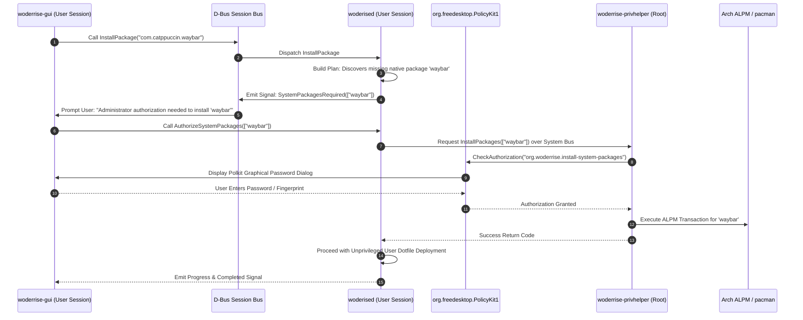

# IPC Protocol and Privilege Separation

> **Document ID:** SPEC-ARCH-IPC-022  
> **Status:** Approved Architectural Blueprint  
> **Version:** 1.0.0  
> **Last Updated:** 2026-10-24  

---

## 1. Architectural Philosophy: The Least-Privilege Contract

The overwhelming majority of Linux dotfile and theme breakages stem from running monolithic bash scripts with root privileges (`sudo ./install.sh`). Once root privileges are granted, rogue scripts can clobber `/etc`, install unvetted kernel modules, or wipe system packages.

**Woderrise enforces a strict Least-Privilege Architecture**:
1. The GUI (`woderrise-gui`) and the Core Installation Daemon (`woderised`) execute **exclusively under the desktop user's session (`UID == 1000`)**.
2. **Zero Root for Dotfiles:** The core engine requires zero elevated permissions to manage `$HOME/.config`, `$HOME/.local`, or reload Wayland services.
3. **Isolated Polkit Helper (`woderrise-privhelper`):** Elevated privileges are requested **only** when a package requires native Arch Linux packages (`pacman`). This is handled via a dedicated, single-purpose Polkit action with granular user authorization.



---

## 2. D-Bus Interface Specifications

The daemon exports the standard D-Bus interface: `org.woderrise.Installer` on the session bus.

### 2.1 Interface Definition: `org.woderrise.Installer`

#### Methods
- `PlanInstallation(package_id: String, version: String) -> (PlanSummary, String)`
  Generates an execution plan, file diffs, conflict list, and required system packages without modifying the disk. Returns plan UUID.
- `ExecutePlan(plan_uuid: String) -> (String)`
  Initiates the 15-stage transaction execution for the approved plan UUID. Returns `txn_id`.
- `CancelTransaction(txn_id: String) -> Boolean`
  Requests cancellation and safe rollback of an active transaction.
- `RollbackTransaction(txn_id: String) -> (String)`
  Initiates inverse transaction rollback for a previously committed transaction. Returns rollback `txn_id`.
- `UninstallPackage(package_id: String, restore_backup: Boolean) -> (String)`
  Uninstalls a package and optionally restores pre-installation backups.
- `GetInstalledPackages() -> Vec<InstalledPackageInfo>`
  Returns array of active installed packages, versions, and reference counts.
- `GetTransactionHistory(limit: UInt32, offset: UInt32) -> Vec<TransactionRecord>`
  Returns paginated transaction journal records.

#### Signals
- `TransactionProgress(txn_id: String, stage: UInt32, stage_name: String, progress_percent: Float)`
  Emitted in real-time as the engine transitions through pipeline stages.
- `TransactionCompleted(txn_id: String, success: Boolean, message: String)`
  Emitted when a transaction commits or recovers from failure.
- `ConflictDetected(plan_uuid: String, conflict_details_json: String)`
  Emitted when path ownership or dependency conflicts require user input.

---

## 3. Polkit Action Definition (`org.woderrise.policy`)

The privilege escalation helper installs the standard Polkit action file to `/usr/share/polkit-1/actions/org.woderrise.policy`:

```xml
<?xml version="1.0" encoding="UTF-8"?>
<!DOCTYPE policyconfig PUBLIC
 "-//freedesktop//DTD PolicyKit Policy Configuration 1.0//EN"
 "http://www.freedesktop.org/standards/PolicyKit/1/policyconfig.dtd">
<policyconfig>
  <vendor>Woderrise Desktop Store</vendor>
  <vendor_url>https://github.com/woderrise/woderrise</vendor_url>

  <action id="org.woderrise.install-system-packages">
    <description>Install native system dependencies for desktop customization</description>
    <message>Administrator authentication is required to install system packages requested by Woderrise</message>
    <defaults>
      <allow_any>auth_admin</allow_any>
      <allow_inactive>auth_admin</allow_inactive>
      <allow_active>auth_admin_keep</allow_active>
    </defaults>
    <annotate key="org.freedesktop.policykit.imply">org.woderrise.install-system-packages</annotate>
  </action>
</policyconfig>
```

---

## 4. Helper Containment & Input Sanitization

The privileged helper (`woderrise-privhelper`):
1. **Validates Package Names:** Accepts only valid ALPM package strings (`^[a-z0-9][a-z0-9+._-]*$`). Any shell metacharacters (`;`, `&`, `|`, `` ` ``, `$`) trigger immediate input rejection.
2. **Restricted Binary Execution:** Never calls `sh -c`. Directly invokes `/usr/bin/pacman` or links directly to `libalpm`.
3. **Zero Shell Evaluation:** Parameters are passed as discrete array elements to `std::process::Command`, preventing command injection vulnerabilities.
