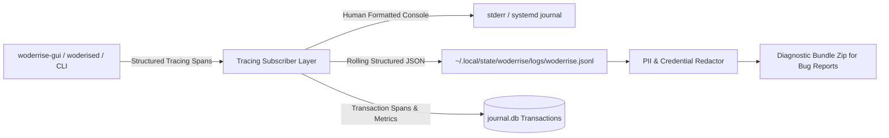

# Observability, Logging, and Diagnostics

> **Document ID:** SPEC-ARCH-OBS-025  
> **Status:** Approved Architectural Blueprint  
> **Version:** 1.0.0  
> **Last Updated:** 2026-10-24  

---

## 1. Observability Architecture & Standards

Woderrise implements **structured, asynchronous tracing and diagnostics** across all processes using the standard Rust [`tracing`](https://crates.io/crates/tracing) framework.



---

## 2. Structured Log Formats

Logs are recorded in standard JSON Lines (`.jsonl`) at `~/.local/state/woderrise/logs/current.log`:

```json
{
  "timestamp": "2026-10-24T10:45:00.123Z",
  "level": "INFO",
  "target": "woderrise_core::engine::installer",
  "span": {
    "name": "install_pipeline",
    "txn_id": "TXN-20261024-0012",
    "package_id": "com.catppuccin.waybar"
  },
  "fields": {
    "message": "Atomic file swap completed successfully",
    "path": "~/.config/waybar/config.jsonc",
    "pre_sha256": "8a91c0128...",
    "post_sha256": "f120ab543...",
    "duration_ms": 14.2
  }
}
```

### Log Levels
- `ERROR`: Unrecoverable errors, failed transactions, broken journal state.
- `WARN`: Missing optional dependencies, untested Hyprland versions, post-install user edit conflicts.
- `INFO`: Normal transaction lifecycle events (pipeline stage transitions, backup creations, service reloads).
- `DEBUG`: D-Bus IPC message payloads, SAT solver candidate evaluations, checksum validations.
- `TRACE`: Raw filesystem syscalls, file-by-file AST traversal, socket I/O bytes.

---

## 3. Privacy Standards & PII Redaction

Woderrise operates under a strict **Zero-Telemetry Default**:
1. **Zero External Phone-Home:** The software makes zero outbound telemetry, usage tracking, or analytics requests.
2. **Automated PII Redaction:** When diagnostic logs are exported:
   - User home directory paths (`/home/pirate/`) are sanitized to standard generic placeholders (`~` or `/home/user/`).
   - Network tokens, SSH keys, GPG fingerprints, and API keys are scrubbed via regex matching.
   - Hostnames and unique machine IDs (`/etc/machine-id`) are hashed.

---

## 4. Local Diagnostic Bundle Export

When a user reports a bug or requests community help on GitHub or Discord:
- The user clicks **"Help -> Export Diagnostic Report"** in the GUI (or runs `woderrise report`).
- The system generates a single compressed archive: `woderrise-diagnostic-YYYYMMDD.tar.zst`.

### The Bundle Contains:
1. `system_info.json`: Hyprland version, commit hash, OS version, kernel version, active Wayland compositor global protocols.
2. `sanitized_logs.jsonl`: The last 2,000 log lines with all PII and passwords redacted.
3. `journal_summary.json`: The last 10 transaction records (omitting file contents).
4. `active_packages.json`: List of installed store packages and versions.

The bundle **never contains private personal files, passwords, or dotfile content payloads**.
