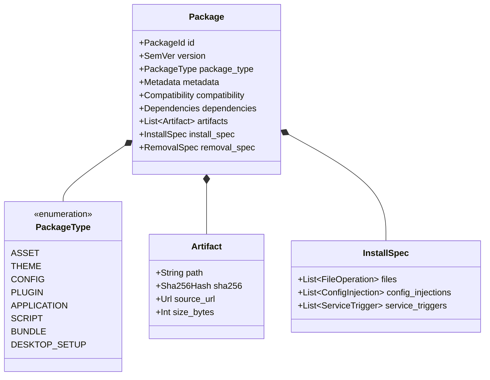
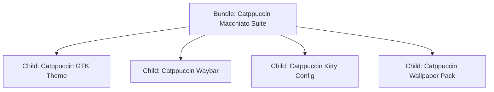

# Universal Package Model

> **Document ID:** SPEC-ECO-MOD-008  
> **Status:** Approved Architectural Blueprint  
> **Version:** 1.0.0  
> **Last Updated:** 2026-10-24  

---

## 1. Architectural Philosophy

The Linux desktop customization ecosystem has historically lacked a common unit of distribution. A wallpaper is distributed as an image download; a Waybar layout is distributed as a Gist; a rice is distributed as a multi-gigabyte Git clone with a custom bash installer.

**Woderrise** establishes a **Universal Package Model**: a single, unified object definition capable of representing everything from an isolated 200KB icon font up to a 50-component desktop environment.



---

## 2. Core Package Attributes

### 2.1 Package Identity (`PackageId`)
Every package possesses a globally unique, canonical identifier formatted according to reverse-DNS naming conventions:
- **Format:** `^[a-z0-9_-]+(\.[a-z0-9_-]+)+$`
- **Examples:**
  - `org.hyprland.hyprpaper`
  - `com.github.catppuccin.waybar`
  - `io.end4.illogical-impulse`
- Reverse-DNS ensures namespace isolation: creators own their domain prefix (e.g. `com.github.<username>.*` or `dev.<customdomain>.*`).

### 2.2 Semantic Versioning (`SemVer`)
Packages strictly adhere to [SemVer 2.0.0](https://semver.org):
- `MAJOR.MINOR.PATCH[-PRERELEASE][+BUILD]`
- Version changes communicate breaking changes to dependencies and file ownership schemas.

### 2.3 Package Types (`PackageType`)
Every package declares its fundamental lifecycle behavior through one of eight types:
1. `asset`: Static binary files placed directly in standard XDG data directories (e.g. wallpapers, fonts, sounds). Never modifies existing user configs.
2. `theme`: Color definitions, CSS, QSS, or Kvantum themes. Applied via standard styling mechanisms.
3. `config`: Declarative dotfile configurations for existing tools (Waybar, Rofi, Kitty, Mako, Dunst).
4. `plugin`: Dynamically linked C++ shared libraries loaded directly into the Hyprland compositor.
5. `application`: Desktop applications installed via system package manager or Flatpak.
6. `script`: Sandboxed automation or helper utilities.
7. `bundle`: A composition package referencing multiple child packages. Contains no direct files; delegates installation to member packages.
8. `desktop_setup`: A comprehensive desktop configuration coordinating multiple components with atomic session switching.

---

## 3. Metadata, Provenance & Signatures

Every package manifest provides cryptographic provenance:
- **License:** Valid [SPDX License Identifier](https://spdx.org/licenses/) (e.g. `MIT`, `GPL-3.0-or-later`, `Apache-2.0`). Unlicensed packages are rejected by the registry.
- **Authors & Maintainers:** Name, email, and PGP/Ed25519 signing key finger-print.
- **Source Repository:** Immutable URL to the public Git repository hosting the source files.
- **Cryptographic Signature:** The manifest and artifact manifest are signed with the creator's Ed25519 private key. The registry validates signatures against registered creator public keys.

---

## 4. Dependencies, Conflicts & Compatibility

### 4.1 Dependency Declarations
A package can declare three classes of dependencies:
```yaml
dependencies:
  # Native system packages managed by host package manager (e.g. pacman)
  system:
    - name: waybar
      version: ">=0.9.20"
    - name: rofi-wayland
    - name: ttf-jetbrains-mono-nerd

  # Other Woderrise packages managed by the store
  packages:
    - id: com.github.catppuccin.gtk-theme
      version: "^1.0.0"
    - id: org.hyprland.hyprpaper
      version: ">=0.6.0"

  # Optional enhancements (installed only if requested by user)
  optional:
    - id: com.github.catppuccin.cava
      description: "Audio spectrum visualizer matching the color scheme"
```

### 4.2 Conflicts
Packages declare explicit mutual exclusivity:
```yaml
conflicts:
  - id: com.github.otherauthor.competing-waybar
    reason: "Both packages claim exclusive ownership over ~/.config/waybar/config.jsonc"
```

### 4.3 Compatibility Matrix
Packages declare runtime environment constraints:
```yaml
compatibility:
  compositors:
    - name: hyprland
      version: ">=0.40.0"
      # For C++ plugins, require exact commit match or ABI hash
      abi_hash: "a4f89b91c78e9"
  display_server: wayland_only
  architecture: ["x86_64", "aarch64"]
```

---

## 5. Declarative Installation Operations

Woderrise replaces imperative bash scripts with **declarative operation primitives**:

### 5.1 File Placements (`files`)
```yaml
install:
  files:
    - source: "artifacts/config.jsonc"
      target: "~/.config/waybar/config.jsonc"
      mode: "0644"
      # Merge strategies: replace | preserve_if_exists | inject_snippet
      strategy: "replace"
      backup_before_write: true

    - source: "artifacts/aura-style.css"
      target: "~/.config/waybar/aura-style.css"
      mode: "0644"
```

### 5.2 Declarative Configuration Injections (`config_injections`)
Rather than overwriting an entire `hyprland.conf`, packages can inject scoped configuration blocks into modular directories:
```yaml
install:
  config_injections:
    - target: "~/.config/hypr/conf.d/keybinds.conf"
      source_block: |
        # Injected by com.creator.rofi-nord
        bind = SUPER, SPACE, exec, rofi -show drun -theme ~/.config/rofi/nord.rasi
      anchor: "bottom"
      unique_marker: "woderrise-injection:com.creator.rofi-nord:keybinds"
```

### 5.3 Service Triggers (`service_triggers`)
```yaml
install:
  service_triggers:
    - action: "reload_hyprland"        # Executes `hyprctl reload`
    - action: "send_signal"             # Sends signal to process
      process_name: "waybar"
      signal: "SIGUSR2"
    - action: "user_systemd_restart"   # Systemctl --user restart
      unit: "swaync.service"
```

---

## 6. How Bundles and Full Setups Compose

### 6.1 Bundles (Composition without Duplication)
A **Bundle** contains no file payloads. It acts as an orchestrator that declares child package dependencies with coordinated presets:



When a user installs the bundle:
1. The engine checks if any child is already installed.
2. It resolves all children into a unified dependency graph.
3. It executes child installations as sub-transactions under a single Parent Transaction.
4. If the user later uninstalls the bundle, the engine provides the choice to keep or remove individual child components.

### 6.2 Complete Desktop Setups (`desktop_setup`)
A **Complete Desktop Setup** is the top-level composition unit. In addition to orchestrating child packages (Bars, Launchers, Lock screens), it:
1. Mandates a **Complete Pre-Installation Snapshot** of the user's entire desktop configuration directory (`~/.config/hypr/`).
2. Configures session-wide environment variables and portal integrations.
3. Automatically creates a distinct "Setup Profile" in the local database, allowing the user to switch between full setups (e.g. "Work Setup" vs "Minimalist Setup") like desktop sessions.
