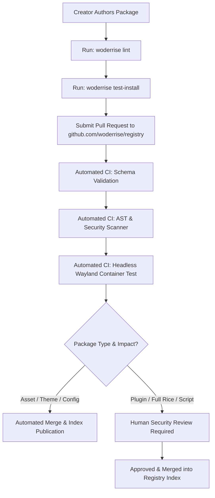

# Package Publishing and Creator Workflow

> **Document ID:** SPEC-ECO-PUB-011  
> **Status:** Approved Architectural Blueprint  
> **Version:** 1.0.0  
> **Last Updated:** 2026-10-24  

---

## 1. Overview & Publishing Philosophy

Woderrise provides a decentralized, community-driven ecosystem. Creators should be able to distribute themes, widgets, and complete setups freely without requiring custom code changes in the core application.

However, desktop configurations have access to the user session, personal files, and IPC sockets. To balance open community publishing with uncompromising user safety, all package submissions pass through an automated **Multi-Stage Verification Pipeline** followed by transparent cryptographic signing.



---

## 2. The Creator Submission Workflow

### Step 1: Scaffold Package Manifest
Creators initialize a manifest in their repository using the developer CLI:
```bash
woderrise init \
  --id com.github.myuser.catppuccin-waybar \
  --name "Catppuccin Waybar Pill" \
  --type config \
  --category bar_themes_modules
```

### Step 2: Local Linting & Schema Verification
Before submitting, the creator verifies manifest syntax and constraints:
```bash
woderrise lint woderrise.yaml
```
The linter checks:
- Strict JSON Schema Draft 2020-12 compliance.
- Valid SPDX license identifier.
- Canonical reverse-DNS ID formatting.
- Correctness of all artifact SHA-256 hashes against actual files on disk.
- Absence of forbidden path traversal sequences (`../`, `/etc/`, `/usr/bin/`).

### Step 3: Sandboxed Dry-Run Installation
Creators test the package in a disposable Bubblewrap container:
```bash
woderrise test-install woderrise.yaml --sandbox
```
This mounts an ephemeral `$HOME` directory in RAM, simulates the 15-stage installation pipeline, executes service triggers inside a headless mock compositor, and verifies clean uninstallation and rollback.

### Step 4: Cryptographic Package Signing
The creator signs the manifest with their Ed25519 private key:
```bash
woderrise sign woderrise.yaml --key ~/.config/woderrise/creator.key
```

### Step 5: Registry Pull Request
The creator creates a GitHub Pull Request against `github.com/woderrise/registry`, appending the new version line to the appropriate sharded JSON file (e.g. `sh/ca/com.github.myuser.catppuccin-waybar.json`).

---

## 3. Automated Validation & Security Checks

Every incoming Pull Request triggers an automated GitHub Actions CI suite executing five verification gates:

### Gate 1: Schema & Semantic Integrity
- Verifies manifest schema version (`1.0.0`).
- Validates semantic version ordering (new versions must strictly increment SemVer).
- Verifies that previously published versions are unchanged (immutability enforcement).

### Gate 2: Artifact Availability & Hash Matching
- CI fetches all declared artifact URLs directly from their origin (GitHub Releases, raw Git).
- Computes SHA-256 digests on fetched payloads.
- Fails immediately if any remote artifact is missing (HTTP 404), exceeds size quotas (e.g. max 250MB for single package), or fails hash validation.

### Gate 3: Security & Static Pattern Analysis
Static AST analyzers inspect all text configuration files, CSS, and scripts for dangerous patterns:
- Prohibited system calls: `sudo`, `doas`, `pkexec` (must use declarative Polkit dependency mechanism instead).
- Data exfiltration patterns: `curl -d @~/.ssh/id_rsa`, `nc -e`, base64-encoded eval payloads.
- Obfuscated binary blobs disguised as text.

### Gate 4: Headless Container Execution Test
CI spawns an unprivileged Arch Linux container running a headless Hyprland session via `wlroots` headless backend:
- Installs the package.
- Asserts that file permissions conform to `0644` (configs) or `0755` (executables).
- Executes uninstallation and verifies zero leftover files in `$HOME/.config`.
- Executes rollback and verifies exact byte-level restoration.

---

## 4. Moderation Levels & Risk Tiers

Packages are classified into three moderation tiers based on architectural risk:

| Tier | Included Categories | Verification Level | Review SLA |
| :--- | :--- | :--- | :--- |
| **Tier 1: Low Risk (Green)** | Wallpapers, Fonts, Icons, GTK Themes, Color Presets | **100% Automated CI** (Instant merge upon passing all gates) | < 5 minutes |
| **Tier 2: Medium Risk (Yellow)** | Waybar themes, Rofi configs, Notification layouts | **Automated CI + Community Trust Score** | < 2 hours |
| **Tier 3: High Risk (Orange)** | Hyprland C++ Plugins, Full Desktop Rices, Confined Scripts | **Automated CI + Mandatory Human Security Review** | < 48 hours |

---

## 5. Deprecation, Yanking, and Emergency Takedown

### 5.1 Package Yanking (Creator-Initiated)
A creator can yank a version by submitting a PR setting `"yanked": true`:
- The version is hidden from search and update notifications.
- Existing installations remain functional; reproducible lockfiles continue to resolve.

### 5.2 Emergency Security Takedown (Registry Maintainer Action)
In the event that a malicious package bypasses review or an upstream account is compromised:
1. **Registry Blocklist:** Maintainers append the compromised package ID or artifact SHA-256 to `blocklist.json`.
2. **Client Revocation Sync:** On next sync, Woderrise clients receive the updated blocklist.
3. **User Alert:** If a user has an active blocklisted package installed, Woderrise displays an urgent security notification with a single-click action: **"Isolate & Rollback Compromised Package"**.
