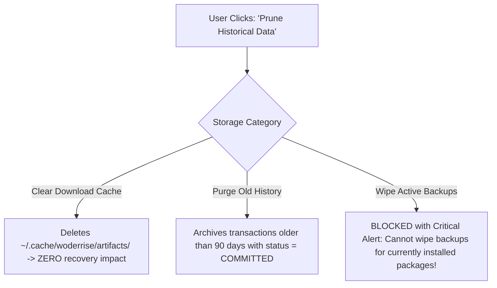

# Privacy Policy and Data Governance

> **Document ID:** SPEC-SEC-PRV-029  
> **Status:** Approved Architectural Blueprint  
> **Version:** 1.0.0  
> **Last Updated:** 2026-10-24  

---

## 1. Core Privacy Commitments

Woderrise is built by and for the Linux open-source community. We consider user privacy an absolute architectural requirement rather than an optional configuration.

1. **Zero Telemetry by Default:** The application contains zero tracking beacons, telemetry pings, advertising SDKs, or behavioral analytics.
2. **Zero Account Requirement:** Users do not need an account, email address, or authentication token to browse, download, install, or manage packages.
3. **Local First:** All package databases, search indexes, transaction histories, and backups reside 100% locally on the user's personal workstation.

---

## 2. Data Flow & Network Requests

| Interaction | Destination Endpoint | Payload Transmitted | Cached Locally? |
| :--- | :--- | :--- | :--- |
| **Catalog Sync** | `github.com/woderrise/registry` or CDN mirror | Standard HTTP GET request. Zero client metadata transmitted. | Yes (`registry.db`) |
| **Artifact Download** | Origin Release URL (e.g. GitHub Releases) | Standard HTTP GET for content-addressed SHA-256 archive. | Yes (`~/.cache/woderrise/artifacts/`) |
| **Search & Filtering**| **None (Local Operation)** | Zero network traffic. Queries local SQLite FTS5 database. | N/A |
| **Installation & Rollback** | **None (Local Operation)** | Zero network traffic. Operates purely on local filesystem. | Yes (`journal.db`) |

---

## 3. Local Data Storage & User Erasure Rights

### 3.1 Local Storage Locations
- **Metadata & State:** `~/.local/share/woderrise/` (`registry.db`, `ownership.db`, `journal.db`, `backups/`)
- **Runtime Locks & Sockets:** `~/.local/state/woderrise/`
- **Temporary Cache:** `~/.cache/woderrise/`

### 3.2 Safe History Pruning vs. Critical Recovery Data
Users can manage and prune their local data via **Settings -> Storage & Privacy**:

> [!CAUTION]
> **Data Integrity Guard:**
> Woderrise will never allow a user to delete backup snapshots referenced by **currently installed packages**. Doing so would destroy the ability to cleanly uninstall or roll back those packages. Backups can only be permanently pruned after their corresponding package has been cleanly uninstalled.
