# Product Vision & Principles

> **Document ID:** SPEC-PROD-VISION-001  
> **Status:** Approved Architectural Blueprint  
> **Version:** 1.0.0  
> **Last Updated:** 2026-10-24  

---

## 1. Executive Summary & Long-Term Vision

**Woderrise** envisions a Linux desktop experience where customization is as seamless, discoverable, inspectable, and reliable as installing an application from an app store. 

The Hyprland Wayland compositor has catalyzed an explosion of creative, beautiful desktop environments ("rices"). However, adopting and sharing these setups remains trapped in the dark ages of computing: users must execute raw shell scripts found on forums, blindly overwrite their `$HOME/.config` directory, manually debug missing packages, and face total desktop instability when a configuration breaks or an ABI changes.

Woderrise eliminates this friction by establishing a **declarative, transaction-journaled desktop customization store**. Whether a user desires a single animated wallpaper, an aesthetic Waybar layout, or a completely orchestrated cyberpunk workstation with custom shaders, widgets, and dynamic plugins, Woderrise enables:
1. **Zero-Fear Customization:** Instant inspection before changes and guaranteed, atomic rollbacks if anything goes wrong.
2. **Unified Modularity:** A single universal packaging model that scales from an isolated cursor theme up to a 50-component desktop setup.
3. **Open Community Ecosystem:** A decentralized, Git-backed package registry where creators can share their creations without modifying the core application.

---

## 2. Target Personas & User Profiles

### Persona A: "The Curious Customizer" (Novice Linux User)
- **Background:** Recently migrated from Windows or macOS to Arch Linux or Fedora to use Hyprland after seeing stunning screenshots on r/unixporn or YouTube.
- **Pain Points:** Intimidated by the terminal; terrified of breaking their graphical session; does not understand JSONC, CSS, or shell scripting; cannot debug why Waybar fails to launch.
- **Goal:** Wants to click "Install" on a gorgeous desktop rice, have it work immediately, and be able to click "Rollback" or "Uninstall" if they do not like it.

### Persona B: "The Component Curator" (Intermediate Enthusiast)
- **Background:** Comfortable with Linux and the terminal, has an established Hyprland setup, but wants to swap out individual components (e.g., trying three different Waybar themes, testing a new Rofi launcher, or adding a workspace switcher plugin).
- **Pain Points:** Hates monolithic dotfile installers that force complete rewrites of `~/.config/hypr/hyprland.conf`; tired of manually merging conflicting configuration snippets.
- **Goal:** Wants to discover, preview, and install modular components without disrupting their existing keybindings or personal workflow.

### Persona C: "The Aesthetic Creator" (Rice Creator / Themer)
- **Background:** Spends dozens of hours crafting meticulous color schemes, widgets, custom Waybar modules, and Hyprland animations.
- **Pain Points:** Overwhelmed by handling bug reports from users whose systems broke due to hardcoded paths, missing dependencies, or conflicting scripts; no clean platform to distribute their work.
- **Goal:** Wants a structured, declarative packaging standard that packages their creation with verified dependencies, automated linting, and screenshot previews.

### Persona D: "The System Reliability Engineer" (Power User / Security Conscious)
- **Background:** Runs Arch Linux for work; values system immutability, data integrity, and strict security boundaries.
- **Pain Points:** Refuses to run arbitrary `curl ... | bash` scripts; demands strict auditing of file modifications and minimal root privileges.
- **Goal:** Wants complete pre-installation diff inspection, cryptographic artifact verification, sandboxed script boundaries, and local transactional journaling.

---

## 3. Core Product Principles

Woderrise is built upon eighteen non-negotiable architectural and product principles:

```mermaid
graph TD
    A[Woderrise Product Principles] --> B[Safety & Recoverability]
    A --> C[Transparency & Inspectability]
    A --> D[Modularity & Declarative Architecture]
    A --> E[Security & Minimal Privilege]

    B --> B1[Atomic WAL Journaling]
    B --> B2[Mandatory Backups Prior to Modification]
    B --> B3[Safe Rollback with Concurrency Guards]
    B --> B4[Preserve Unrelated User Customizations]

    C --> C1[Complete Pre-Install Diff Inspection]
    C --> C2[Clear Failure Diagnostics & Actionable Fixes]
    C --> C3[Persistent Human-Readable History]

    D --> D1[One-Click Installation for Supported Packages]
    D --> D2[Unified Spec: Asset to Full Setup]
    D --> D3[Declarative Manifests Over Arbitrary Scripts]
    D --> D4[Pre-Flight Compatibility & Dependency Checks]

    E --> E1[Zero Root for User Dotfiles]
    E --> E2[Explicit Consent for System Package Installs]
    E --> E3[Strict Bubblewrap Sandboxing for Legacy Adapters]
    E --> E4[Cryptographic Provenance & Hash Verification]
```

### 1. One-Click Installation for Supported Packages
A user should never be forced to open a terminal, clone a repository, or manually move files to install a supported package. The engine automates downloading, verifying, backing up, file placement, and service reloading.

### 2. Inspectability Before Installation
No file on the user's filesystem will ever be modified until the user has had the opportunity to inspect:
- The exact files being added, modified, or replaced.
- A visual unified diff of configuration changes.
- All declared system dependencies.
- Required execution hooks or permissions.

### 3. Unified Package Ecosystem
A single wallpaper, a Waybar module, an icon set, a Hyprland plugin, and a full desktop environment share the exact same manifest format, package schema, and transactional lifecycle. Full setups compose modular components rather than duplicating them.

### 4. Declarative Manifests First
Packages must describe their behavior declaratively (files, targets, symlinks, configuration injections, service triggers). Arbitrary shell execution is strictly discouraged and heavily restricted.

### 5. Pre-Flight Dependency & Compatibility Verification
Before a single file is touched or downloaded, the system verifies:
- Hyprland version and C++ plugin ABI compatibility.
- Display server and Wayland protocol compatibility.
- Available disk space.
- File ownership and collision detection.
- System package availability.

### 6. Persistent Installation History & Transaction Journaling
All operations are committed to a durable, append-only SQLite Write-Ahead Log (WAL) transaction journal. The user can review the exact chronological history of every installation, upgrade, removal, and rollback.

### 7. Crash Consistency & Durable Recovery
If the system experiences a power loss, kernel panic, or crash mid-transaction, Woderrise detects the incomplete transaction on subsequent boot and safely rolls back to the previous stable state.

### 8. Backups Before Modifying Existing User Files
Before overwriting or altering any existing file in `$HOME`, Woderrise stores a content-addressed, uncompressed copy in a local backup repository.

### 9. Rollback That Reverses Recorded Operations Safely
Users can trigger a rollback from the journal. Rollback reverses operations in strict inverse dependency order, restoring modified files, deleting created files, and restoring removed files.

### 10. Preserve Unrelated User Modifications (Optimistic Concurrency)
If a user manually modifies an installed configuration file after installation, Woderrise detects the modification via checksum validation. It will **never silently overwrite** user edits during rollback or updates; instead, it provides a 3-way merge or prompts for conflict resolution.

### 11. Explicit Consent for Privileged Operations
The core engine and GUI run as the unprivileged user. Any action requiring elevated privileges (such as installing native Arch Linux packages via `pacman`) must explicitly request consent through Polkit with granular reason strings.

### 12. No Silent Execution of Arbitrary Community Scripts
Packages cannot run uninspected shell scripts. Any package containing post-install hooks must present the full script source to the user for explicit approval, execute within a strictly confined Bubblewrap sandbox, and come with a clear warning that external side effects cannot be guaranteed to roll back.

### 13. Minimal Privilege Boundary
User configurations live in `$HOME/.config`, `$HOME/.local/share`, and `$HOME/.local/state`. The core daemon requires zero root permissions to manage these files.

### 14. Actionable Diagnostics and Clear Error Messages
Error messages must avoid cryptic exit codes. Every error screen must explain:
1. What failed.
2. Why it failed.
3. What state the system is currently in.
4. Actionable recovery buttons (e.g., "Roll Back Changes", "Retry Download", "Resolve Conflict").

### 15. Offline-Aware Package Caching
Downloaded artifacts, manifests, and signatures are stored in a content-addressed local cache. If an upstream git repository or web server is deleted or the user loses internet connectivity, installed packages can still be inspected, reconfigured, or uninstalled.

### 16. Versioning and Reproducible References
All packages must define semantic versions (`semver`). All remote dependencies, assets, and artifacts must be referenced by immutable git commit SHAs or cryptographic SHA-256 content hashes.

### 17. Community Contributions Without Core Changes
The registry is decentralized and community-driven. Adding new themes, rices, or components requires only submitting a manifest to the public catalog repository, requiring zero code changes to the Woderrise application.

### 18. Open-Source Transparency & Honest Guarantees
Woderrise explicitly distinguishes **guaranteed transactional operations** (file replacements, declarative configuration injections, symlinks) from **best-effort operations** (external service state, third-party system daemon reloads, sandboxed script side effects). We never promise full rollback for irreversible operations.

---

## 4. Product Boundaries (What Woderrise Is & Is Not)

| What Woderrise IS | What Woderrise IS NOT |
| :--- | :--- |
| A desktop customization store & declarative package manager. | An operating system installer or Linux distribution. |
| A manager for user-session dotfiles, assets, and Hyprland plugins. | A replacement for system package managers (`pacman`, `apt`, `dnf`). |
| An atomic file-transaction engine for user configurations. | A full-system disaster recovery or Btrfs snapshot tool (e.g. Snapper/Timeshift). |
| A bridge that verifies and prompts for system dependencies. | An unconfined script execution harness for random bash scripts. |
| A Wayland-native graphical application built for Hyprland. | An X11 window manager configurator. |

---

## 5. Success Metrics & Key Performance Indicators (KPIs)

1. **Zero Silent Overwrites:** 100% of existing customized user files are detected, backed up, and protected from silent clobbering.
2. **Crash Recovery Reliability:** 100% recovery to last stable state following simulated process termination or power cuts at any stage of the 15-stage installation pipeline.
3. **Rollback Fidelity:** Over 99% of declarative package installations can be cleanly reversed to the exact prior byte-for-byte state without manual intervention.
4. **Time to First Rice:** A novice user can boot into a fresh Hyprland install, launch Woderrise, and have a functional, themed Waybar + wallpaper + launcher desktop operational in under 3 minutes.
5. **Ecosystem Safety:** Zero root-privilege escalations permitted without explicit Polkit user authorization.
