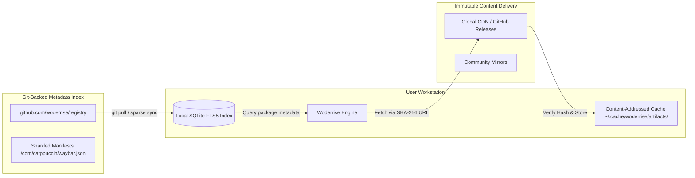

# Registry and Repositories Architecture

> **Document ID:** SPEC-ECO-REG-010  
> **Status:** Approved Architectural Blueprint  
> **Version:** 1.0.0  
> **Last Updated:** 2026-10-24  

---

## 1. Architectural Overview & Design Goals

The Woderrise package ecosystem is designed around a **decentralized, Git-backed registry** paired with **content-addressed artifact storage**. 

Inspired by modern, resilient package architectures (Cargo, Homebrew, and Flathub), Woderrise strictly separates:
1. **The Registry Metadata Index:** Lightweight, version-controlled metadata files indexing package identity, versions, descriptions, dependencies, and artifact hashes.
2. **Artifact Payloads:** Content-addressed binary and configuration archives stored on decentralized CDNs, GitHub Releases, or IPFS.



---

## 2. Repository Structure & Current Import Format

The implemented client currently imports versioned package directories. This
format keeps the manifest and its verified local artifacts together and gives
the installer an exact immutable path:

```text
registry/
└── packages/
    └── com.catppuccin.waybar/
        └── 1.0.0/
            ├── woderrise.yaml
            └── artifacts/
                └── mocha.css
```

The importer recursively discovers files named `woderrise.yaml`, validates
their package ID/version, verifies every referenced artifact, and atomically
replaces the SQLite catalog. Duplicate `(package_id, version)` entries fail
the import transaction. The client does not currently parse the JSONL format
described below; that remains a future registry transport/index format.

### 2.1 Planned Sharded Index Format

To prevent git repository bloat as the catalog scales to tens of thousands of packages, the registry index uses a **2-character prefix sharding scheme** (identical to Cargo):

```text
registry/
├── config.json                     # Registry configuration & API endpoints
├── keys/                           # Trusted root Ed25519 public keys
│   └── root-2026.pub
├── 1/                              # Packages with 1-character names
├── 2/                              # Packages with 2-character names
├── 3/                              # Packages with 3-character names
└── sh/                             # Sharded by first 2 characters of package ID
    └── ar/
        └── org.hyprland.hyprpaper.json
    └── ca/
        └── com.catppuccin.waybar.json
```

### 2.2 Sharded Index Format (`com.catppuccin.waybar.json`)
Each package file in the index is an append-only JSON Lines (`.jsonl`) file, where each line represents a released semantic version:

```json
{"schema_version":"1.0.0","id":"com.catppuccin.waybar","name":"Catppuccin Waybar","version":"1.0.0","type":"config","license":"MIT","sha256":"4b227...","deps":[{"name":"waybar","version":">=0.9.20"}],"artifacts":[{"path":"config.jsonc","sha256":"e3b0c...","url":"https://github.com/catppuccin/waybar/releases/download/v1.0.0/config.jsonc"}],"yanked":false}
{"schema_version":"1.0.0","id":"com.catppuccin.waybar","name":"Catppuccin Waybar","version":"1.1.0","type":"config","license":"MIT","sha256":"8a91c...","deps":[{"name":"waybar","version":">=0.9.22"}],"artifacts":[{"path":"config.jsonc","sha256":"f120a...","url":"https://github.com/catppuccin/waybar/releases/download/v1.1.0/config.jsonc"}],"yanked":false}
```

---

## 3. Package Discovery & Local Search Indexing

Rather than requiring active internet requests for every search keystroke:
1. **Incremental Sync:** On client launch or background refresh, Woderrise fetches the latest Git commits using smart HTTP git transfer or an optimized compressed tarball snapshot (`index-snapshot.tar.zst`).
2. **Local SQLite FTS5 Engine:** The metadata is compiled directly into a high-performance local SQLite database (`~/.local/share/woderrise/registry.db`) equipped with Full-Text Search 5 (FTS5).
3. **Instantaneous Results:** Searches across title, tags, description, and author evaluate in under **10 milliseconds** completely offline.

---

## 4. Immutable Releases & Version Retention

To guarantee **reproducible installations and reliable rollbacks**:
- **Immutability Guarantee:** Once a version (e.g. `1.2.0`) is published to the registry, its manifest, dependencies, and artifact hashes can **never be mutated or overwritten**.
- **Yanking (Deprecation):** If a critical vulnerability or bug is discovered in a release, maintainers or creators may mark the version as `"yanked": true`.
  - Yanked packages cannot be newly installed by general users.
  - Existing installations, rollbacks, and reproducible builds referencing that exact version continue to function without breaking.

---

## 5. Content Delivery, Mirrors & Offline Behavior

### 5.1 Content-Addressed Caching
Artifacts are stored on disk using their cryptographic SHA-256 digest:
`~/.cache/woderrise/artifacts/8f/8f434346648f6b96df89dda901c5176b10a6d83961dd3c1ac88b59b2dc327aa4`

Before an artifact is handed to the installation engine:
1. The engine checks if the file exists in local cache.
2. Computes the SHA-256 hash of the cached file.
3. If valid, the file is reused without network transfer.

### 5.2 Community Mirrors & Redundancy
The registry configuration specifies primary and fallback mirror endpoints:
```json
{
  "api_version": 1,
  "dl": "https://cdn.woderrise.org/artifacts/{sha256}",
  "fallback_mirrors": [
    "https://mirror.eu.woderrise.org/artifacts/{sha256}",
    "https://archive.org/download/woderrise-cache/{sha256}"
  ]
}
```

### 5.3 Offline Mode Capabilities
When no internet connection is detected:
- **Available:** Full-text catalog search, pre-installation inspection of cached packages, package re-configuration, uninstallation, history audit, and rollback.
- **Unavailable:** Downloading new, un-cached packages; checking for remote updates.
- The UI never hangs or presents modal network error alerts; an unobtrusive status pill indicates *"Offline (Cached Catalog)"*.
