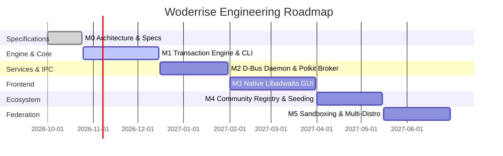

# Project Roadmap and Delivery Milestones

> **Document ID:** SPEC-MGT-ROA-036  
> **Status:** Approved Architectural Blueprint  
> **Version:** 1.0.0  
> **Last Updated:** 2026-10-24  

---

## 1. Executive Roadmap Overview

The delivery of Woderrise is organized into six disciplined, sequential milestones:

---

## 2. Milestone Breakdown & Deliverables

### Milestone 0: Architecture & Technical Foundations (Current)
- **Status:** ✅ **Completed**
- **Deliverables:**
  - 41-document architectural foundation.
  - Package manifest specification v1.0.0 and JSON Schemas.
  - ACID-inspired SQLite WAL transaction journal schema.
  - Formal STRIDE threat model and security specifications.

---

### Milestone 1: Core Engine, WAL Journal & CLI (M1)
- **Target Timeline:** Q4 2026 (8 Weeks)
- **Dependencies:** Milestone 0 completion.
- **Core Deliverables:**
  - `woderrise-core` Rust crate:
    - 15-stage atomic installation pipeline.
    - POSIX `renameat2` atomic file replacement engine.
    - Content-addressed backup engine (`backup_snapshots`).
    - SQLite WAL transaction journal and crash-recovery scanner.
    - Inverse rollback engine with optimistic concurrency checks.
  - `woderrise-cli` command-line tool:
    - `woderrise install <manifest.yaml>`
    - `woderrise rollback <txn_id>`
    - `woderrise list`
    - `woderrise lint <manifest.yaml>`
- **Acceptance Criteria:** 100% pass rate on the 11-point fault injection test suite (`cargo test --test fault_injection`). Zero filesystem corruption under simulated crashes.

---

### Milestone 2: D-Bus Daemon, Resolver & Privilege Helper (M2)
- **Target Timeline:** Q1 2027 (6 Weeks)
- **Dependencies:** Milestone 1 completion.
- **Core Deliverables:**
  - `woderrise-dbus` crate exporting `org.woderrise.Installer` over session bus.
  - `woderrise-privhelper` root helper with Polkit authorization (`org.woderrise.install-system-packages`).
  - PubGrub SAT dependency solver integration.
  - Hyprland IPC client (`hyprctl version`, `hyprctl reload`, `hyprctl plugin load`).
- **Acceptance Criteria:** Daemon starts via systemd D-Bus auto-activation; unprivileged user can trigger native `pacman` installation of `waybar` via Polkit with zero root access for dotfiles.

---

### Milestone 3: Native Libadwaita Graphical Frontend (M3)
- **Target Timeline:** Q1 2027 (8 Weeks)
- **Dependencies:** Milestone 2 completion.
- **Core Deliverables:**
  - `woderrise-gui` native Wayland desktop application.
  - Adaptive dual-pane navigation (`AdwNavigationSplitView`).
  - Package catalog cards, search bar with sub-50ms local FTS5 response.
  - HiDPI screenshot gallery with color palette extraction swatches.
  - Pre-installation unified side-by-side diff viewer.
  - Chronological History view with one-click Rollback button.
- **Acceptance Criteria:** Full compliance with Libadwaita HIG; complete keyboard navigation; zero UI freezes during background transactions.

---

### Milestone 4: Community Registry & Ecosystem Seeding (M4)
- **Target Timeline:** Q2 2027 (6 Weeks)
- **Dependencies:** Milestone 3 completion.
- **Core Deliverables:**
  - Public Git repository `github.com/woderrise/registry` with 2-char sharding.
  - Automated GitHub Actions CI verification pipeline (Schema linting, AST security scanner, headless Wayland execution test).
  - Seed catalog of 50 high-quality packages:
    - 15 Wallpapers (8K, dynamic).
    - 15 Waybar layouts and themes.
    - 10 Rofi and launcher configs.
    - 5 Official Hyprland plugins (`hyprbars`, `hyprsplit`).
    - 5 Complete desktop setups (End-4, ML4W, Catppuccin, Nord).

---

### Milestone 5: Bubblewrap Sandboxing & Distribution Expansion (M5)
- **Target Timeline:** Q2 2027 (6 Weeks)
- **Dependencies:** Milestone 4 completion.
- **Core Deliverables:**
  - Isolated Bubblewrap (`bwrap`) script execution harness for legacy packages.
  - Abstract `SystemPackageManager` trait supporting Fedora (`dnf`) and openSUSE (`zypper`).
  - Creator publishing CLI tool (`woderrise publish`).

---

## 3. Explicit Out-of-Scope Items (Guarding Project Scope)

The following capabilities are explicitly **excluded** from initial milestones:
1. **Replacement for System Package Managers:** Woderrise will not become a generic package manager for Linux operating systems.
2. **Whole-Disk Btrfs Snapshot Orchestration:** While compatible with Snapper and Timeshift, Woderrise operates strictly within user session dotfiles and does not orchestrate subvolume snapshots.
3. **X11 / i3 / bspwm Support:** Woderrise is laser-focused on the Wayland compositor ecosystem, specifically Hyprland.
4. **Commercial Paid Marketplace:** All community packages in the official registry are strictly free and open-source under recognized SPDX licenses.
