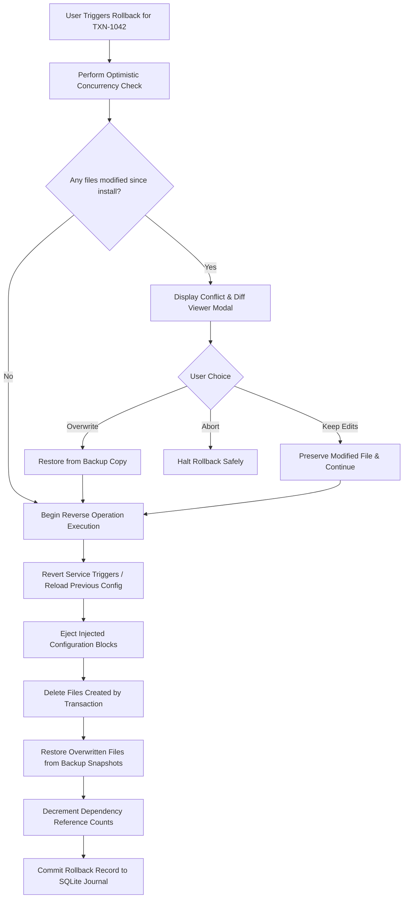

# Rollback and Recovery Specification

> **Document ID:** SPEC-ENG-ROL-015  
> **Status:** Approved Architectural Blueprint  
> **Version:** 1.0.0  
> **Last Updated:** 2026-10-24  

---

## 1. Architectural Definitions: Distinguishing State Operations

To prevent user confusion and engineering defects, Woderrise strictly defines and distinguishes four separate operational terms that are frequently conflated in Linux administration:

| Operation | Scope | Mechanism | Reversibility Guarantee |
| :--- | :--- | :--- | :--- |
| **Transaction Rollback** | An exact prior transaction recorded in the journal. | Reverses recorded operations in reverse order using verified local backups. | **Guaranteed** for all declarative file operations and configuration injections. |
| **Package Uninstallation** | The removal of an installed package and its owned files. | Removes package-owned files and purges ownership table; optionally restores pre-install backup. | **Guaranteed** clean file removal; optional backup restoration. |
| **Version Downgrade** | Transitioning an installed package from version `N` to version `N-1`. | Applies version `N-1` manifest as an update transaction. | **Best-effort** if configuration schemas are backwards-incompatible. |
| **System Snapshot Restore** | Whole-system block-level or filesystem snapshot (e.g. Btrfs Snapper, Timeshift). | Reverts the entire root filesystem or home subvolume to a prior block state. | Handled by OS/filesystem; out of scope for Woderrise core. |

---

## 2. Inverse Operation Execution Rules

When a transaction rollback is triggered, operations are processed in **strict reverse sequence (`sequence_num` descending)**:

### Exact Reversal Semantics by Operation Type

1. **`CREATE_FILE` Reversal:**
   - The file was created by the transaction and did not exist previously.
   - **Action:** Delete the file from disk (`unlink`).
   - If the parent directory was also created by this transaction and is now empty, prune the empty directory.
2. **`MODIFY_FILE` Reversal:**
   - The file existed previously and was modified/replaced.
   - **Action:** Read the verified pre-install backup from `backup_snapshots`. Atomically swap the backup content back into the target path via POSIX atomic rename.
3. **`DELETE_FILE` Reversal:**
   - The file was removed by the transaction.
   - **Action:** Restore the file from its backup snapshot, preserving original POSIX permissions and timestamps.
4. **`INJECT_CONFIG` Reversal:**
   - Scans the target configuration file for the exact `unique_marker` block injected during installation.
   - Surgically removes the injected block while leaving all surrounding user lines untouched.
5. **`SERVICE_TRIGGER` Reversal:**
   - Re-evaluates active service states and sends reload signals (`hyprctl reload`, `killall -SIGUSR2 waybar`) to activate the restored state.

---

## 3. The Optimistic Concurrency Guard (Protecting User Edits)

The most catastrophic failure mode of traditional dotfile managers is **silent overwriting of subsequent user work**.

> [!CAUTION]
> **Scenario:**
> 1. Day 1: User installs `Catppuccin Waybar`.
> 2. Day 2: User opens `~/.config/waybar/config.jsonc` and manually customizes the battery module and clock format (spending 45 minutes tweaking).
> 3. Day 3: User clicks "Rollback" on the Day 1 transaction.

### How Woderrise Prevents Data Loss:
1. Before any file is modified or restored during rollback, the engine computes:
   `CURRENT_HASH = sha256(file_on_disk)`
2. Compares `CURRENT_HASH` against the recorded `post_sha256` in the journal.
3. **If `CURRENT_HASH == post_sha256`:** The file has not been modified since installation. Rollback proceeds automatically.
4. **If `CURRENT_HASH != post_sha256`:** The user has edited the file!
   - The engine **immediately halts automated execution**.
   - Displays a prominent **Conflict Resolution Modal**:
     - Shows a 3-way visual diff: `[Original Backup] <-> [Installed Version] <-> [Your Current Edits]`.
     - Offers three explicit actions:
       1. **Keep My Modifications:** Preserves the user's customized file and rolls back the rest of the package.
       2. **Overwrite with Backup:** Discards user edits and restores the pre-installation backup (saving a copy of the user's edits to a safety rescue folder first).
       3. **Cancel Rollback:** Aborts the rollback with zero disk changes.

---

## 4. Crash Recovery During Rollback (Secondary Crash Handling)

What happens if the machine crashes **during the rollback operation itself**?

1. **Rollback as a First-Class Transaction:**
   A rollback is not executed in-place ad-hoc. It is registered as a new transaction in the journal:
   - `txn_id`: `TXN-20261024-ROLLBACK-008`
   - `txn_type`: `ROLLBACK`
   - `status`: `EXECUTING`
   - `parent_txn_id`: Reference to the transaction being reversed.
2. **Crash Invariant:**
   If the machine loses power mid-rollback:
   - On next boot, the recovery engine detects `TXN-20261024-ROLLBACK-008` in state `EXECUTING`.
   - The engine inspects which reversal operations were completed.
   - It safely resumes and completes the remaining reversal operations, ensuring the system reaches the intended clean rolled-back state.

---

## 5. Rollback Limitations and Best-Effort Scenarios

Woderrise is transparent about architectural boundaries. The following operations cannot be guaranteed 100% reversible by file journal rollback alone:

1. **Native System Package Uninstalls:**
   If a package installed `rofi-wayland` via `pacman`, rolling back the Woderrise package removes the configuration files. It will **not silently uninstall the system binary** without confirmation, because the user may have begun using `rofi-wayland` in custom scripts.
2. **Third-Party External Services:**
   If a package altered an external state (e.g. registered a remote Bluetooth device or modified an external database), Woderrise cannot reverse external network state.
3. **Sandboxed Shell Script Side Effects:**
   While script filesystem writes within the sandbox are recorded, any external IPC messages emitted by a script cannot be reversed.
