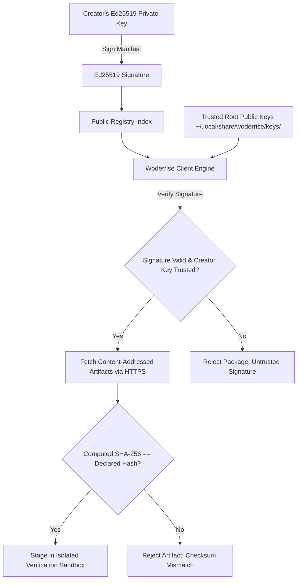

# Security Architecture and Trust Model

> **Document ID:** SPEC-SEC-MOD-027  
> **Status:** Approved Architectural Blueprint  
> **Version:** 1.0.0  
> **Last Updated:** 2026-10-24  

---

## 1. Foundational Security Axioms

The Woderrise security architecture is anchored by three foundational axioms:

> [!WARNING]
> **Axiom 1: A Checksum Proves Integrity, Not Safety.**
> A cryptographic SHA-256 checksum proves only that an artifact matches the bytes intended by the publisher. It does NOT prove that those bytes are benign. Security requires combining artifact verification with provenance, sandboxing, and least privilege.

> [!IMPORTANT]
> **Axiom 2: Declarative Over Imperative.**
> Code execution is inherently dangerous. Woderrise enforces declarative operations (file swaps, config injections, service reloads) as first-class citizens. Executable scripts are treated as high-risk, untrusted adapters.

> [!NOTE]
> **Axiom 3: Complete Isolation of Elevated Privileges.**
> The desktop user's session must never be granted blanket root access. Elevating to root is restricted to an isolated Polkit helper performing strictly typed package manager actions.

---

## 2. Cryptographic Provenance & Signature Verification



### 2.1 The Two-Tier Key Architecture
1. **Root Registry Keys:** Maintained by the core Woderrise project security team. Used to sign registry snapshot metadata, deprecation notices, and emergency blocklists.
2. **Creator Signing Keys:** Individual Ed25519 public keys published in the registry. Every package version commit must be cryptographically signed by the registered author's key.

---

## 3. Safe Archive Extraction & Zip-Slip Protection

When packages deliver multi-file archives (e.g. icon themes, fonts, or complete setups):
1. **Zip-Slip Neutralization:**
   The extraction engine validates every archived file path. Any entry containing `../`, beginning with `/`, or containing Windows drive prefixes (`C:`) causes immediate archive rejection.
2. **Decompression Bomb Protection:**
   The extractor imposes hard limits:
   - Maximum uncompressed single file size: **500 MB**.
   - Maximum total package extraction size: **2.0 GB**.
   - Maximum compression ratio threshold: **100:1**. If bytes written exceed 100x bytes read, extraction aborts with `ERR-INT-003`.
3. **Permission Sanitization:**
   All archive file permissions are sanitized. Setuid (`4000`), setgid (`2000`), and sticky bits are stripped. Files are forced to standard user permissions (`0644` for data, `0755` for directories/executables).

---

## 4. Path Confinement & XDG Whitelisting

Woderrise restricts all write operations to a strictly bounded allowlist of XDG user directories:

```text
ALLOWED WRITE TARGETS:
├── ~/.config/             # User dotfiles (Hyprland, Waybar, Rofi, Kitty, etc.)
├── ~/.local/share/        # Desktop assets (fonts, icons, backgrounds, themes)
├── ~/.local/state/        # Application state files
└── ~/.themes/             # Legacy GTK theme directory

STRICTLY FORBIDDEN TARGETS:
├── /etc/                  # System configuration (BLOCKED)
├── /usr/                  # System binaries & libraries (BLOCKED)
├── /var/                  # System runtime data (BLOCKED)
├── ~/.ssh/                # User SSH credentials (BLOCKED)
├── ~/.gnupg/              # User GPG keyrings (BLOCKED)
└── ~/.bashrc, ~/.zshrc    # Shell login profiles (BLOCKED from direct overwrite;
                           # must use modular ~/.config/ inclusion)
```

---

## 5. Security Vulnerability Reporting & Disclosure

- Vulnerabilities must be submitted via encrypted email to: `security@woderrise.org` (GPG Key ID: `0x9A4B12C4`).
- We practice coordinated responsible disclosure with a standard **90-day patch window**.
- Critical vulnerabilities trigger immediate emergency blocklist broadcast to all connected clients.
