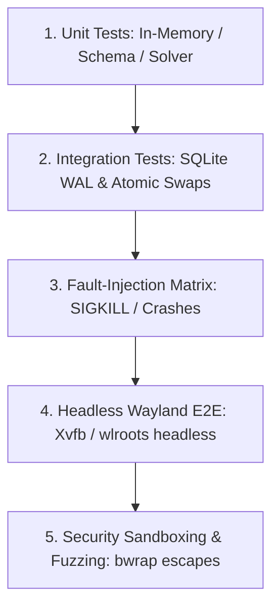

# Comprehensive Testing Strategy

> **Document ID:** SPEC-ENG-TST-033  
> **Status:** Approved Architectural Blueprint  
> **Version:** 1.0.0  
> **Last Updated:** 2026-10-24  

---

## 1. Safety Mandate: Isolated Disposable Test Environments

> [!CAUTION]
> **Cardinal Testing Invariant:**
> **NEVER execute automated integration or fault-injection tests against the developer's real `$HOME` directory.** 
> All test suites must execute strictly within ephemeral, isolated temporary directories (`tempfile::TempDir`) or disposable Linux containers (`bwrap`, Docker, or `systemd-nspawn`) where `$HOME` is redirected to RAM (`tmpfs`).

---

## 2. Test Hierarchy & Test Quadrants

### 2.1 Level 1: Unit Tests (`cargo test --lib`)
- **Manifest Parser:** Validates edge cases in JSON Schema parsing, SemVer constraint matching, and reject invalid path patterns (`../`).
- **PubGrub Dependency Solver:** Solves synthetic graphs including deep diamond dependencies, missing transitive dependencies, and circular dependency loops.
- **Diff Engine:** Validates side-by-side diff generation and unified chunk formatting.

### 2.2 Level 2: Integration Tests (`cargo test --test '*'`)
- **Atomic File Engine:** Asserts that `renameat2` atomic file replacements preserve POSIX modes and do not create half-written files.
- **WAL Journal Engine:** Writes transactions, verifies foreign key cascading, and tests query performance under WAL concurrency.
- **Backup Deduplication:** Verifies content-addressed storage deduplication across identical files.

### 2.3 Level 3: Headless Wayland System Tests
- Executes `woderrise-gui` inside a headless Wayland environment via `sway -c /etc/sway/config -d` or `hyprland --config headless.conf` with `WLR_BACKENDS=headless`.
- Simulates user clicks, search input, and modal dialogues programmatically via `libadwaita` test drivers.

---

## 4. The 11-Point Fault-Injection Matrix

To verify crash consistency and recoverability, the automated test harness simulates hardware and environment disasters across the pipeline:

| Fault ID | Injected Scenario | Trigger Mechanism | Expected Recovery Outcome |
| :--- | :--- | :--- | :--- |
| **FI-01** | Disk-Full Error (`ENOSPC`) | FUSE filesystem configured to return `ENOSPC` during Stage 10 file writes. | Engine halts; cleans temporary files; leaves original files untouched; emits `ERR-STR-001`. |
| **FI-02** | Network Severed | Disables network interface mid-download during Stage 3. | Download times out; partial files wiped from cache; zero filesystem mutations. |
| **FI-03** | Corrupt Checksum Payload | Flips random bits in downloaded artifact before Stage 4. | SHA-256 validation fails; artifact purged from cache; transaction halts. |
| **FI-04** | Permission Denied (`EACCES`) | Marks target directory `~/.config/app/` as `0400` (read-only). | Engine detects write failure before committing; triggers automated rollback. |
| **FI-05** | Pre-Existing File Conflict | Injects an unmanaged file at target path prior to install. | Planner detects collision; captures backup snapshot before write. |
| **FI-06** | Abrupt Process Kill (`SIGKILL`)| Sends `kill -9` to daemon at each of the 15 pipeline stages. | Startup recovery scanner detects incomplete state; rolls back to pre-install state. |
| **FI-07** | Crash During Rollback | Sends `kill -9` during execution of a rollback transaction. | Secondary recovery resumes rollback on reboot and completes restoration. |
| **FI-08** | Post-Install User Edits | Manually edits installed file; then invokes rollback. | Optimistic concurrency check halts; diff dialogue prompts user; zero silent clobber. |
| **FI-09** | Shared Dependency Removal | Package A uninstalled while Package B depends on shared GTK theme. | Dependency `ref_count` decrements from 2 to 1; GTK theme remains active. |
| **FI-10** | Missing Backup Snapshot | Manually deletes backup file from disk before rollback. | Engine detects missing snapshot; halts with clear manual rescue instructions. |
| **FI-11** | SQLite Database Corruption | Corrupts journal header bytes via `dd`. | Engine detects corruption via checksums; enters Safe Recovery Mode. |

---

## 5. Security & Fuzzing Harnesses

1. **Manifest Fuzzing (`cargo fuzz`):**
   Fuzzes the YAML and JSON manifest parsers with malformed, oversized, and deeply nested inputs to detect memory bugs or infinite loops.
2. **Bubblewrap Sandbox Escape Tests:**
   Spawns aggressive scripts attempting to read `/etc/shadow`, mount filesystems, or make network connections from inside the container, asserting that all attempts fail with `EPERM`.
