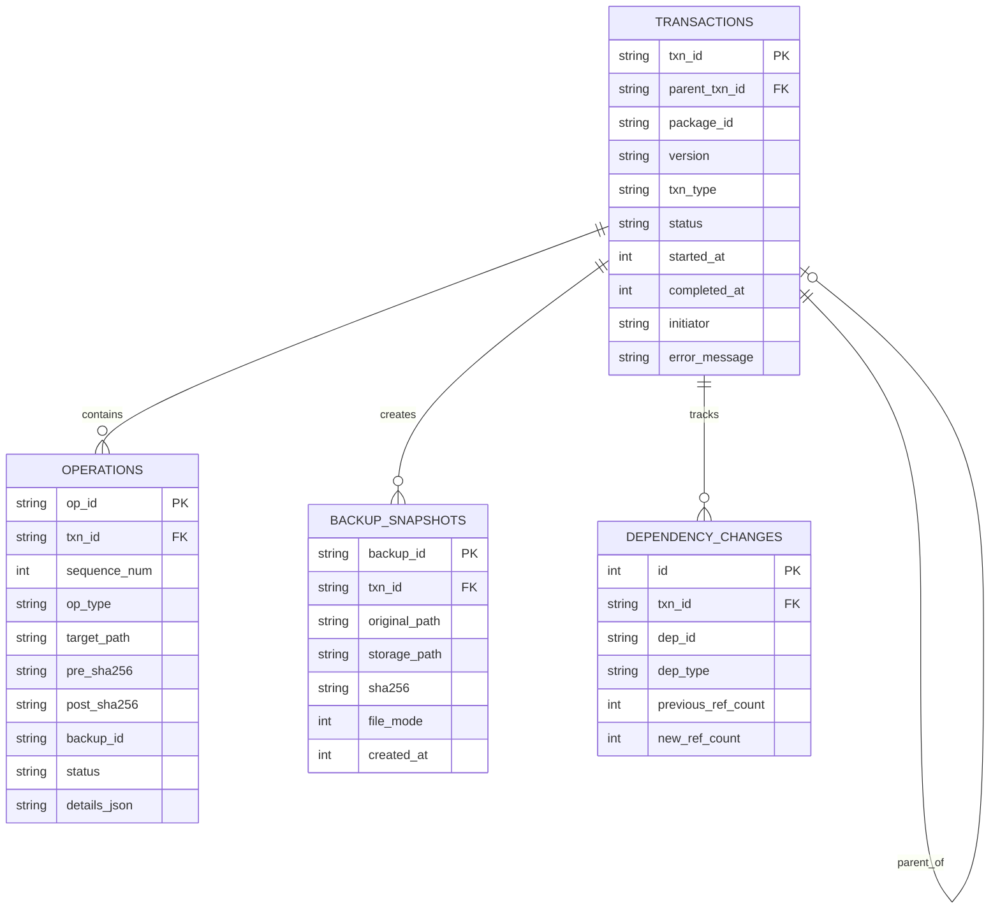
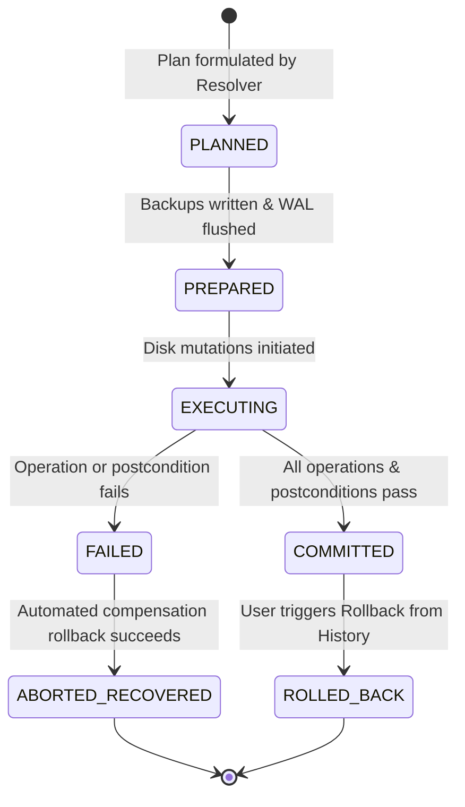

# Transaction Journal Specification

> **Document ID:** SPEC-ENG-JRN-014  
> **Status:** Approved Architectural Blueprint  
> **Version:** 1.0.0  
> **Last Updated:** 2026-10-24  

---

## 1. Architectural Mandate: Journal as Source of Truth

> [!CAUTION]
> **Fundamental Principle:**
> Text logs are purely diagnostic and MUST NEVER be used as the source of truth for system state, uninstallation, or rollback. All state transitions, file mutations, and recovery metadata are persisted in an ACID-compliant, append-only SQLite database operating in **Write-Ahead Logging (WAL)** mode.

The **Transaction Journal** fulfills two critical requirements:
1. **Machine-Automated Recovery:** Enables deterministic, crash-consistent rollback of any interrupted or failed transaction.
2. **Human-Readable Audit Trail:** Provides the user with a comprehensive history of every change made to their workstation, complete with timestamps, file diffs, and package provenance.

---

## 2. Relational Journal Schema

The journal database is stored at `~/.local/share/woderrise/journal.db`.



---

## 3. Database Table Definitions

### 3.1 Table: `transactions`
```sql
CREATE TABLE IF NOT EXISTS transactions (
    txn_id TEXT PRIMARY KEY,                       -- e.g. 'TXN-20261024-0012-9A4B'
    parent_txn_id TEXT REFERENCES transactions(txn_id), -- Non-null for child transactions in bundles
    package_id TEXT NOT NULL,                      -- e.g. 'com.catppuccin.waybar'
    version TEXT NOT NULL,                         -- e.g. '1.2.0'
    txn_type TEXT NOT NULL CHECK (txn_type IN (
        'INSTALL', 'UPDATE', 'UNINSTALL', 'ROLLBACK', 'RECOVERY'
    )),
    status TEXT NOT NULL CHECK (status IN (
        'PLANNED', 'PREPARED', 'EXECUTING', 'COMMITTED', 'FAILED', 'ABORTED_RECOVERED', 'ROLLED_BACK'
    )),
    started_at INTEGER NOT NULL,                   -- Unix timestamp milliseconds
    completed_at INTEGER,                          -- Unix timestamp milliseconds
    initiator TEXT NOT NULL DEFAULT 'user_gui',    -- 'user_gui' | 'user_cli' | 'crash_recovery'
    error_message TEXT,                            -- Structured diagnostic error payload if failed
    metadata_json TEXT                             -- Serialized metadata (authors, license, UI tags)
);

CREATE INDEX IF NOT EXISTS idx_txn_status ON transactions(status);
CREATE INDEX IF NOT EXISTS idx_txn_package ON transactions(package_id);
```

### 3.2 Table: `operations`
```sql
CREATE TABLE IF NOT EXISTS operations (
    op_id TEXT PRIMARY KEY,                        -- e.g. 'OP-001'
    txn_id TEXT NOT NULL REFERENCES transactions(txn_id) ON DELETE CASCADE,
    sequence_num INTEGER NOT NULL,                 -- Strictly ordered execution sequence (1, 2, 3...)
    op_type TEXT NOT NULL CHECK (op_type IN (
        'CREATE_FILE', 'MODIFY_FILE', 'DELETE_FILE',
        'INJECT_CONFIG', 'EJECT_CONFIG',
        'SERVICE_TRIGGER', 'INSTALL_SYSTEM_DEP'
    )),
    target_path TEXT NOT NULL,                     -- Normalized absolute path (e.g. '/home/user/.config/waybar/config.jsonc')
    pre_sha256 TEXT,                               -- Hash of file prior to operation (NULL for new files)
    post_sha256 TEXT,                              -- Hash of file after operation (NULL for deletions)
    backup_id TEXT REFERENCES backup_snapshots(backup_id),
    status TEXT NOT NULL CHECK (status IN (
        'PLANNED', 'EXECUTING', 'COMPLETED', 'FAILED', 'REVERSED'
    )),
    details_json TEXT                              -- Additional metadata (e.g. signal number, injection marker)
);

CREATE INDEX IF NOT EXISTS idx_op_txn ON operations(txn_id, sequence_num);
```

### 3.3 Table: `backup_snapshots`
```sql
CREATE TABLE IF NOT EXISTS backup_snapshots (
    backup_id TEXT PRIMARY KEY,                    -- e.g. 'BKP-8F43-20261024'
    txn_id TEXT NOT NULL REFERENCES transactions(txn_id),
    original_path TEXT NOT NULL,                   -- Original location on disk
    storage_path TEXT NOT NULL,                    -- Content-addressed location in ~/.local/share/woderrise/backups/
    sha256 TEXT NOT NULL,                          -- Cryptographic SHA-256 of backed-up content
    file_mode INTEGER NOT NULL,                    -- POSIX permissions (e.g. 0644)
    created_at INTEGER NOT NULL
);
```

---

## 4. State Machine & Lifecycle Transitions



### State Definitions
1. `PLANNED`: The dependency solver and installation planner have assembled the execution DAG. No disk writes have occurred.
2. `PREPARED`: Pre-install backups of all target files are created and verified. The transaction record and operation plan are safely flushed to SQLite WAL.
3. `EXECUTING`: Atomic file writes, injections, or service reloads are actively occurring on disk.
4. `COMMITTED`: All operations completed cleanly, postconditions verified, and file ownership table updated. This is a terminal success state.
5. `FAILED`: An operation failed during execution. Triggers automated rollback.
6. `ABORTED_RECOVERED`: The engine reversed all mutations performed during a failed or crashed transaction. Filesystem is clean.
7. `ROLLED_BACK`: A previously committed transaction was explicitly reversed by the user.

---

## 5. Illustrative Journal Entry (JSON Representation)

```json
{
  "txn_id": "TXN-20261024-0042-8E1A",
  "parent_txn_id": null,
  "package_id": "com.catppuccin.waybar",
  "version": "1.2.0",
  "txn_type": "INSTALL",
  "status": "COMMITTED",
  "started_at": 1792842000150,
  "completed_at": 1792842000890,
  "initiator": "user_gui",
  "operations": [
    {
      "sequence_num": 1,
      "op_type": "MODIFY_FILE",
      "target_path": "/home/pirate/.config/waybar/config.jsonc",
      "pre_sha256": "8a91c01287e0...",
      "post_sha256": "f120ab5431c9...",
      "backup_id": "BKP-20261024-WAYBAR-01",
      "status": "COMPLETED"
    },
    {
      "sequence_num": 2,
      "op_type": "CREATE_FILE",
      "target_path": "/home/pirate/.config/waybar/catppuccin-style.css",
      "pre_sha256": null,
      "post_sha256": "4b227777d4dd...",
      "backup_id": null,
      "status": "COMPLETED"
    },
    {
      "sequence_num": 3,
      "op_type": "SERVICE_TRIGGER",
      "target_path": "waybar",
      "status": "COMPLETED",
      "details_json": "{\"signal\":\"SIGUSR2\"}"
    }
  ]
}
```

---

## 6. Crash Consistency & Database Integrity

1. **SQLite PRAGMA Settings for Maximum Durability:**
   ```sql
   PRAGMA journal_mode = WAL;
   PRAGMA synchronous = NORMAL;
   PRAGMA foreign_keys = ON;
   PRAGMA busy_timeout = 5000;
   ```
2. **Crash Invariant:**
   If a crash occurs when status is `PREPARED` or `EXECUTING`, the startup recovery engine uses the ordered `operations` list and `backup_snapshots` to reverse all operations with `status = 'COMPLETED'` in **strict reverse order (high `sequence_num` to low)**.
3. **Retention & Archiving:**
   Transactions are permanently retained to ensure infinite undo history. If the journal exceeds 100MB, historic transaction logs older than 180 days (with their associated backups) can be archived to a compressed cold storage file (`journal-archive-YYYY.db.zst`) upon user approval.
