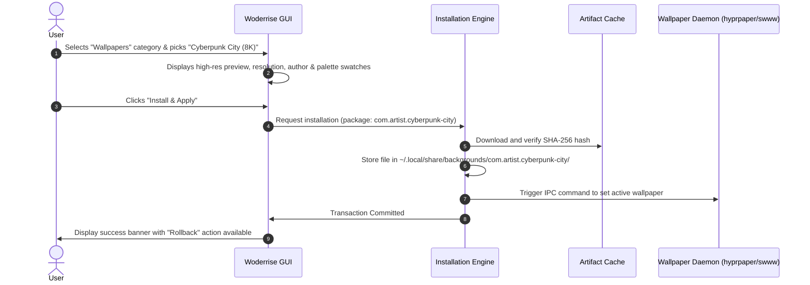
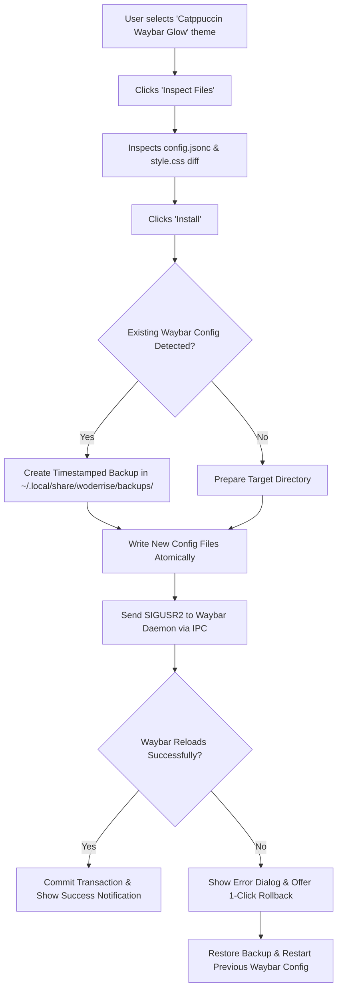
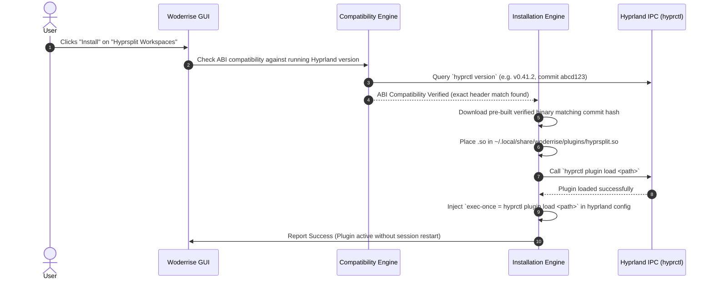
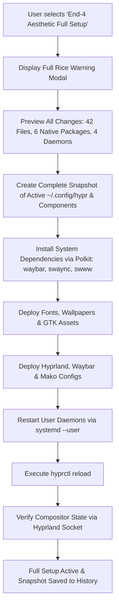
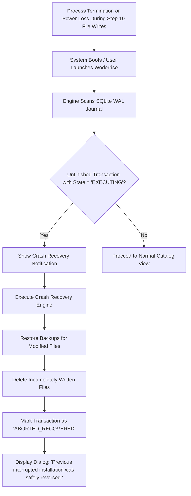
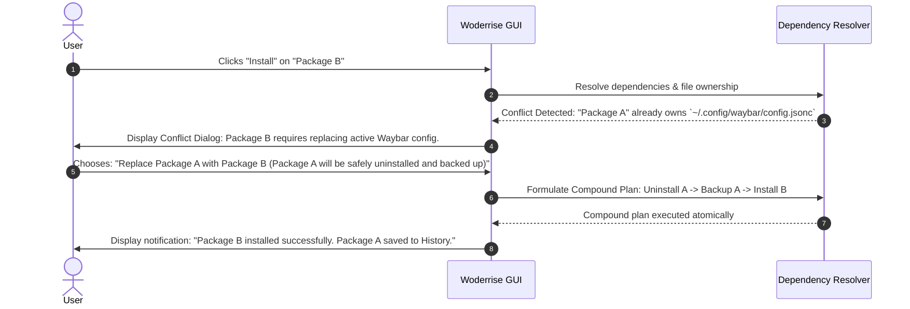

# User Flows & Interaction Workflows

> **Document ID:** SPEC-PROD-FLOWS-003  
> **Status:** Approved Architectural Blueprint  
> **Version:** 1.0.0  
> **Last Updated:** 2026-10-24  

---

## 1. Overview

This document specifies the primary user journeys and operational interaction loops within **Woderrise**. Each flow documents user triggers, system evaluations, UI state transitions, transaction events, and error handling mechanisms.

---

## 2. Core User Flows

### Flow 1: Finding and Installing a Wallpaper
- **Actor:** User wanting to update their desktop aesthetic.
- **Context:** Standalone asset installation (zero system dependencies, non-destructive file write).

---

### Flow 2: Installing a Waybar Theme
- **Actor:** Intermediate User swapping their status bar design.
- **Complexity:** Configuration overwrite / merge; requires service reload (`killall -SIGUSR2 waybar`).

---

### Flow 3: Installing an Application Launcher (Rofi-Wayland) & Custom Config
- **Actor:** User seeking an aesthetic application launcher.
- **Complexity:** Requires a native system binary dependency (`rofi-wayland` via pacman) + dotfile configuration.

1. **User Action:** Clicks "Install" on "Dracula Glass Rofi Menu".
2. **Dependency Analysis:** The engine evaluates dependencies:
   - System binary required: `rofi-wayland`.
   - Engine queries ALPM: `rofi-wayland` is not currently installed.
3. **Privilege Consent:**
   - UI displays modal: *"This package requires native system package: rofi-wayland (1.2 MB). Administrator authorization required."*
4. **Execution:**
   - User approves -> Polkit prompt authenticates user.
   - Polkit helper installs `rofi-wayland` via ALPM.
   - Engine deploys `~/.config/rofi/config.rasi` and theme files.
   - Engine injects launch shortcut into `~/.config/hypr/conf.d/woderrise_keybinds.conf` (`bind = SUPER, SPACE, exec, rofi -show drun`).
   - Reloads Hyprland keybinds via `hyprctl reload`.
5. **Outcome:** User presses `Super + Space` to open the newly installed launcher immediately.

---

### Flow 4: Installing a Hyprland C++ Plugin
- **Actor:** Power user installing an official or community plugin (e.g. `hyprbars` or `hyprsplit`).
- **Complexity:** Strict C++ ABI compatibility validation; compilation or dynamic loading.

> [!WARNING]
> If `hyprctl version` does not match available pre-built binary hashes and the user lacks a C++ compiler or headers, the engine halts before changes and warns the user that installing would crash the compositor.

---

### Flow 5: Installing a Component Bundle
- **Actor:** User wanting a coordinated set of components (e.g., "Nord Minimalist Suite": Wallpaper + GTK Theme + Waybar + Kitty Terminal).
- **Complexity:** Multi-package parent-child transaction graph; partial failure handling.

1. **User Action:** Browses "Bundles" and clicks "Install" on "Nord Minimalist Suite".
2. **Pre-Flight Inspection:**
   - UI displays child package breakdown:
     - 1 Wallpaper (`com.nord.wallpaper`)
     - 1 GTK Theme (`com.nord.gtk-theme`)
     - 1 Waybar Layout (`com.nord.waybar`)
     - 1 Kitty Configuration (`com.nord.kitty`)
3. **Execution Pipeline:**
   - Transaction engine opens a **Parent Transaction**.
   - Sub-transactions 1, 2, 3, and 4 are planned and resolved in dependency order.
   - If Sub-transaction 4 fails (e.g., disk full or file conflict):
     - Engine triggers **Sub-Transaction Compensation**: operations from Sub-transactions 1, 2, and 3 are automatically rolled back.
     - Filesystem returns cleanly to initial pre-bundle state.
4. **Outcome:** No half-broken desktop; user receives clear diagnostic on which sub-package failed.

---

### Flow 6: Installing a Complete Desktop Setup ("Full Rice")
- **Actor:** New user wanting a turnkey desktop transformation ("End-4 Aesthetic Setup").
- **Complexity:** Comprehensive configuration composition, multiple services, wallpaper daemon, font installation, and Hyprland config reloads.

---

### Flow 7: Inspecting Package Files Before Installation
- **Actor:** Security-conscious user verifying safety before installation.

1. User opens "Aura Floating Bar" package details.
2. Clicks the **"Inspect Files & Diffs"** tab.
3. An interactive file tree shows:
   - `~/.config/waybar/config.jsonc` (Modified — will replace 42 lines)
   - `~/.config/waybar/aura-style.css` (New file)
   - `~/.config/waybar/scripts/mediaplayer.py` (New script — 85 lines)
4. User clicks `mediaplayer.py` -> reads full Python source in the syntax-highlighted viewer.
5. User clicks `config.jsonc` -> reads side-by-side unified diff comparing their current configuration against the incoming package.
6. Satisfied with file safety and code quality, user clicks "Approve & Install".

---

### Flow 8: Recovering from a Failed Installation
- **Actor:** User whose installation was interrupted by a network disconnect, disk-full condition, or process termination.

---

### Flow 9: Rolling Back a Successful Installation
- **Actor:** User who installed a theme 3 days ago, decided they dislike it, and wants their previous layout back.

1. User opens **"History"** tab in Woderrise.
2. Finds the transaction: `TXN-20261021-0089: Installed 'Cyberpunk Waybar' (v1.2.0)`.
3. Clicks **"Rollback"**.
4. **Optimistic Concurrency Check:**
   - Engine computes current SHA-256 hashes of all installed files.
   - Files are unmodified since installation -> Clean match.
5. Engine restores the pre-installation backup snapshot.
6. Engine sends SIGUSR2 to Waybar to reload.
7. Journal records `TXN-20261024-0012: Rolled back TXN-20261021-0089`.
8. Previous custom bar is instantly restored on screen.

---

### Flow 10: Updating and Uninstalling Packages

#### Scenario A: Updating a Package
1. Notification badge appears: *"1 Update Available: Tokyo Night Kitty Theme (v1.0.0 -> v1.1.0)"*.
2. User clicks "Review Update".
3. UI presents changelog and unified diff of the update.
4. User clicks "Apply Update".
5. Engine creates a new backup of the v1.0.0 state and applies v1.1.0 atomically.

#### Scenario B: Uninstalling a Package
1. User navigates to **"Installed"** tab.
2. Selects "Catppuccin Dunst Theme" and clicks "Uninstall".
3. Modal asks: *"Do you want to restore the previous Dunst configuration that was backed up before this install?"*
   - Option A: **Restore Previous Backup** (Restores original user files).
   - Option B: **Clean Removal** (Deletes package files; leaves directory clean).
4. User picks Option A -> Previous configuration restored and Dunst reloaded.

---

### Flow 11: Resolving Dependency Conflicts

